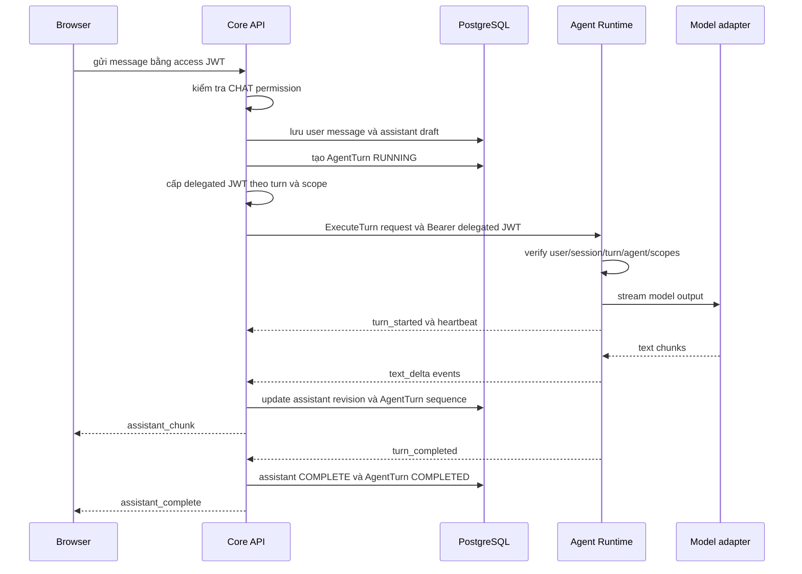

# PersonaForge Agent Runtime

## Mục tiêu và trạng thái triển khai

Agent Runtime đã được tách khỏi FastAPI thành service Python độc lập. Core API không import
SDK của LLM, TTS hay avatar model. Nó chỉ phụ thuộc `AgentRuntimePort`; adapter hiện có:

- `LegacyReplyAgentAdapter`: chạy demo scripted/HTTP cũ trong process API;
- `GrpcAgentRuntimeAdapter`: gọi Agent Runtime qua server-streaming gRPC;
- `ScriptedLanguageModelAdapter`: model giả lập nằm hoàn toàn trong Agent service.

TTS và avatar sinh bởi model chưa được triển khai. Media runtime hiện vẫn phát clip thu sẵn
và audio im lặng/beep debug. Khi bổ sung TTS/avatar, adapter của chúng thuộc Agent/Render
Worker, không được đưa SDK provider vào domain hoặc application của Core API.

## Ranh giới trách nhiệm

| Thành phần | Sở hữu trách nhiệm |
| --- | --- |
| Browser | HTTP/WS với Core, WebRTC với aiortc hoặc LiveKit |
| Core API | xác thực user, ACL session, transcript, `AgentTurn`, realtime UI |
| Agent Runtime | orchestration, model stream, heartbeat, cancel, tools/knowledge scope |
| TTS adapter (tiếp theo) | text segment thành audio artifact/PCM theo voice config |
| Render Worker | timeline audio/video, avatar renderer, publish WebRTC lên SFU |
| LiveKit | fan-out một publication cho nhiều viewer |

Agent không nhận refresh token hoặc browser access token. Core cấp một delegated JWT riêng,
TTL mặc định hai phút và chỉ đủ quyền cho đúng một turn.

## Luồng một chat turn



Core chỉ chuyển avatar từ `thinking` sang `speaking` khi nhận `text_delta` đầu tiên. Điều này
tránh hiển thị speaking trong lúc Agent chỉ gửi heartbeat. Nếu RPC lỗi, idle quá thời hạn,
client hủy request hoặc session đóng, Core gọi `CancelTurn` best effort và lưu trạng thái
`failed`, `timed_out` hoặc `cancelled`.

## Contract gRPC

Contract nguồn nằm tại `proto/personaforge/agent/v1/agent.proto`. Không sửa trực tiếp hai file
`*_pb2.py`; sinh lại bằng:

```bash
python -m grpc_tools.protoc \
  -I proto \
  --python_out=src \
  --grpc_python_out=src \
  proto/personaforge/agent/v1/agent.proto
```

`ExecuteTurn` là server-streaming RPC. Stream giữ kết nối HTTP/2, phát heartbeat khi model
chưa có token và có deadline ở Core. Cấu hình mặc định:

- keepalive ping: 10 giây;
- keepalive timeout: 3 giây;
- toàn turn deadline: `AGENT_TURN_TIMEOUT=120`;
- không nhận event: `AGENT_IDLE_TIMEOUT=15`;
- heartbeat Agent: `AGENT_HEARTBEAT_INTERVAL=5`.

`CancelTurn` dùng cùng channel và đặt cancellation event cho turn đang chạy. Service còn
đăng ký chuẩn `grpc.health.v1.Health`; Docker healthcheck kiểm tra service name
`personaforge.agent.v1.AgentRuntime`.

## Delegated authorization

Core ký HS256 JWT bằng `AGENT_DELEGATION_SECRET`. Claims quan trọng:

```json
{
  "sub": "user-id",
  "session_id": "session-id",
  "turn_id": "turn-id",
  "agent_id": "default",
  "tool_permissions": ["calendar.read"],
  "knowledge_base_ids": ["kb-team-a"],
  "iss": "personaforge-api",
  "aud": "personaforge-agent",
  "iat": 0,
  "exp": 0,
  "jti": "unique-id"
}
```

Agent so sánh exact match cho identity/session/turn/agent và chỉ chấp nhận tool/knowledge
requested là tập con của scope được cấp. Tool adapter về sau phải kiểm tra scope này ở mỗi
lần gọi; không dùng token người dùng gốc để truyền xuyên hệ thống. Production nên thay shared
HS256 bằng asymmetric signing hoặc workload identity, đồng thời lấy secret từ secret manager.

`AgentAuthorizationPort` là điểm nối để Core resolve ACL theo user/session/agent trước khi ký.
Adapter mặc định là `DenyAllAgentAuthorizationAdapter`, vì hệ thống chưa có màn hình cấu hình
tool/knowledge: mọi danh sách scope đều rỗng thay vì vô tình cấp quyền rộng. Khi thêm catalog,
chỉ thay adapter này bằng repository/policy adapter và giữ nguyên use case cũng như gRPC.

## Persistence và retry

Migration `20260804_04` thêm `avatar_sessions.agent_id` và bảng `agent_turns`. Mỗi event có
sequence tăng dần; Core bỏ event trùng hoặc cũ và lưu `last_event_sequence`. Hiện một turn
không tự động retry vì model/tool call có thể tạo side effect. Khi cần retry, contract phải có
idempotency key ở từng tool call và cơ chế resume từ sequence đã lưu.

## Chạy Docker

```bash
cp .env.example .env
sed -i 's/AGENT_RUNTIME_PROVIDER=local/AGENT_RUNTIME_PROVIDER=grpc/' .env
docker compose --profile agent up --build
docker compose --profile agent ps
docker compose --profile agent logs -f personaforge-agent avatar-chat
```

Nếu chạy service ngoài Docker:

```bash
AGENT_GRPC_TARGET=127.0.0.1:50051 \
AGENT_RUNTIME_PROVIDER=grpc \
uvicorn avatar_chat.main:app --host 0.0.0.0 --port 8000

python -m personaforge_agent.main
```

Core và Agent phải dùng cùng ba biến `AGENT_DELEGATION_SECRET`,
`AGENT_DELEGATION_ISSUER`, `AGENT_DELEGATION_AUDIENCE`.

## Lộ trình TTS và avatar model

Không truyền audio PCM lớn qua RPC `ExecuteTurn`. Agent nên chia text thành speech segment,
gọi `SpeechSynthesisPort`, lưu audio vào object storage hoặc media buffer service, rồi phát
command chứa URI + timing metadata lên queue dành cho Render Worker. Render Worker tải audio,
render lip-sync/video và publish trực tiếp lên LiveKit. Core chỉ nhận lifecycle event để cập
nhật UI và audit.

Các contract cần thêm ở bước đó:

1. `SpeechSynthesisPort.synthesize(segment, voice_config) -> AudioArtifact`;
2. `AvatarRenderPort.enqueue(turn_id, segment_id, audio_uri, timestamps)`;
3. event `speech_started`, `speech_completed`, `render_failed`;
4. cancel theo `turn_id`, idempotency theo `segment_id`;
5. queue depth, synthesis latency, time-to-first-audio và A/V drift metrics.

Cách này cho phép Agent kết nối trực tiếp adapter TTS/Render mà không đưa media payload qua
FastAPI, trong khi Core vẫn là authority duy nhất về user/session/tool permissions.
