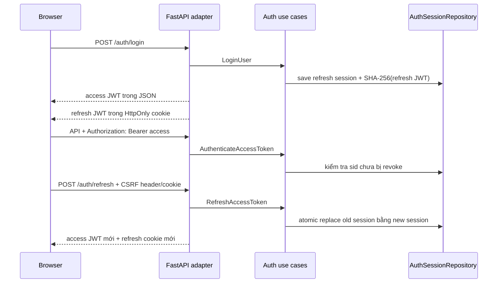

# Xác thực JWT và vòng đời refresh token

## Kiến trúc

Core không import FastAPI, cookie hay PyJWT. Các use case phụ thuộc `JwtTokenPort`,
`AuthSessionRepository`, `PasswordHasherPort` và `SecureTokenPort`. Adapter PyJWT chịu trách
nhiệm ký/kiểm tra token; repository memory hoặc SQLAlchemy lưu trạng thái phiên và hash của
refresh token.

## JWT claims

Access token gồm `sub` (user), `sid` (server-side auth session), `type=access`, `iat`, `exp`,
`iss`, `aud`. Refresh token có thêm `family` và `type=refresh`. Decoder khóa thuật toán ở
`HS256`, bắt buộc các claim chính, đồng thời kiểm tra issuer, audience và expiration.

Access JWT sống ngắn nhưng không hoàn toàn stateless: `sid` được kiểm tra trong database.
Đổi lại logout, logout-all, refresh rotation và khóa user có hiệu lực ngay cho REST lẫn
WebSocket.

## Rotation và replay detection

`AuthSessionRepository.replace()` dùng compare-and-swap trên `auth_session_id`, hash token và
`revoked_at IS NULL`. Vì vậy hai refresh request đồng thời không thể cùng thành công. Token cũ
được đánh dấu `revoked_at` và liên kết tới `replaced_by_session_id`.

Nếu một JWT refresh có chữ ký hợp lệ nhưng bản ghi đã bị revoke, sai hash hoặc không còn đúng
family, server coi đó là replay và gọi `revoke_all()` cho user. Người dùng phải đăng nhập lại
trên mọi thiết bị.

## Browser

Access token chỉ giữ trong biến JavaScript, không dùng `localStorage`. Khi tải lại trang,
frontend đọc CSRF cookie rồi gọi `/api/auth/refresh`. Một timer refresh trước hạn 30 giây và
REST client cũng retry đúng một lần sau HTTP 401. Các refresh đồng thời được gộp về một Promise
để tránh tự gây replay. Sau rotation, frontend kết nối lại WebSocket với access JWT mới qua
`Sec-WebSocket-Protocol`.

## Endpoint

| Endpoint | Credential | Chức năng |
|---|---|---|
| `POST /api/auth/register` | Không | Tạo user và cặp token đầu tiên |
| `POST /api/auth/login` | Không | Xác minh Argon2 và tạo phiên |
| `POST /api/auth/refresh` | Refresh cookie + CSRF | Rotate và trả access JWT mới |
| `GET /api/auth/me` | Bearer access JWT | Đọc user hiện tại |
| `POST /api/auth/logout` | Bearer + CSRF | Thu hồi phiên hiện tại |
| `POST /api/auth/logout-all` | Bearer + CSRF | Thu hồi mọi phiên của user |

## Vận hành

Không dùng secret development trong production. Đặt `AUTH_COOKIE_SECURE=true`, chạy HTTPS,
giới hạn chính xác `ALLOWED_ORIGINS`, đưa `JWT_SECRET` vào secret manager và rotate secret theo
quy trình có hỗ trợ nhiều signing key nếu cần zero-downtime. Login rate limiter hiện là
in-memory; khi chạy nhiều replica cần adapter Redis. Nên định kỳ xóa auth session đã hết hạn và
lưu sự kiện replay/logout vào audit/monitoring.
