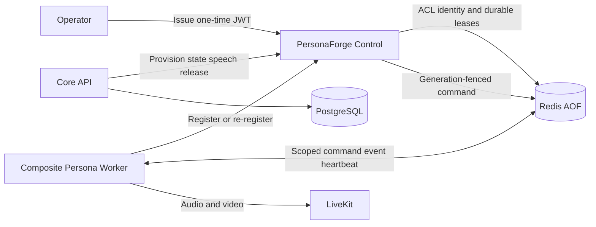

# PersonaForge Control Plane Implementation

> Trạng thái: đã triển khai MVP cho enrollment, worker identity, dynamic Redis ACL, worker
> registry, composite slot scheduler, generation fencing, command routing và deterministic TTS
> speech playback. GPU model thật và production HA chưa thuộc phạm vi này.

## 1. Thành phần đã triển khai



Package chính:

- `personaforge_control`: Enrollment/Registration Service, scheduler và Redis adapters.
- `personaforge_worker.application`: composite slot manager, audio timeline và speech pipeline.
- `personaforge_worker.identity`: auto identity, first enrollment và management-token re-registration.
- `ControlPlaneAvatarStreamAdapter`: Core API gọi Control Plane mà không giữ assignment trong
  RAM tiến trình.

## 2. Data ownership và persistence

| Dữ liệu | Nơi lưu | Lý do |
|---|---|---|
| User, auth session, chat session, share, transcript, agent turn | PostgreSQL | Business state lâu dài và transaction |
| Enrollment JTI/state/result recovery | Redis AOF | Atomic one-time claim và retry window |
| Stable worker identity, management-token hash/family | Redis AOF | Restart/re-register không phụ thuộc replica |
| Active registration, heartbeat, worker index | Redis AOF + TTL | Health và owner fencing |
| Assignment, generation, slot lease, VRAM/compute counters | Redis AOF | Atomic scheduling giữa nhiều Core/Control replica |
| Worker ACL username metadata | Redis AOF; ACL user trong Redis | Worker-scoped authorization |
| Raw management token | Worker identity volume, mode `0600` | Secret chỉ Worker cần biết; server chỉ giữ hash |
| PCM, raw frame, tensor, model handle, bounded queue | RAM/GPU Worker | Dữ liệu media tạm thời; không ghi PostgreSQL/Redis |

Không có memory repository trong source production của Control Plane. In-memory test doubles
chỉ nằm trong `tests/support` và không được composition root import.

Redis Compose chạy AOF `appendfsync everysec` trên volume `redis_data`. PostgreSQL dùng
`postgres_data`. Worker identity secret dùng volume `avatar_worker_identity`.

## 3. Enrollment lifecycle

First boot:

1. Operator gọi `POST /internal/worker-enrollment-tokens` bằng `CONTROL_OPERATOR_TOKEN`.
2. Control phát JWT audience riêng, có `jti`, host/cluster/type binding và TTL tối đa 15 phút.
3. Worker gọi `POST /internal/workers/register` với cùng `registration_request_id` khi retry.
4. JTI được claim atomically; request ID khác bị coi là replay.
5. Control tạo Redis ACL identity chỉ truy cập namespace của worker.
6. Control lưu stable identity và trả owner token, management token cùng Redis credential.
7. Worker ghi stable identity secret atomic với permission `0600`.

Restart:

1. Worker đọc `identity.json` từ volume.
2. Gọi `POST /internal/workers/reregister` bằng management token hiện tại.
3. Control rotate management token, tăng `identity_generation`, tạo boot ACL mới và revoke ACL
   của boot cũ.
4. Token cũ không dùng lại được.

Runtime renew/deregister luôn kiểm tra `worker_id + boot_id + owner_token hash`. Worker cũ không
thể renew hoặc xóa registration của process mới.

## 4. Scheduling và lease

Scheduler chỉ nhận worker thỏa các điều kiện:

- registration và heartbeat chưa hết hạn;
- trạng thái `ready`, không draining;
- runtime và compute capability tương thích;
- còn slot, VRAM reservation và compute budget.

Reservation atomic cấp `lease_token + generation`. Mọi start/state/speech/stop command mang
generation và lease token; Worker từ chối command cũ hoặc sai owner.

Control Service có reconciler đọc assignment từ Redis:

- heartbeat còn sống: renew slot lease và assignment TTL;
- heartbeat mất: release capacity và xóa assignment;
- restart Control: đọc lại assignment index từ Redis và tiếp tục reconcile.

Core API không giữ `session -> worker` mapping trong dictionary. Mỗi state/speech/release đi qua
Control Plane và lấy assignment durable từ Redis.

## 5. Worker Core stream hiện tại

Đã có:

- Neutral speech/audio/video DTO và TTS/lip-sync/media ports.
- Single-writer/multi-reader bounded `AudioTimeline` với cursor riêng.
- Backpressure khi consumer chậm.
- Scripted tone TTS adapter và recorded-clip lip-sync adapter cho fake pipeline.
- Audio PTS theo sample index, video target PTS theo audio master clock.
- LiveKit worker nhận `avatar.speech.synthesize` qua `CompositeSpeechPipeline`; audio publisher
  và recorded-clip lip-sync có cursor riêng trên bounded timeline. Fake renderer dùng đúng
  `speaking.mp4` của nhân vật, không chèn frame màu đặc ngoài character catalog.
- Queued media adapter chỉ acknowledge sau khi LiveKit publishing loop nhận frame; worker chỉ
  gửi `avatar.speech.completed` sau cả audio và video cuối.
- Core giữ avatar ở `speaking` cho đến speech completion rồi mới về `idle`.
- Tin nhắn chuyển `complete` ngay khi Agent kết thúc text stream; cursor UI không chờ media.
  Avatar vẫn `speaking` cho đến khi audio và video cuối được acknowledge, nên text có thể hoàn
  tất trước video mà không phải lỗi đồng bộ.
- Worker crawl GPU bằng `nvidia-smi` mỗi heartbeat và report live VRAM/utilization/temperature/
  power; `auto` fallback về configured snapshot khi demo không có GPU.

Target monitoring đã chốt thay subprocess `nvidia-smi` bằng public API của `nvitop`: Worker
Master thu host CPU/RAM, GPU VRAM/utilization/temperature/power và host/GPU resource theo từng
managed Child PID. Đây là migration target, chưa phải trạng thái source hiện tại; chi tiết xem
[`worker-master-child-grpc.md`](worker-master-child-grpc.md#131-resource-collector-dùng-nvitop).

Model TTS/lip-sync thật chỉ cần implement application ports; không đổi chat/session business.

## 6. Chạy enrollment mode bằng Docker Compose

Đặt các biến sau trong `.env`:

```env
CONTROL_PLANE_URL=http://personaforge-control:8090
AVATAR_REGISTRATION_URL=http://personaforge-control:8090
CONTROL_OPERATOR_TOKEN=replace-with-a-long-random-operator-token
CONTROL_CORE_TOKEN=replace-with-a-different-long-random-core-token
CONTROL_ENROLLMENT_JWT_SECRET=replace-with-at-least-32-random-bytes

AVATAR_HOST_ID=demo-host
AVATAR_GPU_UUID=GPU-demo
AVATAR_GPU_COMPUTE_CAPABILITY=0.0
AVATAR_GPU_TOTAL_VRAM_MB=0
AVATAR_GPU_SCHEDULABLE_VRAM_MB=0
AVATAR_GPU_PROBE_PROVIDER=auto
AVATAR_GPU_PROBE_TIMEOUT_SECONDS=3
AVATAR_GPU_RESERVE_VRAM_MB=512
AVATAR_WORKER_MAX_SLOTS=1
PERSONA_PEAK_VRAM_MB=0
```

Khởi động storage và Control Service trước:

```bash
docker compose --profile livekit up -d postgres redis livekit personaforge-control
```

Issue bootstrap token:

```bash
curl -fsS http://127.0.0.1:8090/internal/worker-enrollment-tokens \
  -H "Authorization: Bearer ${CONTROL_OPERATOR_TOKEN}" \
  -H "Content-Type: application/json" \
  -d '{
    "worker_type":"persona-render",
    "cluster_id":"development",
    "host_id":"demo-host",
    "max_gpu_count":1,
    "ttl_seconds":600
  }'
```

Lấy `bootstrap_token` từ response, đặt vào `.env`:

```env
AVATAR_WORKER_BOOTSTRAP_TOKEN=<one-time-token>
```

Sau đó chạy Core và Worker:

```bash
docker compose --profile livekit up -d avatar-chat avatar-worker
```

Sau first enrollment, restart Worker dùng management token trong volume; không cần phát
bootstrap token mới. Xóa volume `avatar_worker_identity` hoặc revoke identity thì cần token mới.

Kiểm tra registration và hardware heartbeat mà không lộ credential:

```bash
curl -fsS http://127.0.0.1:8090/internal/workers \
  -H "Authorization: Bearer ${CONTROL_OPERATOR_TOKEN}"
```

Runbook đầy đủ cho CPU demo, NVIDIA container, first enrollment và re-register nằm tại
[`tts-avatar-render-flow.md`](tts-avatar-render-flow.md#15-runbook-đăng-ký-persona-render-worker-hiện-tại).

Smoke test ACL nội bộ:

```bash
docker compose --profile livekit run --rm --no-deps avatar-chat \
  python scripts/smoke_control_plane.py
```

## 7. Security trước production

- Dùng HTTPS/mTLS cho Registration và Control API.
- Dùng `rediss://`, Redis admin credential riêng và không expose Redis ra Internet.
- Thay secret development; operator token và core token phải khác nhau.
- Bootstrap/management/Redis password không được ghi log hoặc đưa vào query string.
- Chuyển enrollment signing từ HS256 local MVP sang EdDSA/RS256 qua cùng token port.
- Mã hóa worker identity volume và enrollment recovery envelope.
- Export audit event enroll/re-register/revoke sang PostgreSQL hoặc audit store chuyên dụng.
