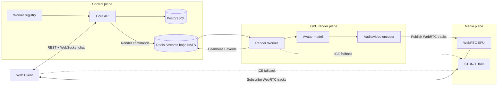
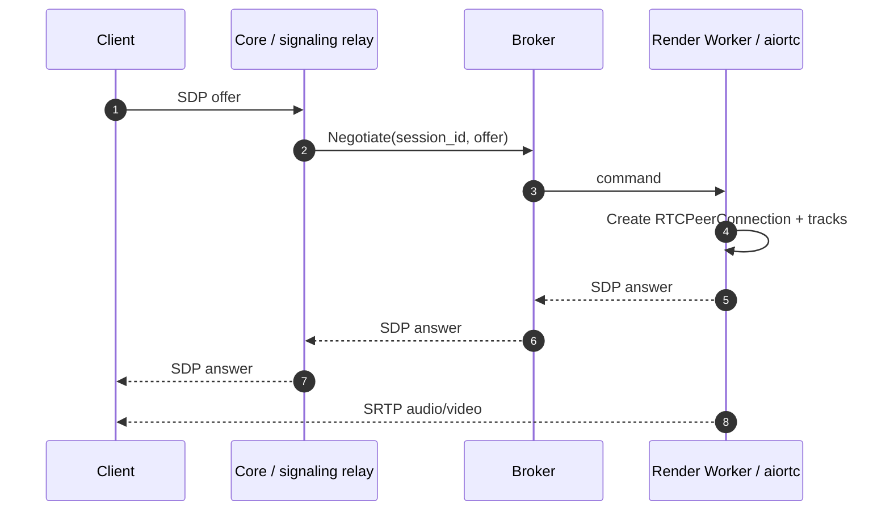
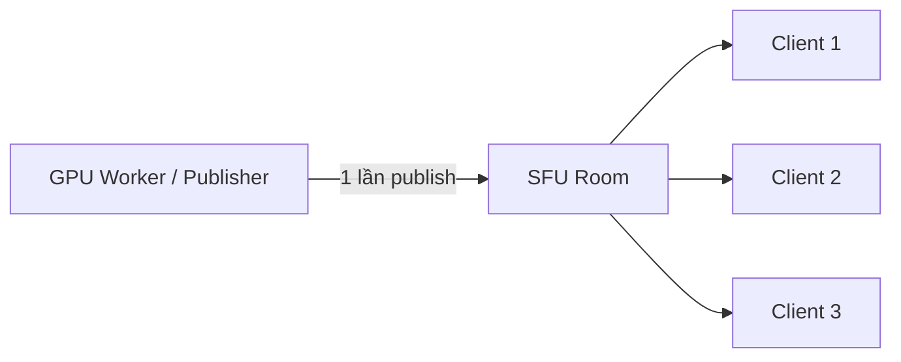
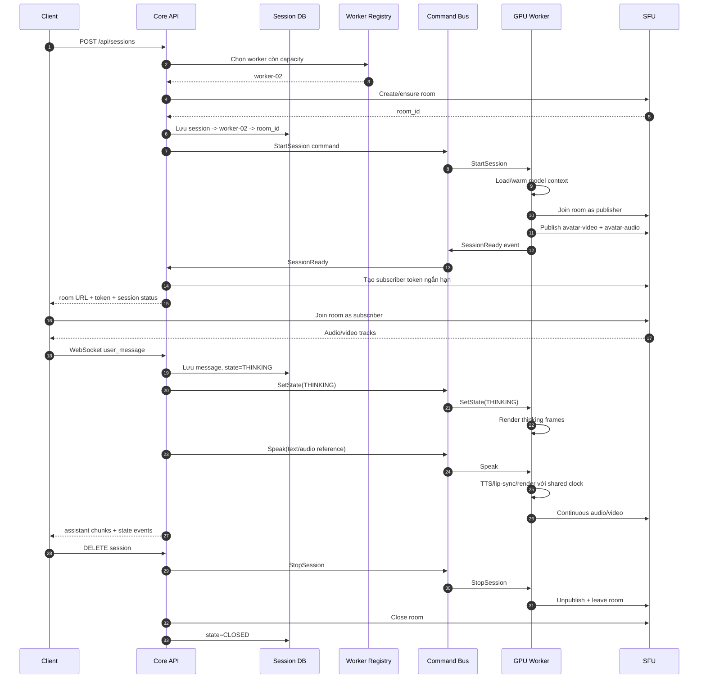
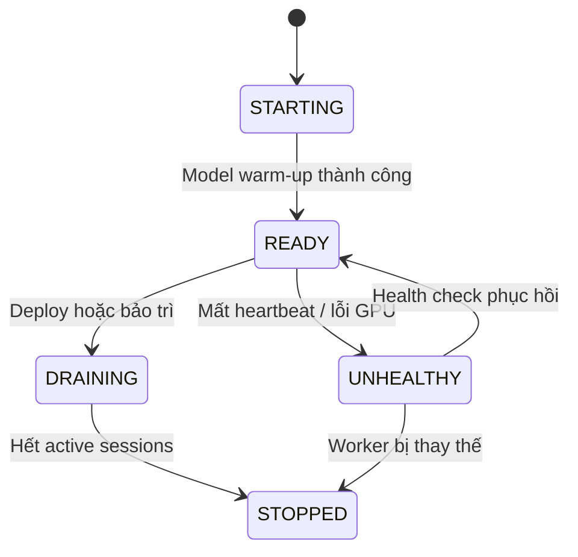
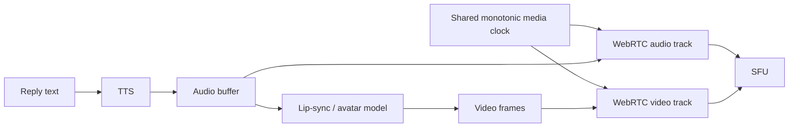
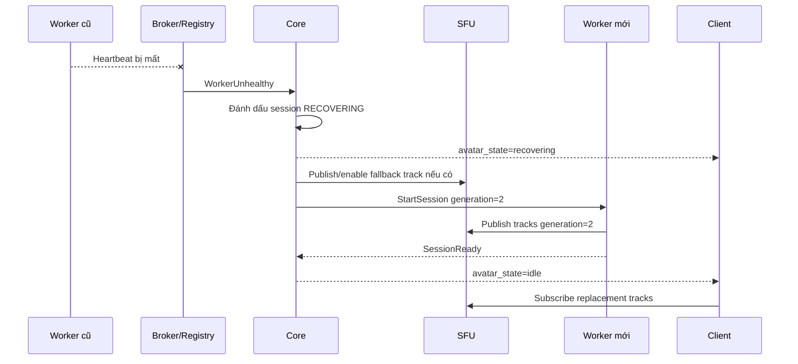
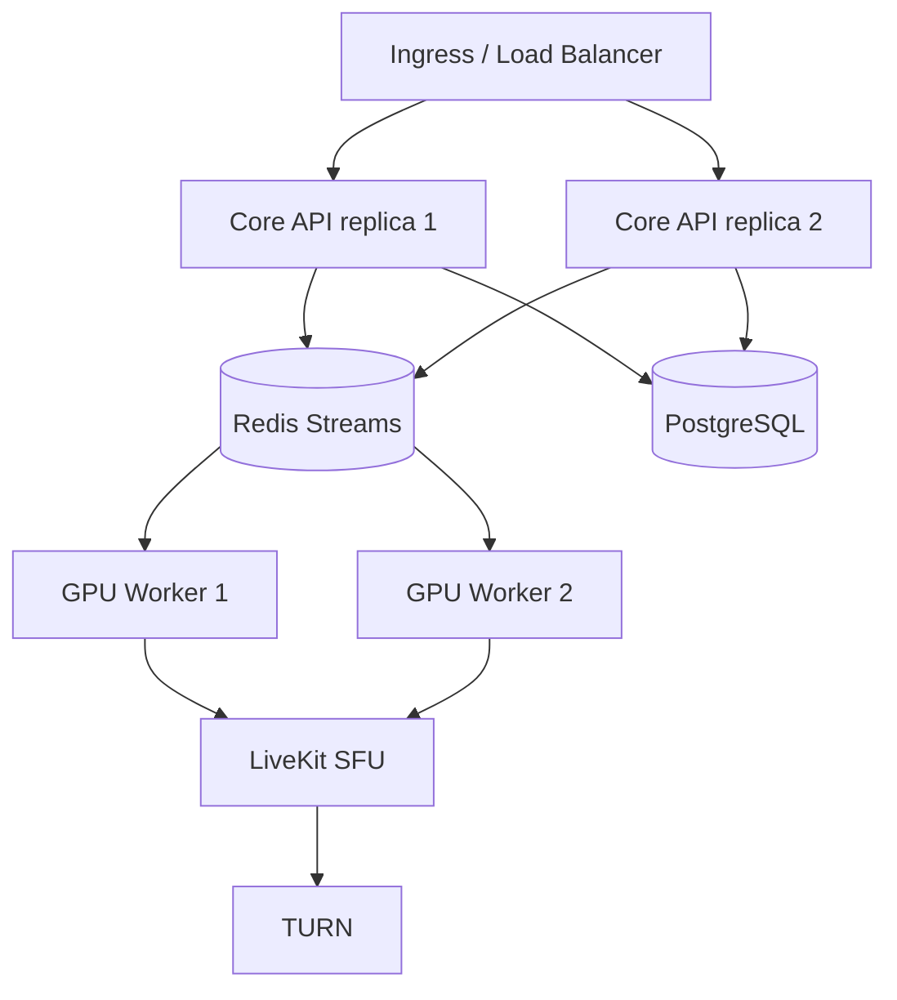

# Worker stream WebRTC trực tiếp qua SFU

> Trạng thái tài liệu: kiến trúc giai đoạn 2 đã được triển khai bằng
> `avatar-worker + Redis Streams + LiveKit SFU`. Các phần scheduler động, GPU model,
> distributed recovery và production hardening bên dưới vẫn là thiết kế mục tiêu.

## 1. Mục tiêu

Tách tác vụ render nhân vật ảo và truyền media khỏi Core API để model GPU nặng không làm
chậm REST API, WebSocket chat, state machine hoặc persistence.

Kiến trúc mục tiêu cần đáp ứng:

- Core chỉ quản lý nghiệp vụ: session, hội thoại, trạng thái avatar, xác thực và điều phối.
- Render Worker sở hữu model, GPU, audio/video pipeline và media clock.
- Frame thô hoặc CUDA tensor không đi qua Core API, Redis hay database.
- Client vẫn nhận audio/video bằng WebRTC.
- Có thể thay runtime WebRTC, message broker hoặc model bằng adapter mới mà không sửa domain.
- Có backpressure, worker affinity, heartbeat, fallback và khả năng phục hồi khi worker lỗi.

## 2. Hai runtime hiện có và giới hạn

Runtime local `AiortcAvatarStreamAdapter` chạy cùng process FastAPI và implement
`AvatarStreamPort`:

```text
Browser <-- WebRTC --> FastAPI process / aiortc
                           |
                           +-- Recorded video tracks
                           +-- Silent/debug audio track
```

Thiết kế này phù hợp với MVP nhưng khi đưa model sinh video vào sẽ có các rủi ro:

- inference GPU và encode có thể chiếm CPU/GPU, RAM và event loop của API;
- mỗi lần process API restart sẽ làm mất toàn bộ peer connection;
- khó scale API và GPU worker theo hai chính sách độc lập;
- `AvatarStreamPort` đang gộp hai trách nhiệm: signaling media và điều khiển render;
- một process phải vừa xử lý nghiệp vụ vừa quản lý vòng đời frame/codec/ICE.

Runtime khuyến nghị hiện đã có đường tách process:

```text
Browser <-- WebRTC --> LiveKit <-- WebRTC --> avatar-worker
Browser <-- REST/WS --> avatar-chat <-- Redis Streams --> avatar-worker
API replica <-------- Redis Pub/Sub --------> API replica
```

Worker hiện phát clip thu sẵn và audio silence/beep. Một `RENDER_WORKER_ID` tĩnh được dùng
thay cho scheduler; Redis pending reclaim/DLQ và model GPU thật chưa được triển khai.

## 3. Kiến trúc mục tiêu khuyến nghị

Khuyến nghị dùng Render Worker publish trực tiếp vào SFU. Client subscribe track từ SFU,
không nhận frame qua Core.



Ba plane có thể triển khai, scale và giám sát độc lập:

| Plane | Trách nhiệm | Không được làm |
|---|---|---|
| Control | Session, chat, auth, state machine, chọn worker, cấp token | Xử lý raw frame hoặc chạy model GPU |
| Render | Inference, TTS/lip-sync, render, media clock, publish track | Lưu nghiệp vụ hội thoại lâu dài |
| Media | ICE, DTLS-SRTP, chuyển tiếp track, bandwidth adaptation | Chạy business logic hoặc model |

## 4. Hai phương án truyền media

### 4.1. Worker WebRTC trực tiếp với từng client

Worker chạy `aiortc` và sở hữu một `RTCPeerConnection` cho mỗi client.



Ưu điểm:

- tận dụng nhiều code `aiortc` hiện tại;
- ít thành phần hạ tầng, phù hợp prototype;
- độ trễ media ngắn khi một session chỉ có một người xem.

Giới hạn:

- signaling request/response qua broker phức tạp hơn command một chiều;
- một worker phải xử lý ICE, DTLS, RTP, encode và inference;
- một avatar có nhiều người xem làm tăng số kết nối và băng thông upload;
- khó chuyển connection đang hoạt động sang worker khác;
- worker cần public UDP hoặc TURN connectivity.

Chỉ nên chọn phương án này cho giai đoạn thử nghiệm 1 avatar - 1 client.

### 4.2. Worker publish vào SFU

Worker tham gia một room dưới vai trò publisher. Client tham gia room dưới vai trò
subscriber. Core chỉ cấp token và điều phối worker.



Ưu điểm:

- worker publish một lần dù có nhiều người xem;
- SFU xử lý WebRTC networking, simulcast, subscriber và reconnect;
- API không cần relay SDP của worker theo từng client;
- có thể scale Core, worker và SFU độc lập;
- phù hợp production và thuận lợi khi bổ sung recording/observability.

Đổi lại hệ thống cần vận hành thêm SFU và TURN. Lựa chọn thực dụng là LiveKit; interface
phía Core vẫn nên trung lập để có thể thay bằng Janus, mediasoup hoặc một SFU khác.

## 5. Luồng end-to-end khuyến nghị



Core nên chỉ trả thông tin kết nối sau khi nhận `SessionReady`, hoặc trả ngay trạng thái
`initializing` rồi thông báo readiness qua WebSocket. Cách thứ hai tránh giữ HTTP request
lâu trong lúc model warm-up.

## 6. Tách port trong application core

`AvatarStreamPort` hiện tại nên được tách theo Interface Segregation Principle.

```python
from dataclasses import dataclass
from typing import Protocol


@dataclass(frozen=True, slots=True)
class MediaAccess:
    room_id: str
    server_url: str
    access_token: str


class MediaSessionPort(Protocol):
    async def create_room(self, session_id: str) -> str: ...

    async def issue_subscriber_access(
        self,
        session_id: str,
        user_id: str,
    ) -> MediaAccess: ...

    async def close_room(self, session_id: str) -> None: ...


class AvatarRenderPort(Protocol):
    async def start_session(
        self,
        session_id: str,
        worker_id: str,
        room_id: str,
        character_id: str,
    ) -> None: ...

    async def set_state(self, session_id: str, state: str) -> None: ...

    async def speak(self, session_id: str, text: str) -> None: ...

    async def cancel(self, session_id: str, operation_id: str) -> None: ...

    async def stop_session(self, session_id: str) -> None: ...


class WorkerSchedulerPort(Protocol):
    async def reserve(self, session_id: str, character_id: str) -> str: ...

    async def release(self, session_id: str, worker_id: str) -> None: ...
```

Adapter dự kiến:

```text
MediaSessionPort
├── LiveKitMediaSessionAdapter
├── JanusMediaSessionAdapter
└── DirectAiortcSignalingAdapter       # prototype

AvatarRenderPort
├── InProcessRecordedRenderAdapter     # tương thích demo hiện tại
├── RedisRenderCommandAdapter
└── NatsRenderCommandAdapter

WorkerSchedulerPort
├── InMemoryWorkerScheduler            # local test
├── RedisWorkerScheduler
└── KubernetesWorkerScheduler
```

Domain không import LiveKit SDK, Redis, aiortc, CUDA, PyTorch hoặc client HTTP. Việc chọn
adapter chỉ diễn ra trong `bootstrap/container.py`.

## 7. Cấu trúc source code mục tiêu

```text
src/avatar_chat/
├── domain/
│   ├── models.py
│   ├── events.py
│   └── errors.py
├── application/
│   ├── dto.py
│   ├── ports.py
│   └── use_cases/
│       ├── create_session.py
│       ├── handle_message.py
│       ├── provision_media.py
│       └── close_session.py
├── adapters/
│   ├── inbound/
│   │   └── fastapi_app.py
│   └── outbound/
│       ├── media/
│       │   ├── livekit_room.py
│       │   └── direct_aiortc.py
│       ├── render/
│       │   ├── in_process_recorded.py
│       │   └── redis_commands.py
│       ├── scheduling/
│       │   └── redis_scheduler.py
│       └── persistence/
└── bootstrap/
    ├── container.py
    └── settings.py

src/avatar_worker/
├── application/
│   ├── command_handlers.py
│   └── session_manager.py
├── domain/
│   ├── render_session.py
│   └── commands.py
├── adapters/
│   ├── inbound/
│   │   └── redis_consumer.py
│   └── outbound/
│       ├── models/
│       │   ├── recorded_avatar.py
│       │   └── generated_avatar.py
│       ├── media/
│       │   └── livekit_publisher.py
│       └── heartbeat/
│           └── redis_heartbeat.py
└── main.py
```

Core service và worker có thể nằm cùng repository ở giai đoạn đầu nhưng phải build thành
hai image/process riêng. Các message contract dùng một package nhỏ, không chia sẻ domain
object có behavior giữa hai service.

## 8. Command và event contract

Mọi command cần có `command_id`, `session_id`, version, timestamp và idempotency key.

Ví dụ `StartSession`:

```json
{
  "schema_version": 1,
  "type": "avatar.session.start",
  "command_id": "cmd-01K...",
  "session_id": "session-123",
  "worker_id": "gpu-worker-02",
  "created_at": "2026-08-02T10:30:00Z",
  "payload": {
    "room_id": "avatar-session-123",
    "publisher_token_ref": "secret://media/session-123",
    "character_id": "demo-avatar"
  }
}
```

Ví dụ `Speak`:

```json
{
  "schema_version": 1,
  "type": "avatar.speak",
  "command_id": "cmd-01M...",
  "session_id": "session-123",
  "operation_id": "reply-456",
  "created_at": "2026-08-02T10:31:00Z",
  "payload": {
    "text": "Xin chào, tôi có thể giúp gì cho bạn?",
    "voice_id": "vi-female-01"
  }
}
```

Các event tối thiểu:

- `avatar.session.ready`
- `avatar.state.changed`
- `avatar.speech.started`
- `avatar.speech.completed`
- `avatar.session.failed`
- `avatar.session.stopped`
- `worker.heartbeat`

Quy tắc xử lý:

- worker lưu các `command_id` đã xử lý trong một cửa sổ thời gian để chống xử lý lặp;
- command của cùng `session_id` phải được xử lý theo thứ tự;
- `operation_id` phân biệt nhiều lần nói trong cùng session;
- command cũ hơn generation hiện tại phải bị bỏ qua;
- retry dùng exponential backoff và dead-letter stream sau số lần tối đa;
- token publisher không ghi trực tiếp vào log hoặc payload lưu lâu dài.

## 9. Worker lifecycle, scheduling và affinity

Worker gửi heartbeat định kỳ, ví dụ mỗi 5 giây:

```json
{
  "worker_id": "gpu-worker-02",
  "status": "ready",
  "active_sessions": 3,
  "max_sessions": 8,
  "gpu_memory_used_mb": 18420,
  "gpu_memory_total_mb": 46068,
  "queue_depth": 1,
  "models": ["avatar-v1"],
  "last_heartbeat": "2026-08-02T10:30:00Z"
}
```

Scheduler chỉ chọn worker thỏa mãn model/capability và còn capacity. Một scoring đơn giản:

```text
score = 0.5 * session_utilization
      + 0.3 * gpu_memory_utilization
      + 0.2 * queue_utilization
```

Chọn worker có score thấp nhất. Sau khi reserve, session phải giữ affinity với worker đó
vì model context, temporal state và frame buffer nằm trong RAM/GPU của worker.

Trạng thái worker:



Worker `DRAINING` không nhận session mới nhưng tiếp tục phục vụ session hiện tại.

## 10. Audio/video pipeline và đồng bộ

Worker phải sinh audio và video theo cùng một monotonic media clock:



Khuyến nghị:

- audio PCM 48 kHz, packet 20 ms; video 25 hoặc 30 fps;
- PTS lấy từ monotonic clock, không lấy từ thời gian hoàn thành inference;
- buffer video nhỏ, khoảng 2-3 frame;
- khi model chậm, ưu tiên `latest-frame-wins` thay vì tích lũy latency vô hạn;
- audio là master clock; video có thể drop/duplicate frame để theo audio;
- giữ track liên tục khi đổi `idle/thinking/speaking`, không unpublish rồi publish lại;
- trong lúc chưa có speech, phát silent audio và idle frame/clip;
- giữ chế độ beep + flash hiện tại làm A/V sync diagnostic cho worker mới.

Không truyền CUDA tensor hoặc raw frame qua Redis. Nếu model và publisher ở cùng host nhưng
khác process, có thể dùng shared-memory ring buffer tạm thời. Khi dùng SFU, tốt nhất model
pipeline và publisher nằm trong cùng worker process hoặc pod.

## 11. Backpressure và giới hạn tài nguyên

Mỗi render session cần các queue có kích thước hữu hạn:

| Queue | Chính sách khi đầy |
|---|---|
| Chat/render commands | Không drop; reject hoặc retry có kiểm soát |
| Audio PCM | Giới hạn theo thời gian; cancel operation nếu vượt ngưỡng |
| Video frames | Drop frame cũ, giữ frame mới nhất |
| Telemetry | Có thể sample/drop |

Worker không nhận session mới khi vượt một trong các ngưỡng:

- số active session tối đa;
- GPU memory watermark;
- inference queue latency;
- encoder utilization;
- publish bitrate hoặc packet loss bất thường.

Core nên trả `503 capacity_unavailable` hoặc đưa session vào hàng đợi có timeout rõ ràng,
không âm thầm gán quá tải cho worker.

## 12. Failure handling và phục hồi



Các mức phục hồi:

1. **Media reconnect:** SFU/client tự reconnect, worker vẫn sống.
2. **Publisher restart:** worker publish track mới trong cùng room.
3. **Worker replacement:** scheduler chọn worker mới và tăng `generation`.
4. **Fallback:** phát clip idle/“đang kết nối lại” trong lúc model khôi phục.

Không thể di chuyển một `RTCPeerConnection` trực tiếp giữa hai worker. SFU giúp client giữ
room connection trong khi publisher được thay thế. Core nên lưu đủ dữ liệu tái tạo session,
nhưng không cố checkpoint CUDA state ở giai đoạn đầu.

## 13. Security

- Client chỉ nhận subscriber token, tuyệt đối không nhận publisher token.
- Token room có TTL ngắn, giới hạn đúng room, participant và quyền publish/subscribe.
- Core xác thực user có quyền truy cập `session_id` trước khi cấp token.
- Worker dùng service identity/mTLS hoặc credential riêng để đọc command bus.
- TURN dùng credential ngắn hạn; không hard-code secret trong frontend.
- Command payload được validate schema và giới hạn kích thước text/audio reference.
- URL audio hoặc asset phải là object-store reference đã ký, không cho worker fetch URL tùy ý.
- Log không chứa access token, SDP đầy đủ, secret hoặc nội dung nhạy cảm nếu không cần thiết.
- Rate limit create-session, chat message và token refresh.

## 14. Observability

Mọi log/trace/metric nên có `session_id`, `worker_id`, `operation_id` và `generation`.

Metric quan trọng:

- thời gian allocate worker và warm-up model;
- time-to-first-video và time-to-first-audio;
- text-to-first-audio và text-to-first-frame;
- inference time/frame, render FPS và dropped frames;
- audio buffer depth, A/V drift và end-to-end latency;
- WebRTC RTT, jitter, packet loss và outbound bitrate;
- active session/worker, GPU memory/utilization và queue depth;
- worker restart, reconnect, command retry và session recovery count.

Readiness của worker chỉ `true` sau khi model warm-up và có thể kết nối SFU. Liveness không
nên fail chỉ vì một session riêng lẻ gặp lỗi.

## 15. Configuration dự kiến

Core API:

```env
MEDIA_PROVIDER=livekit
LIVEKIT_URL=wss://media.example.com
LIVEKIT_API_KEY=...
LIVEKIT_API_SECRET=...

RENDER_PROVIDER=redis
REDIS_URL=redis://redis:6379/0
WORKER_HEARTBEAT_TIMEOUT=15
SESSION_READY_TIMEOUT=30
```

Render Worker:

```env
WORKER_ID=gpu-worker-02
WORKER_MAX_SESSIONS=8
WORKER_MODELS=avatar-v1
REDIS_URL=redis://redis:6379/0

MEDIA_PROVIDER=livekit
LIVEKIT_URL=wss://media.example.com
MODEL_PROVIDER=recorded
AV_SYNC_DEBUG=true
```

Secret nên được inject qua secret manager/Kubernetes Secret thay vì commit vào `.env`.

## 16. Deployment gợi ý



API replica hiện dùng Redis Pub/Sub để fan-out WebSocket và PostgreSQL/cursor để recovery.
API vẫn chưa hoàn toàn stateless vì lock xử lý message và login rate limit nằm trong process;
production cần distributed ownership/lock hoặc routing theo session. GPU worker được scale
theo GPU capacity và không nằm chung pod/container với API.

## 17. Kế hoạch triển khai theo giai đoạn

### Giai đoạn 1 - Tách abstraction, không đổi hành vi — hoàn thành một phần

1. Tách `AvatarStreamPort` thành `MediaSessionPort` và `AvatarRenderPort`.
2. Tạo adapter compatibility dùng lại `AiortcAvatarStreamAdapter` và video thu sẵn.
3. Bổ sung `WorkerSchedulerPort` với implementation in-memory một worker.
4. Giữ toàn bộ test hiện tại và bổ sung contract tests cho các port.
5. Thêm `render_session_id`, `worker_id`, `media_room_id`, `generation` vào session metadata.

Kết quả: ứng dụng vẫn chạy một process như hiện tại nhưng core đã sẵn sàng cho worker ngoài.

Hiện đã có `AvatarStreamPort`, `MediaRoomPort`, adapter aiortc/Redis/LiveKit và composition
root. `WorkerSchedulerPort`, worker assignment động và các field generation/worker/room trong
domain session chưa có; LiveKit MVP tạm dùng `RENDER_WORKER_ID` cấu hình tĩnh.

### Giai đoạn 2 - Worker process riêng trên một host — đã có MVP LiveKit

1. Tạo `avatar_worker` và command handler độc lập.
2. Dùng Redis Streams cho command/event và heartbeat.
3. Ban đầu worker vẫn phát video thu sẵn để kiểm chứng lifecycle.
4. Đường media đã chọn và triển khai: worker publish vào LiveKit SFU.
5. Chạy chaos test: kill worker, duplicate command, broker reconnect và session timeout —
   chưa hoàn thiện.

Kết quả: CPU/GPU/media đã tách khỏi Core, dù chưa có model sinh avatar thật.

### Giai đoạn 3 - Tích hợp model và production hardening

1. Implement `GeneratedAvatarModelAdapter` trong worker.
2. Thêm TTS, lip-sync, bounded buffer và shared media clock.
3. Thêm fallback track, generation-based recovery và drain worker.
4. Bật autoscaling, TURN production, auth, quota và observability.
5. Load test theo số session/GPU và đo latency trước khi tăng rollout.

## 18. Tiêu chí hoàn thành

Thiết kế được xem là đạt khi:

- Core API không import model SDK, aiortc hoặc SFU SDK ngoài adapter;
- raw frame không xuất hiện trong request, database hoặc broker;
- restart Core không buộc worker/model dừng render;
- worker publish audio/video trực tiếp tới SFU/client;
- mỗi session luôn xác định được worker, room và generation;
- command retry không làm phát lời nói hai lần;
- worker lỗi được phát hiện trong heartbeat timeout và client thấy trạng thái recovering;
- video/audio giữ track liên tục qua `idle`, `thinking`, `speaking`;
- có metric time-to-first-media, dropped frames và A/V drift;
- recorded-video adapter vẫn dùng được để test mà không cần GPU.

## 19. Quyết định đề xuất

Sử dụng **Core API + Redis Streams + GPU Render Worker + LiveKit SFU + TURN** làm kiến trúc
đích. Giai đoạn đầu vẫn giữ recorded-video adapter để kiểm thử toàn bộ control/media flow
trước khi tích hợp model thật.

Worker chịu trách nhiệm từ model output đến encoded WebRTC tracks; Core chỉ gửi command và
nhận event. Đây là ranh giới quan trọng nhất để model nặng không ảnh hưởng tới phần nghiệp
vụ và để các dependency bên ngoài có thể thay thế bằng adapter.
