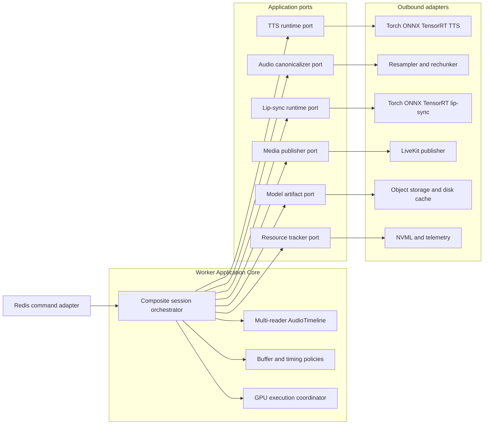

# Persona Render Worker Core Architecture

> Trạng thái: Worker Core DTO/ports, bounded multi-reader audio timeline, composite slot manager,
> deterministic TTS/lip-sync adapters, queued LiveKit publisher và speech command đã được triển
> khai end-to-end. Worker cũng report GPU snapshot từ `nvidia-smi`; model GPU thật, per-session
> CUDA profiler và execution coordinator vẫn là target tiếp theo.

Target process topology đã chốt dùng Worker Master đọc Redis và Composite Child giao tiếp bằng
gRPC bidirectional stream qua Unix Domain Socket. Xem
[`worker-master-child-grpc.md`](worker-master-child-grpc.md). Các domain DTO/ports trong tài liệu
này tiếp tục được dùng bên trong Child và không phụ thuộc transport gRPC.

## 1. Mục tiêu và phạm vi

Tài liệu này định nghĩa ranh giới Hexagonal Architecture bên trong Persona Render Worker. Mục
tiêu là cho phép thay TTS/lip-sync model, runtime GPU và media transport mà không sửa orchestration
hoặc Core API.

Cần phân biệt hai core:

| Core | Trách nhiệm |
|---|---|
| Core API | Auth, session business, transcript, Agent turn, character selection và command |
| Worker Application Core | Composite runtime lifecycle, PTS, AudioTimeline, buffering, lip-sync orchestration và playback |

Core API không import CUDA/Torch/LiveKit. Worker Application Core cũng không phụ thuộc trực tiếp
Torch, TensorRT, NumPy, PyAV hay LiveKit SDK; các framework này nằm trong adapters.

## 2. Dependency direction



Dependency luôn đi từ adapter vào port do application định nghĩa. Model SDK không được xuất
hiện trong domain/application DTO.

## 3. Luồng dữ liệu qua Worker Core

```mermaid
flowchart LR
    Command[SpeechSegment command]
    TTS[TtsSessionRuntime]
    Native[NativeAudioChunk]
    Convert[AudioCanonicalizer]
    Canonical[CanonicalAudioChunk]
    Timeline[AudioTimeline]
    AudioReader[LiveKit audio reader]
    LipReader[Lip-sync reader]
    Request[LipSyncRenderRequest]
    LipSync[LipSyncSessionRuntime]
    Video[TimedVideoFrame]
    Sync[Audio master synchronizer]
    Publisher[MediaPublisher]

    Command --> TTS
    TTS --> Native
    Native --> Convert
    Convert --> Canonical
    Canonical --> Timeline
    Timeline --> AudioReader
    Timeline --> LipReader
    LipReader --> Request
    Request --> LipSync
    LipSync --> Video
    AudioReader --> Sync
    Video --> Sync
    Sync --> Publisher
```



Redis chỉ mang text, IDs, voice configuration và control metadata. PCM, lip-sync feature,
tensor và raw video frame không đi qua Redis, PostgreSQL hoặc Core API.

## 4. DTO trung lập

DTO không chứa `torch.Tensor`, `numpy.ndarray`, `av.AudioFrame`, `av.VideoFrame`, CUDA stream
hoặc LiveKit object.

### 4.1. Speech input

```python
@dataclass(frozen=True)
class SpeechSegment:
    session_id: str
    turn_id: str
    utterance_id: str
    sequence: int
    text: str
    language: str
    is_final: bool
```

### 4.2. Voice runtime specification

```python
class VoiceMode(Enum):
    FULL_MODEL = "full-model"
    ADAPTER = "adapter"
    EMBEDDING = "embedding"


@dataclass(frozen=True)
class VoiceRuntimeSpec:
    tts_model_id: str
    model_version: str
    artifact_uri: str
    checksum: str
    voice_id: str
    voice_mode: VoiceMode
    speaker_embedding_uri: str | None
    language: str
```

### 4.3. TTS native output

```python
@dataclass(frozen=True)
class NativeAudioChunk:
    utterance_id: str
    sequence: int
    samples: bytes
    sample_rate: int
    channels: int
    sample_format: AudioSampleFormat
    end_of_utterance: bool = False
```

TTS adapter trả sample rate native của model. Nó không tự cấp global PTS hoặc publish LiveKit.

### 4.4. Canonical audio

```python
@dataclass(frozen=True)
class CanonicalAudioChunk:
    session_id: str
    turn_id: str
    utterance_id: str
    sequence: int
    start_sample: int
    samples: bytes
    sample_rate: int = 48_000
    channels: int = 1
    end_of_utterance: bool = False
```

Canonical format mặc định:

```text
PCM signed 16-bit
mono
48 kHz
20 ms per frame
960 samples per audio frame
```

`start_sample` do Worker Core cấp. Audio PTS được tính bằng `start_sample / sample_rate`.

### 4.5. Lip-sync request

```python
@dataclass(frozen=True)
class LipSyncRenderRequest:
    session_id: str
    utterance_id: str
    frame_index: int
    target_pts_ns: int
    audio_start_sample: int
    audio_end_sample: int
    audio_samples: bytes
    sample_rate: int
```

Worker Core chọn audio window, look-back/look-ahead và target PTS. Lip-sync adapter không dùng
thời điểm inference hoàn thành làm timestamp.

### 4.6. Timed video output

```python
@dataclass(frozen=True)
class TimedVideoFrame:
    session_id: str
    utterance_id: str
    frame_index: int
    pts_ns: int
    width: int
    height: int
    pixel_format: PixelFormat
    data: bytes
```

`data` là buffer trung lập. Media adapter chịu trách nhiệm chuyển nó sang SDK frame cụ thể.

## 5. Application ports

### 5.1. TTS runtime

Factory/session split phản ánh model được load theo composite session:

```python
class TtsRuntimeFactoryPort(Protocol):
    async def load(
        self,
        specification: VoiceRuntimeSpec,
        compute_target: ComputeTarget,
    ) -> "TtsSessionRuntime": ...


class TtsSessionRuntime(Protocol):
    def synthesize(
        self,
        segment: SpeechSegment,
    ) -> AsyncIterator[NativeAudioChunk]: ...

    async def close(self) -> None: ...
```

Implementation có thể load full model, shared base cộng adapter hoặc speaker embedding mà không
đổi interface.

### 5.2. Audio canonicalizer

```python
class AudioCanonicalizerPort(Protocol):
    def convert(
        self,
        segment: SpeechSegment,
        chunk: NativeAudioChunk,
    ) -> Iterable[CanonicalAudioChunk]: ...
```

Resample/rechunk là adapter DSP. Composition root cấu hình canonical format; Worker Core cấp
sample timeline liên tục khi append chunk.

### 5.3. AudioTimeline

```python
class AudioTimelinePort(Protocol):
    async def append(self, chunk: CanonicalAudioChunk) -> CanonicalAudioChunk: ...
    def reader(self, consumer: str) -> "AudioTimelineReader": ...
    async def close(self) -> None: ...
```

Timeline là single-writer/multi-reader ring buffer. LiveKit và lip-sync có cursor riêng; không
dùng chung một `asyncio.Queue` khiến hai consumer tranh mất chunk.

### 5.4. Lip-sync runtime

```python
class LipSyncRuntimeFactoryPort(Protocol):
    async def load(
        self,
        specification: AvatarRuntimeSpec,
        compute_target: ComputeTarget,
    ) -> "LipSyncSessionRuntime": ...


class LipSyncSessionRuntime(Protocol):
    async def render(self, request: LipSyncRenderRequest) -> TimedVideoFrame: ...
    async def close(self) -> None: ...
```

Batch optimization có thể là optional capability:

```python
class BatchedLipSyncRuntime(Protocol):
    async def render_batch(
        self,
        requests: Sequence[LipSyncRenderRequest],
    ) -> Sequence[TimedVideoFrame]: ...
```

### 5.5. Media publisher

```python
class MediaPublisherPort(Protocol):
    async def publish_audio(self, frame: CanonicalAudioChunk) -> None: ...
    async def publish_video(self, frame: TimedVideoFrame) -> None: ...
    async def close(self) -> None: ...
```

Adapter có thể là LiveKit, aiortc, recorder hoặc fake test publisher.

### 5.6. Artifact và resource tracking

```python
class ModelArtifactPort(Protocol):
    async def resolve(self, reference: ArtifactReference) -> LocalArtifact: ...


class ResourceTrackerPort(Protocol):
    async def record(self, sample: PersonaResourceSample) -> None: ...
```

Telemetry là best-effort, dùng bounded queue và không được block media loop.

## 6. Composite session orchestrator

```python
class CompositePersonaSession:
    def __init__(
        self,
        tts: TtsSessionRuntime,
        lipsync: LipSyncSessionRuntime,
        canonicalizer: AudioCanonicalizerPort,
        timeline: AudioTimelinePort,
        publisher: MediaPublisherPort,
        resource_tracker: ResourceTrackerPort,
    ) -> None: ...
```

Các execution task:

```python
async def run(self) -> None:
    async with asyncio.TaskGroup() as tasks:
        tasks.create_task(self._consume_speech_commands())
        tasks.create_task(self._run_tts())
        tasks.create_task(self._render_lipsync())
        tasks.create_task(self._publish_audio())
        tasks.create_task(self._publish_video())
        tasks.create_task(self._track_resources())
```

Nếu Python version chưa hỗ trợ `TaskGroup`, bootstrap có thể dùng structured task supervisor
tương đương; lifecycle semantics không đổi.

## 7. Ownership và điều cấm

| Thành phần | Được quyết định | Không được làm |
|---|---|---|
| Worker Core | Timeline, PTS, prebuffer, backpressure, drop policy, speaking/idle, cleanup | Import model/LiveKit SDK |
| TTS adapter | Load voice runtime, synthesize native chunks, close GPU resources | Ghi transcript, publish media, tự cấp global PTS |
| Lip-sync adapter | Render target frame từ timed audio window | Đọc Redis, gọi TTS, quyết định frame drop/session state |
| Canonicalizer adapter | Resample, normalize và rechunk đúng format | Tự thay timeline offset |
| LiveKit adapter | Convert DTO sang SDK frame, publish track, report transport error | Chọn model hoặc sửa business state |
| Redis inbound adapter | Parse/validate schema và gọi use case | Chạy model hoặc đưa PCM vào Redis |
| Resource adapter | Đo NVML/runtime và export telemetry | Tạo backpressure lên inference/media |

Worker Core sở hữu policy; adapter sở hữu framework-specific mechanism.

## 8. GPU execution coordination

TTS và lip-sync cùng dùng GPU nên không được tự launch workload đồng thời không kiểm soát.
MVP dùng một execution lane:

```text
highest priority: lip-sync frame gần presentation deadline
next: TTS burst khi audio buffer gần low watermark
next: TTS pre-generation khi GPU còn budget
lowest: idle/background work
```

Model API đồng bộ chạy trong dedicated inference thread/executor, không block asyncio event
loop. Chỉ dùng nhiều CUDA stream sau benchmark thread-safety, P99 VRAM, inference latency và
frame deadline miss.

## 9. Synchronization invariants

1. Lip-sync và LiveKit đọc cùng canonical PCM.
2. Audio PTS luôn lấy từ sample index.
3. Video PTS là target presentation time, không phải inference completion time.
4. Timeline có cursor riêng cho LiveKit và lip-sync.
5. Speaking chỉ bắt đầu sau minimum prebuffer.
6. Video quá deadline bị drop; không kéo chậm audio vô hạn.
7. TTS high watermark tạo backpressure, không spill PCM sang Redis.
8. Playback complete chỉ sau TTS final, audio drain và video final handled.
9. Close/cancel đóng iterator và runtime idempotently.
10. Composite admission phải giữ TTS/lip-sync nhanh hơn realtime ở P95/P99 mục tiêu.

## 10. Failure và cancellation

Cleanup theo thứ tự:

```text
reject new speech segments
cancel current TTS iterator
close AudioTimeline writer
drain or discard buffers according to policy
stop lip-sync render loop
unpublish and leave LiveKit
close lip-sync runtime
close TTS runtime
release composite GPU slot
emit terminal event
```

Các `close()` phải idempotent. Late frame/event mang generation cũ bị bỏ qua. Nếu TTS underrun,
Worker giữ clock bằng timestamped silence/neutral frame và phát metric; underrun kéo dài làm
utterance fail hoặc chuyển fallback theo policy.

## 11. Source structure đề xuất

```text
src/personaforge_worker/
├── domain/
│   ├── audio.py
│   ├── video.py
│   ├── speech.py
│   └── runtime_specs.py
├── application/
│   ├── composite_session.py
│   ├── audio_timeline.py
│   ├── gpu_execution.py
│   ├── ports.py
│   └── policies.py
├── adapters/
│   ├── inbound/
│   │   └── redis_commands.py
│   └── outbound/
│       ├── tts/
│       │   ├── scripted.py
│       │   ├── torch_runtime.py
│       │   └── tensorrt_runtime.py
│       ├── lipsync/
│       │   ├── recorded.py
│       │   ├── torch_runtime.py
│       │   └── tensorrt_runtime.py
│       ├── audio/
│       ├── media/
│       │   └── livekit.py
│       ├── artifacts/
│       └── telemetry/
└── bootstrap/
    ├── settings.py
    └── container.py
```

Đây là target structure. Migration không cần di chuyển toàn bộ source trong một commit; có thể
tách ports/DTO trước, sau đó bọc recorded renderer hiện tại bằng adapter mới.

## 12. Test strategy

Worker Core được test bằng deterministic fake adapters:

```text
ScriptedTtsRuntime
  emits beep or impulse at known sample indexes

FakeLipSyncRuntime
  returns flash frames at requested target PTS

RecordingMediaPublisher
  records timed audio and video without LiveKit
```

Unit/contract test bắt buộc:

- Không mất chunk giữa LiveKit và lip-sync readers.
- Audio/video PTS tăng đơn điệu.
- Beep/flash offset nằm trong sync threshold.
- Video trễ bị drop, audio không bị kéo chậm.
- Backpressure dừng TTS khi buffer đầy.
- Playback complete chỉ sau timeline drain.
- Cancel giữa TTS đóng async iterator và không leak task/model.
- Runtime `close()` được gọi đúng một lần về mặt hiệu lực.
- Adapter error đưa composite session về terminal state an toàn.
- Full-model và shared-base/adapter resource lifecycle đều release đúng refcount.

Adapter có contract test riêng cho sample format, frame layout, artifact checksum và cleanup;
E2E test với model thật chỉ dùng cho integration/performance, không thay unit test Worker Core.

## 13. Liên hệ với source hiện tại

Đã có:

- `RedisRenderWorker` làm inbound command consumer.
- Session manager quản lý render task theo session.
- `LiveKitRenderSession` giữ stable publisher và clocked media loop.
- Recorded frame source cho idle/thinking; silence/beep chỉ là fallback/debug.

Đã bổ sung trong feature Control/Composite Worker:

- Domain-neutral TTS/lip-sync DTO và application ports.
- Multi-reader bounded AudioTimeline với backpressure.
- Composite slot manager có lease token và generation fencing.
- Scripted TTS và deterministic recorded-clip lip-sync chạy qua `CompositeSpeechPipeline`.
- Queued media publisher chỉ hoàn tất frame sau LiveKit loop acknowledge.
- Speech command đi từ Core qua Control/Redis đến LiveKit Worker.
- `nvidia-smi`/configured GPU probe và Redis heartbeat cho Control inventory/scheduler.

Chưa có:

- `TtsRuntimeFactoryPort` và `LipSyncRuntimeFactoryPort` cho model thật.
- Composite GPU execution coordinator.
- GPU model adapters và per-session composite resource tracker; hardware-level snapshot đã có.

Lộ trình an toàn:

1. Implement model runtime adapters qua các port hiện tại.
2. Nối local `CompositeSlotManager` vào Redis Worker runtime.
3. Thêm native resampler và GPU execution coordinator.
4. Instrument VRAM/RTF/FPS/A-V drift theo session.
5. Benchmark composite profile trước khi bật GPU admission thật.
