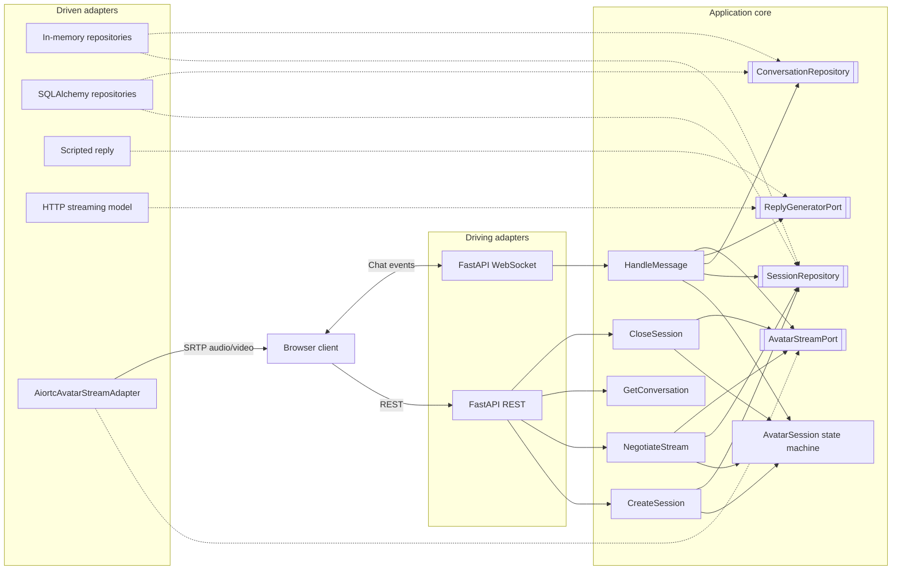
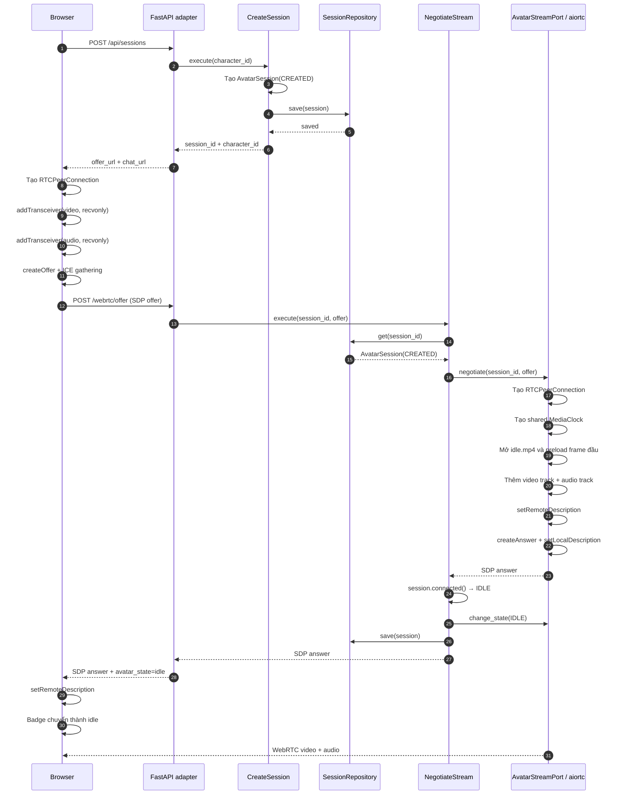
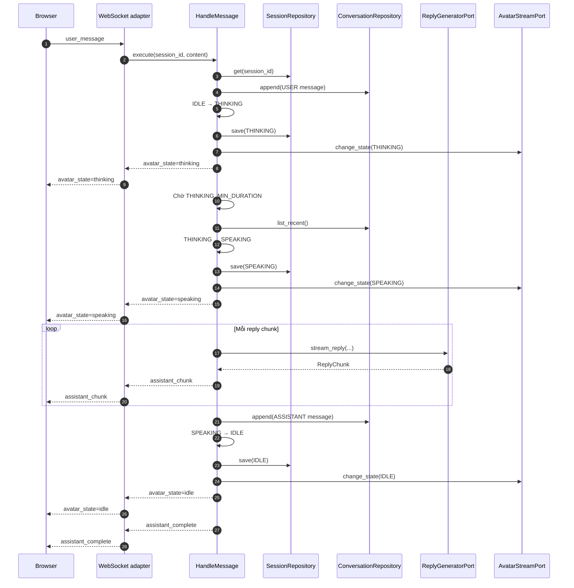
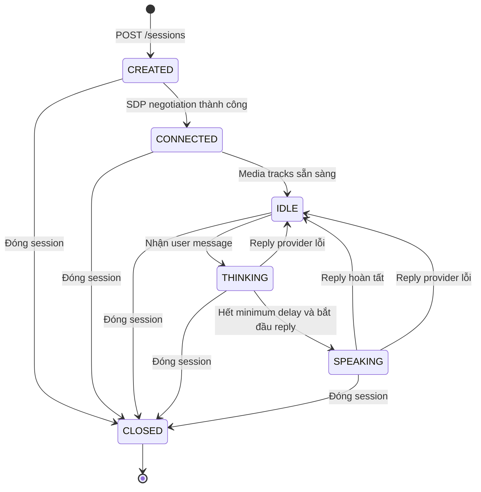
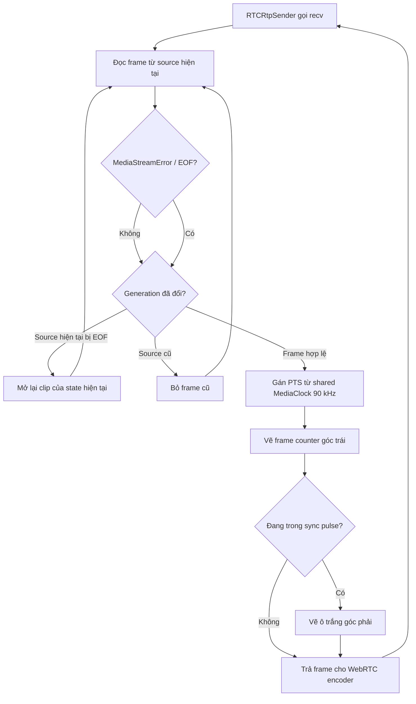
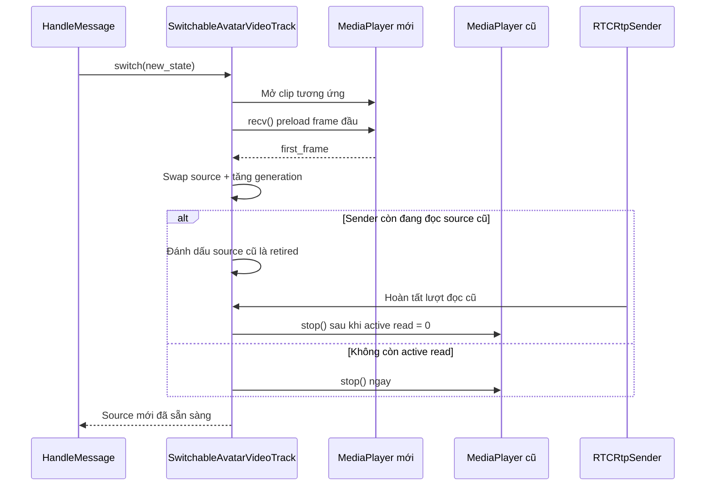
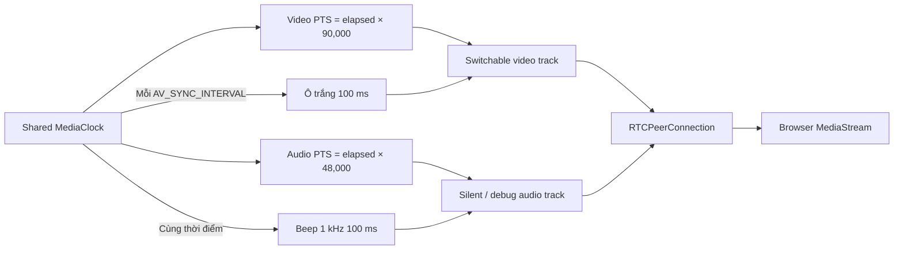
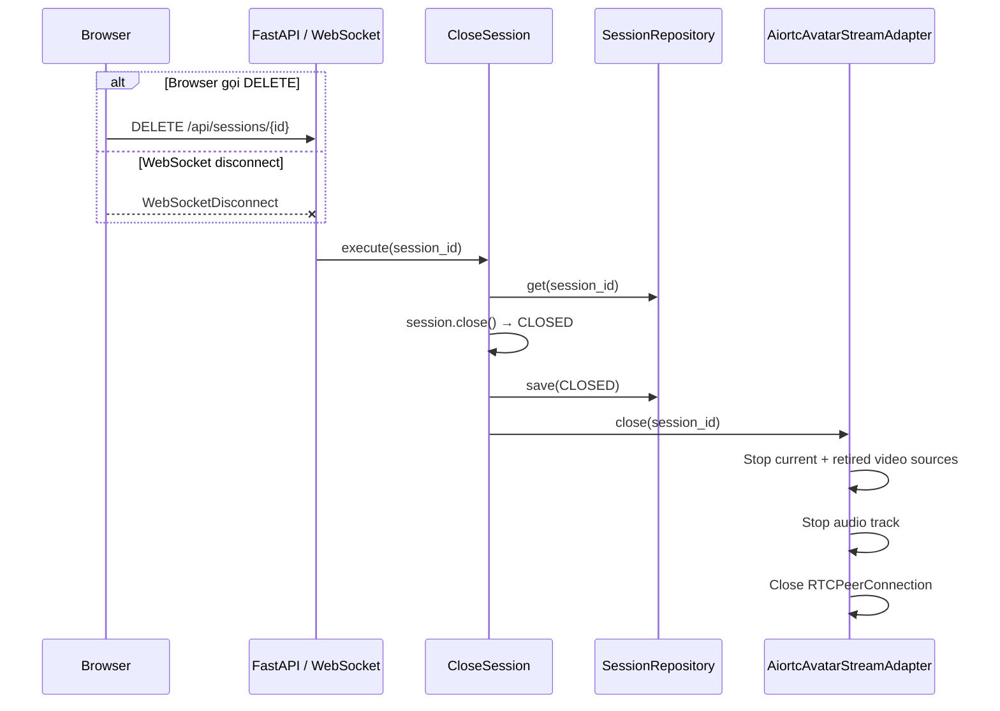

# Luồng xử lý Avatar Chat WebRTC Server

Tài liệu này mô tả luồng xử lý hiện tại của server theo kiến trúc Hexagonal
(Ports & Adapters). Core không phụ thuộc FastAPI, aiortc, SQLAlchemy hay model service.

## 1. Kiến trúc tổng thể



Dependency được nối duy nhất tại `bootstrap/container.py`. Thay database, model service
hoặc WebRTC runtime chỉ cần thêm adapter và đổi composition root.

## 2. Khởi tạo session và WebRTC



## 3. Luồng chat và trạng thái avatar



Mỗi session có một `asyncio.Lock`. Nếu một message khác đến trong khi message hiện tại
đang xử lý, core trả `SessionBusy` thay vì làm hỏng state machine.

## 4. State machine



## 5. Video track, đổi clip và khôi phục EOF

`SwitchableAvatarVideoTrack` là outbound track ổn định. Việc đổi clip không thay track và
không yêu cầu SDP renegotiation.



Khi đổi state:



Wrapper tự mở lại clip khi PyAV báo EOF ở cuối video 3 giây. Vì vậy frame counter tiếp tục
tăng qua nhiều vòng clip và qua mọi lần đổi trạng thái.

## 6. Audio câm và A/V sync debug



Mặc định debug sync được bật:

```env
AV_SYNC_DEBUG=true
AV_SYNC_INTERVAL=2.0
AV_SYNC_PULSE_DURATION=0.1
```

Browser khởi động video ở chế độ muted. Người dùng phải bấm **Bật âm thanh kiểm tra** để
nghe beep do chính sách autoplay của trình duyệt.

## 7. Đóng session và cleanup



Khi ứng dụng shutdown, container gọi `avatar_stream.shutdown()` để đóng toàn bộ peer còn
tồn tại, sau đó mới dispose database engine.
