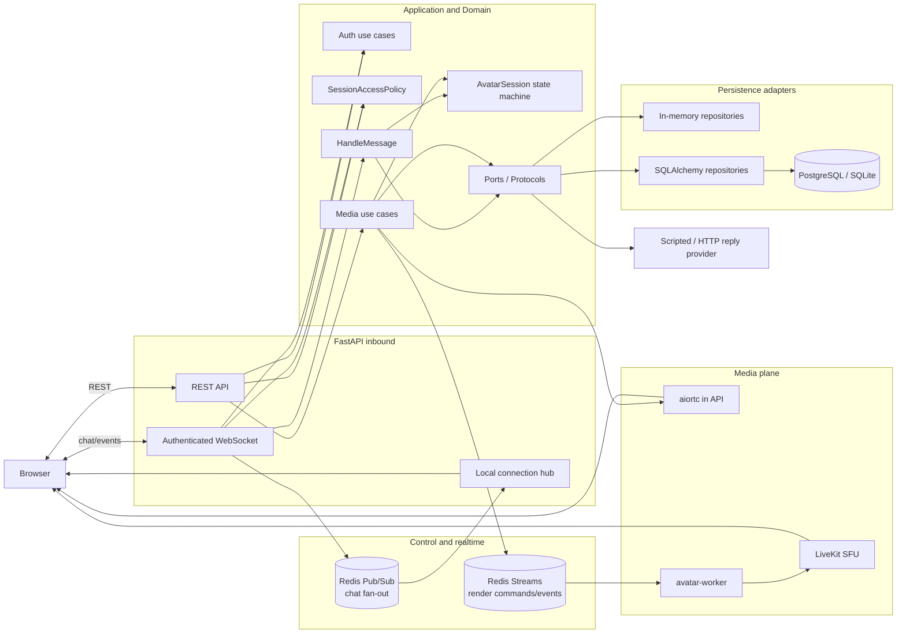
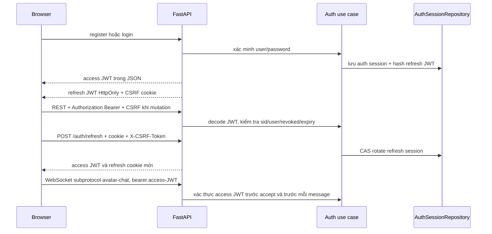
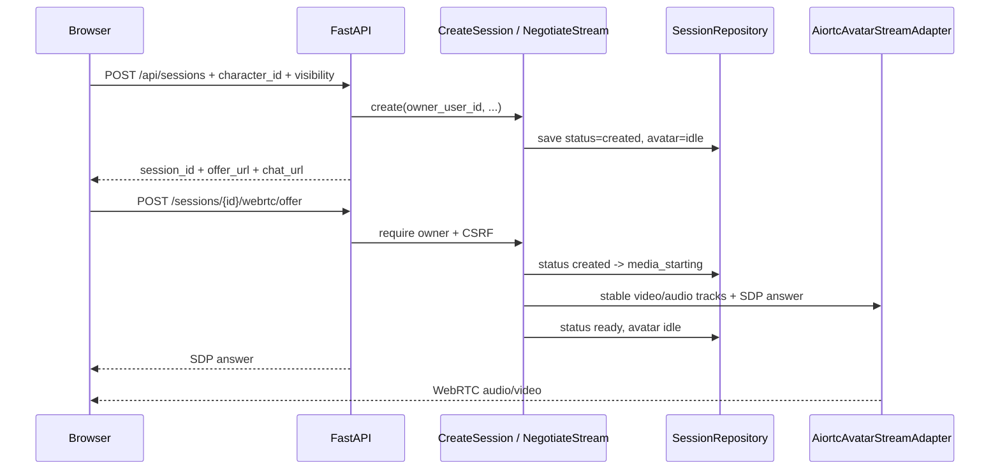
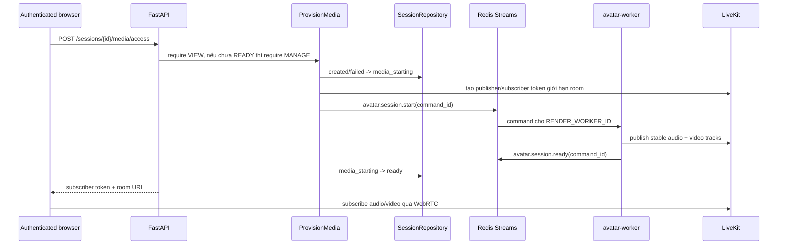
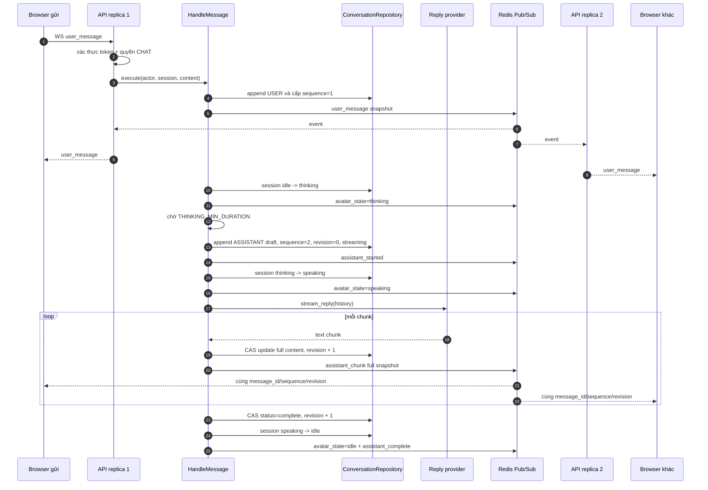
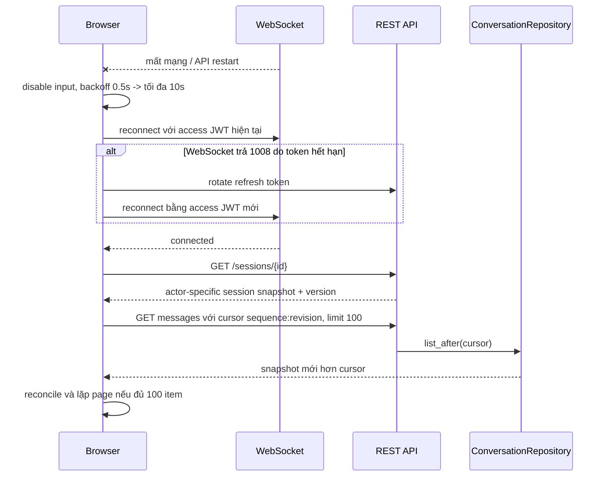
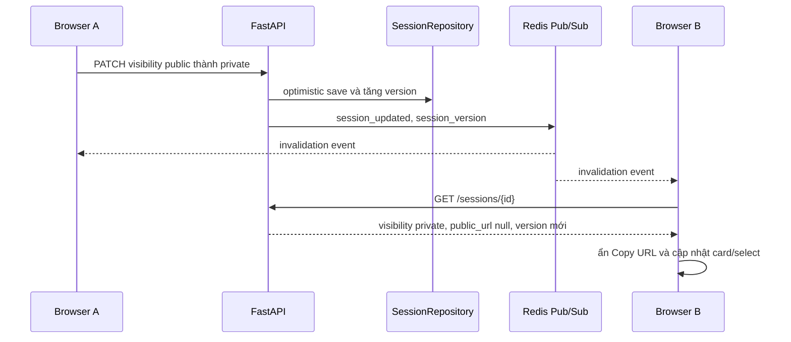
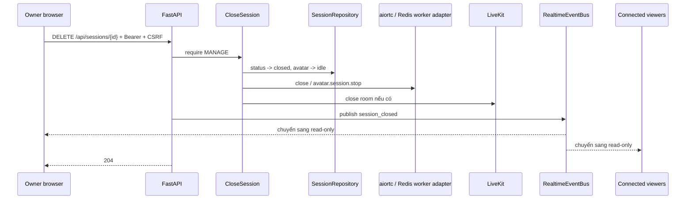

# Luồng xử lý Avatar Chat WebRTC Server hiện tại

Tài liệu này phản ánh implementation hiện tại trong repository. Hệ thống dùng Hexagonal
Architecture: domain/application không import FastAPI, SQLAlchemy, Redis, aiortc, LiveKit hay
SDK model. Mọi dependency bên ngoài được nối tại `bootstrap/container.py`.

## 1. Thành phần và ranh giới

Hai loại Redis có mục đích khác nhau:

- Redis Streams giữ command/event điều khiển Render Worker và có ACK/retry.
- Redis Pub/Sub fan-out chat event giữa API replica; database và cursor mới là nguồn recovery.

## 2. Xác thực browser

Access token chỉ nằm trong memory của trang. Refresh token chỉ nằm trong cookie `HttpOnly`,
không được trả cho JavaScript. Logout thu hồi auth session server-side nên REST và WebSocket
mất quyền ngay. Chi tiết nằm trong [authentication.md](authentication.md).

## 3. Quyền session

| Actor | Xem session/transcript/media | Gửi chat | Đổi public/private | Quản lý share | Đóng session |
|---|---:|---:|---:|---:|---:|
| Owner | Có | Có | Có | Có | Có |
| Shared `interactor` | Có | Có | Không | Không | Không |
| Shared `viewer` | Có | Không | Không | Không | Không |
| User đăng nhập xem public | Có | Không, trừ khi có share `interactor` | Không | Không | Không |
| Anonymous qua `/watch/{id}` | Có, chỉ khi public | Không | Không | Không | Không |

`public` không đồng nghĩa có quyền chat. Anonymous watch không render input gửi tin nhắn.
Khi owner chuyển public về private, participant anonymous bị ngắt khỏi LiveKit; các user còn
share hợp lệ vẫn được giữ. Khi thu hồi share, participant tương ứng cũng bị revoke khỏi room.

## 4. Tạo session và khởi tạo media

### 4.1. aiortc mode

aiortc mode phù hợp local và owner duy nhất. Viewer chia sẻ nhiều người cần LiveKit mode.

### 4.2. LiveKit mode

Provision idempotent khi session đã `ready`: API chỉ cấp subscriber token mới, không restart
worker. Anonymous chỉ dùng endpoint `/api/public/sessions/{id}/media/access` khi session đang
public và ready.

## 5. Chat, persistent streaming và fan-out

Chunk là toàn bộ content hiện tại, không phải delta. Browser reconcile theo `message_id` và
chỉ nhận revision không cũ hơn; vì thế event trùng hoặc đến lệch thứ tự không nhân đôi text.
Sequence quyết định thứ tự bubble. Một lock theo session chặn message đồng thời trong cùng
process; repository version/revision phát hiện stale write.

Nếu provider lỗi sau khi draft được tạo, core lưu `status=failed`, khôi phục renderer/domain
về `idle`, rồi phát `avatar_state=idle` và `assistant_failed`.

## 6. Reconnect và catch-up

Redis Pub/Sub không lưu event. Sau reconnect, `SessionRepository` và `ConversationRepository`
mới là source of truth.
Public Watch không dùng chat WebSocket; trang poll endpoint public mỗi giây với cùng cursor.

### 6.1. Đồng bộ cấu hình giữa nhiều browser

Event chỉ là tín hiệu invalidation, không mang `access_role` hay `can_chat`, vì hai user trên
cùng session có thể có quyền khác nhau. Endpoint snapshot tính lại owner/interactor/viewer/public
theo access token của từng browser. Frontend bỏ snapshot có version cũ hơn state đang giữ.

`session_shares_updated` dùng cùng cơ chế. Owner tab reload danh sách share; interactor/viewer
reload snapshot để bật/tắt chat. Nếu share bị thu hồi trên private session, hub đóng WebSocket
với reason `Access revoked`, frontend ngắt media và xóa các quyền điều khiển.

## 7. Video/audio pipeline

Cả hai media runtime giữ một video track và một audio track ổn định trong suốt session. State
chỉ đổi nguồn frame `idle`, `thinking`, `speaking`, không renegotiate track.

- Mỗi frame được normalize về resolution cấu hình và có frame counter góc trái.
- Audio PCM mono 48 kHz chạy liên tục; hiện là silence hoặc beep debug.
- Shared media clock/`AVSynchronizer` giữ cadence và A/V sync.
- `AV_SYNC_DEBUG` tạo beep 1 kHz và flash trắng trên cùng timeline.
- Worker dùng bounded queue; audio timeline là master clock và video chạy theo FPS cấu hình.

## 8. Đóng session và cleanup

Đóng WebSocket **không đóng session**. Điều này là chủ ý để browser reconnect và catch-up mà
không làm dừng media của các viewer khác.

Frontend giữ transcript nhưng ngắt WebSocket/media, khóa chat, visibility và share controls,
đồng thời phủ vùng avatar bằng thông báo “Session đã đóng”. Card session được đánh dấu closed;
mở lại card không tạo WebSocket hay WebRTC mới. Public Watch theo dõi session status và chuyển
sang thông báo kết thúc thay vì retry provision vô hạn.

Core cũng xem closed session là immutable: chat, negotiate/provision, đổi visibility và thay
đổi share trả `409 SessionClosed`. Các API xem session và transcript vẫn hoạt động để người có
quyền xem lại lịch sử.

Khi application shutdown, container dừng realtime event bus, media adapter và database theo
thứ tự. Worker process và LiveKit có lifecycle container riêng.

## 9. Nguồn dữ liệu và giới hạn scale hiện tại

- Không có `DATABASE_URL`: toàn bộ user/session/message/share/auth state ở memory và mất khi
  restart; không dùng được cho nhiều replica.
- Có database chung + `REALTIME_EVENT_BUS=redis`: history và realtime fan-out dùng được giữa
  replica.
- Lock xử lý chat vẫn nằm trong process. Hai replica cùng nhận chat cho một session có thể
  cạnh tranh; optimistic version/CAS sẽ từ chối stale write nhưng chưa thay distributed lock.
- Login rate limiter còn in-memory theo replica.
- Redis Streams chưa có pending reclaim/DLQ; worker vẫn dùng một `RENDER_WORKER_ID` tĩnh.
- Health endpoint hiện mới xác nhận API process, chưa aggregate Redis/DB/worker/LiveKit.
