# Luồng Composite TTS và Avatar Render Worker

> Trạng thái: Enrollment/Identity Plane, Redis ACL, Control Plane scheduler, composite lease,
> worker heartbeat và application-level `CompositeSpeechPipeline` đã được triển khai. Luồng
> LiveKit hiện chạy end-to-end bằng scripted tone TTS và recorded-clip lip-sync giả qua bounded
> multi-reader audio timeline. Model TTS/lip-sync GPU, artifact storage và production HA chưa
> được triển khai.

## 1. Các quyết định kiến trúc

- Core API giữ business logic, quyền truy cập, transcript và lifecycle của chat session.
- Core không load CUDA model và không vận chuyển PCM, tensor hoặc raw video frame.
- Mỗi session được cấp một Composite Persona Slot gồm TTS session runtime, Avatar/lip-sync
  model, audio timeline và LiveKit publisher trong cùng Render Worker.
- TTS và Avatar model chỉ được load sau khi Core gửi đủ character/voice runtime specification.
- TTS model có thể là full model riêng, hoặc shared base model cộng voice adapter/embedding theo
  session; boundary không giả định một hình thức duy nhất.
- Thời gian reserve slot, tải weights, load model và publish track là thời gian khởi tạo media.
- Một session giữ nguyên Render Worker và composite runtime cho đến khi media session release.
- TTS audio là master clock; video frame dùng timestamp cùng timeline với audio.
- Render Worker publish một cặp track ổn định vào LiveKit; browser không reconnect khi avatar
  đổi `idle`, `thinking` hoặc `speaking`.
- Giai đoạn MVP, worker giao tiếp Redis trực tiếp qua TLS bằng Redis ACL credential được cấp
  động cho riêng từng `worker_id + boot_id`.
- Kiến trúc target đã chốt chuyển worker thành Master quản lý host: chỉ Master đọc Redis;
  Composite Child giao tiếp với Master bằng gRPC bidirectional stream qua Unix Domain Socket và
  publish media trực tiếp lên LiveKit. Chi tiết tại
  [`worker-master-child-grpc.md`](worker-master-child-grpc.md).
- Multi-replica Scheduler, Redis HA/Cluster và Worker Control Service là target tương lai, không
  thuộc phạm vi triển khai model/TTS đầu tiên.

## 2. Sơ đồ tổng thể

```mermaid
flowchart LR
    Browser[Browser]

    subgraph Identity[Enrollment and identity plane]
        Operator[Operator or deployment]
        Enrollment[Enrollment token API]
        Registration[Worker Registration Service]
        TokenStore[(Token and idempotency store)]
        ACLIssuer[Redis ACL credential issuer]
    end

    subgraph Control[Control plane]
        Core[Core API]
        Agent[Agent Runtime]
        DB[(PostgreSQL)]
        Bus[(Redis control bus and registry)]
        Scheduler[Composite GPU slot scheduler]
    end

    subgraph Render[Composite persona worker]
        RenderWorker[Persona Render Worker]
        Slot[Composite session slot]
        TTSRuntime[Session TTS runtime]
        Normalize[Resample and rechunk]
        Timeline[Multi-reader audio timeline]
        LipSync[Lip-sync feature extractor]
        AvatarModel[Character model instance]
        AVSync[Audio master AV synchronizer]
        Publisher[Stable LiveKit publisher]
    end

    Storage[Model registry and object storage]
    Telemetry[Metrics and usage pipeline]
    Profiles[(Resource profile store)]
    LiveKit[LiveKit SFU]

    Operator --> Enrollment
    Enrollment --> TokenStore
    RenderWorker -->|Bootstrap or management token| Registration
    Registration --> TokenStore
    Registration --> ACLIssuer
    ACLIssuer -->|Privileged ACL operation| Bus
    Registration -->|Worker scoped Redis credential| RenderWorker

    Browser <-->|REST and WebSocket| Core
    Core <--> DB
    Core <-->|gRPC text stream| Agent
    Core -->|Provision and render intent| Scheduler
    Scheduler <-->|Registry reservation and commands| Bus
    RenderWorker <-->|TLS ACL commands events heartbeat| Bus
    Core -->|Speech segments and voice config| Bus
    Storage --> RenderWorker
    RenderWorker --> Slot
    Slot --> TTSRuntime
    TTSRuntime -->|Native PCM chunks| Normalize
    Normalize --> Timeline
    Timeline --> LipSync
    LipSync --> AvatarModel
    AvatarModel -->|Timed video frames| AVSync
    Timeline -->|Timed audio frames| AVSync
    AVSync --> Publisher
    Publisher -->|WebRTC publish| LiveKit
    LiveKit -->|WebRTC subscribe| Browser
    RenderWorker -->|Progress and lifecycle events| Bus
    Bus --> Core
    RenderWorker --> Telemetry
    Telemetry --> Profiles
    Profiles --> Scheduler
```

Enrollment plane chỉ cấp/revoke danh tính và credential, không schedule GPU. Runtime Worker dùng
Redis trực tiếp qua TLS/ACL cho command, progress, assignment, heartbeat và metadata. Audio
TTS được truyền in-memory qua bounded multi-reader timeline tới lip-sync và LiveKit; PCM không
đi qua Redis hoặc Core. Raw frame và CUDA tensor luôn ở trong Render Worker. Telemetry đi qua
bounded exporter riêng và không được block media loop.

## 3. Trách nhiệm và quyền sở hữu tài nguyên

| Thành phần | Trách nhiệm chính | Không sở hữu |
|---|---|---|
| Operator/Deployment | Yêu cầu enrollment token và phân phối secret tới đúng host | Redis ACL admin credential, session business state |
| Core API | Session, auth, transcript, character selection, orchestration | CUDA model, GPU slot, raw media |
| Enrollment Token API | Xác thực operator, ký one-time bootstrap JWT và audit | Worker registration, GPU scheduling |
| Registration Service | Enrollment Persona Render Worker, canonical worker ID, credential lifecycle và audit | GPU scheduling, chat orchestration |
| Enrollment Token Store | Trạng thái `jti`, idempotency result và management-token family | Redis command/event payload |
| Redis ACL Credential Issuer | Tạo, rotate và revoke ACL user qua privileged adapter | Worker capability decision |
| Agent Runtime | Sinh text và gọi tool theo delegated authorization | TTS/Avatar lifecycle |
| Composite Slot Scheduler | Chọn worker, atomic claim tổng VRAM/compute và lưu assignment | Model object và frame loop |
| Persona Render Worker | Sở hữu TTS/avatar runtime, GPU, audio timeline, render loop và LiveKit publisher | Business session state |
| Redis | Thực thi ACL, giữ registry, lease, assignment, command và event | Quyết định quyền nghiệp vụ, tensor, PCM dài hạn, video frame |
| Model Registry/Object Storage | Manifest ký, weights, character assets và artifact version | GPU slot, session lifecycle |
| Metrics/Profile Pipeline | Thu telemetry, tổng hợp resource profile P50/P95/P99 | Scheduling transaction, media backpressure |
| LiveKit | SFU room và phân phối WebRTC tracks | Business/model logic |

Core yêu cầu cấp phát hoặc thu hồi nhưng không cấp Worker credential. Registration Service
không chọn GPU; Scheduler không tạo bootstrap token; Redis chỉ enforce ACL đã được credential
issuer cấu hình. Persona Render Worker là resource owner và cleanup toàn bộ composite session.
Scheduler chỉ đánh dấu slot rảnh sau xác nhận của worker hoặc sau khi lease cũ hết hạn.

## 4. Provision session và load model theo yêu cầu

Một request HTTP không nên chờ toàn bộ quá trình load model. Core trả `202 Accepted`, frontend
hiển thị progress, và trạng thái chỉ thành `READY` sau khi worker publish đủ audio/video track.

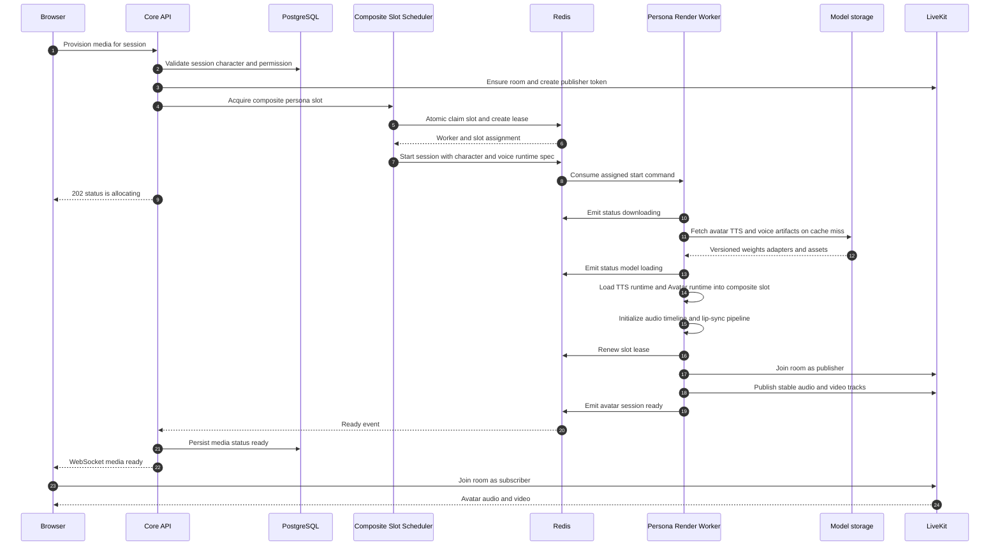

Runtime specification cần tối thiểu:

```json
{
  "session_id": "session-123",
  "generation": 7,
  "character_id": "luna",
  "character_config_version": 5,
  "avatar": {
    "model_id": "luna-avatar-v3",
    "artifact_uri": "...",
    "checksum": "sha256:..."
  },
  "voice": {
    "tts_model_id": "luna-tts-v2",
    "artifact_uri": "...",
    "checksum": "sha256:...",
    "speaker_embedding_uri": null,
    "language": "vi"
  },
  "room_name": "session-123",
  "livekit_publisher_token": "...",
  "render": {"width": 1280, "height": 720, "fps": 25}
}
```

Artifact URI nên là URL ký ngắn hạn hoặc object reference nội bộ. Worker phải kiểm tra checksum
và cache file trên local NVMe. Full TTS model có thể tạo mới theo session; nếu voice chỉ là
adapter/embedding, Worker được phép share immutable TTS base weights nhưng session context và
voice state vẫn phải tách biệt.

## 5. Lifecycle của composite persona slot

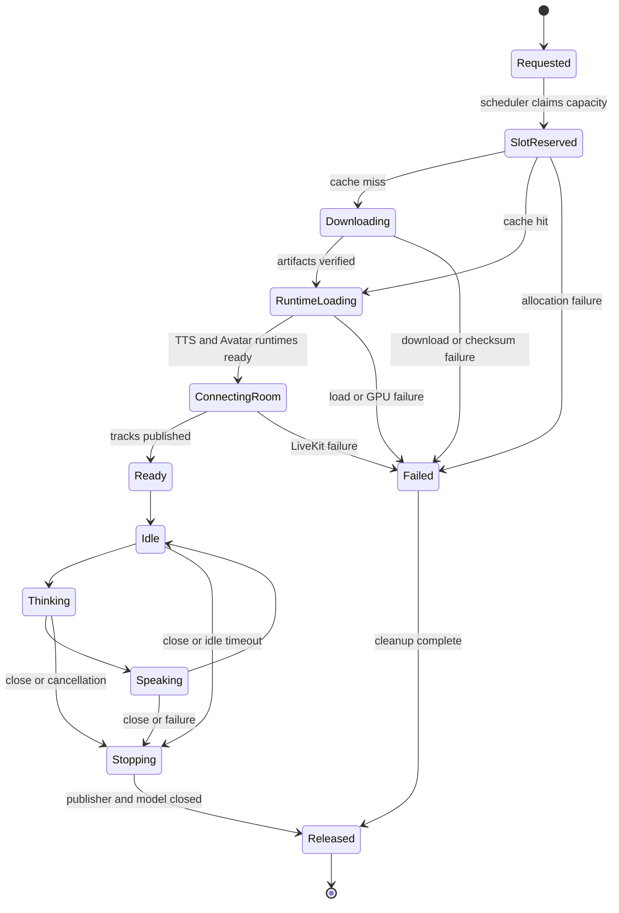

Slot không được release sau mỗi Agent turn. Nó được giữ trong vòng đời media session để duy
trì voice context, avatar temporal state, warm runtimes và stable LiveKit publisher.

## 6. Luồng Agent, TTS và lip-sync

Core vẫn là orchestrator của business turn và gom text delta thành speech segment. Core gửi
segment cùng voice configuration qua Redis tới Persona Render Worker; TTS synthesis, lip-sync,
audio pacing và LiveKit publish diễn ra trong cùng composite session.

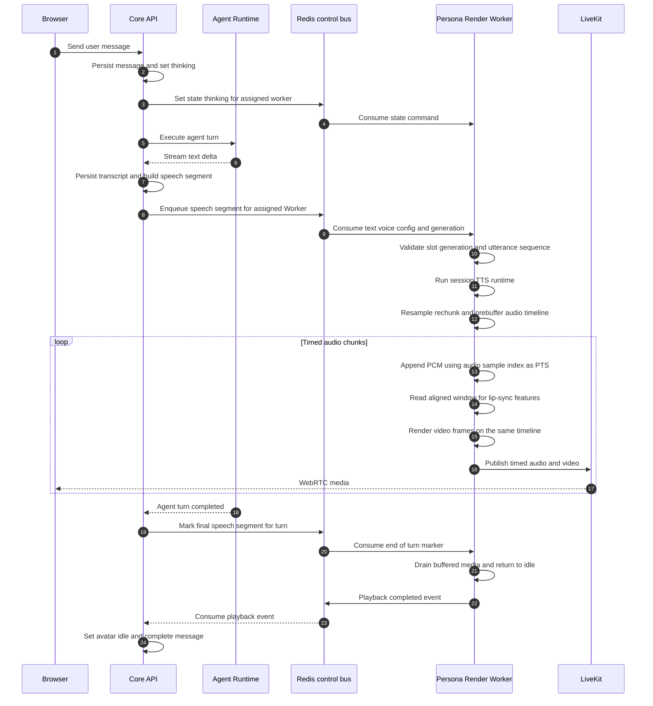

`Agent turn completed` không đồng nghĩa audio đã phát xong. Core chỉ kết thúc trạng thái
`speaking` sau `PlaybackCompleted`, nếu không UI và avatar có thể về idle trước audio.

Không cần media delivery token hoặc network audio stream nội bộ vì TTS runtime và Avatar runtime
có cùng process/slot owner. Redis ACL bảo vệ speech command; Worker vẫn kiểm tra
`session_id`, `turn_id`, `utterance_id`, sequence và slot generation trước khi synthesize.

Audio chunk contract nên có:

```text
session_id, turn_id, utterance_id
sequence
PTS and duration
sample_rate, channels, sample_format
PCM or encoded audio payload
optional phoneme or viseme timeline
end_of_utterance
```

## 7. Audio là master clock

```mermaid
flowchart LR
    Text[Speech segment]
    TTS[Session TTS runtime]
    Normalize[Resample and 20 ms rechunk]
    Audio[Multi-reader audio timeline]
    Feature[Phoneme or audio features]
    Model[Character avatar model]
    Video[Timed video frames]
    Buffer[Bounded AV buffer]
    Track[Stable LiveKit tracks]

    Text --> TTS
    TTS --> Normalize
    Normalize --> Audio
    Audio --> Feature
    Feature --> Model
    Model --> Video
    Audio --> Buffer
    Video --> Buffer
    Buffer --> Track
```

- PTS đến từ audio sample index, không lấy từ thời điểm inference hoàn thành.
- Video frame lấy PTS trên cùng timeline với audio.
- Queue phải bounded; khi render trễ thì ưu tiên drop video frame cũ thay vì kéo chậm audio.
- `utterance_id` và `sequence` chống phát lặp hoặc sai thứ tự.
- Audio timeline là single-writer/multi-reader ring buffer; LiveKit audio cursor và lip-sync
  cursor không tranh mất chunk của nhau như khi dùng chung một `asyncio.Queue`.
- Worker chỉ chuyển `speaking` sau khi đạt minimum prebuffer. Khi buffer chạm high watermark,
  TTS generator bị backpressure; PCM không được spill sang Redis.
- TTS và Avatar runtime giữ affinity với composite slot trong toàn bộ session. Turn sau vẫn dùng
  voice/avatar context hiện tại cho tới khi session release.
- TTS native sample rate được resample một lần về PCM mono 48 kHz và rechunk 20 ms, tương ứng
  960 sample mỗi LiveKit audio frame. Lip-sync reader được phép đọc window/look-ahead dài hơn
  nhưng vẫn quy chiếu về cùng sample index.
- Nếu audio buffer underrun giữa utterance, Worker phát policy event và fallback neutral/silence
  có timestamp; không reset clock. TTS có P95 real-time factor lớn hơn 1 không đạt realtime và
  phải giảm chất lượng, đổi model hoặc từ chối admission thay vì chỉ tăng buffer vô hạn.

## 8. Release slot và cleanup

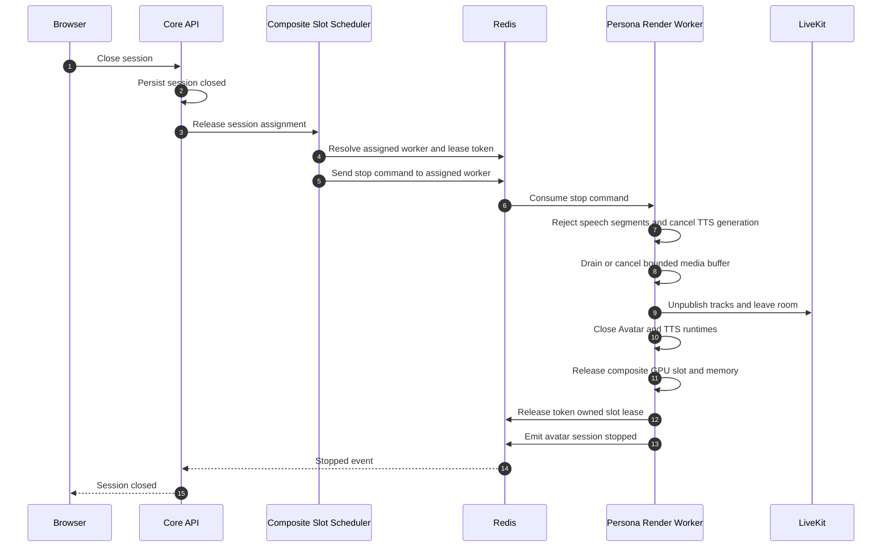

Release cũng được kích hoạt bởi model failure, load timeout, LiveKit failure, worker draining
hoặc no-participant/idle timeout. Browser disconnect không nên release ngay; cần một grace
period để hỗ trợ refresh và mất mạng tạm thời.

Nếu worker crash, renewable lease hết TTL. Reconciler dùng fencing generation để vô hiệu hóa
event từ worker cũ trước khi reschedule; không được có hai publisher hợp lệ cho cùng session.

## 9. Worker process và model runtime

Phương án mặc định:

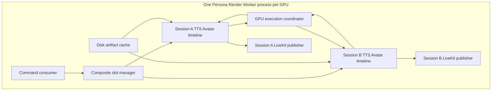

Không tạo subprocess mới theo mặc định. Worker load/unload TTS cùng Avatar runtime trong process
và dùng semaphore để giới hạn composite slot theo VRAM/compute benchmark thực tế. Model API
đồng bộ không được block event loop; adapter chạy qua dedicated inference thread/execution lane.

MVP nên serialize GPU inference có kiểm soát: lip-sync frame gần deadline được ưu tiên, sau đó
TTS chạy theo burst khi audio buffer gần low watermark. Chỉ dùng nhiều CUDA stream khi benchmark
chứng minh runtime thread-safe và không tăng P99 VRAM hoặc frame latency.

Chỉ dùng session subprocess dài hạn theo slot khi TTS/Avatar native runtime crash, leak VRAM,
block event loop hoặc có dependency xung đột. Supervisor quản lý subprocess bằng `spawn`, dùng
Unix socket cho control và shared memory ring buffer nếu cần; TTS và Avatar vẫn thuộc cùng một
logical Worker/slot. Không truyền raw frame/PCM qua Redis và không dùng `fork` sau khi CUDA đã
khởi tạo.

## 10. Timeout, lease và policy đề xuất

```env
AVATAR_SLOT_LEASE_SECONDS=30
AVATAR_SLOT_RENEW_INTERVAL_SECONDS=10
AVATAR_MODEL_DOWNLOAD_TIMEOUT=120
AVATAR_MODEL_LOAD_TIMEOUT=120
TTS_MODEL_LOAD_TIMEOUT=120
AVATAR_SESSION_START_TIMEOUT=180
TTS_AUDIO_PREBUFFER_MS=300
TTS_AUDIO_BUFFER_MAX_MS=2000
AVATAR_VIDEO_BUFFER_MAX_MS=120
AVATAR_NO_PARTICIPANT_GRACE_SECONDS=60
AVATAR_SESSION_IDLE_TIMEOUT=900
AVATAR_MODEL_CACHE_DIR=/var/cache/personaforge/models
AVATAR_MODEL_CACHE_MAX_GB=100
```

Giá trị thực tế phải lấy từ composite benchmark. Scheduler reserve tổng capacity trước khi tải
TTS/Avatar runtimes, renew lease trong toàn bộ quá trình load, và cleanup idempotent khi timeout
hoặc cancel đến giữa chừng.

## 11. Worker registry và GPU scheduler

Phạm vi được chia rõ để không biến định hướng HA tương lai thành dependency của MVP:

| Giai đoạn | Phạm vi |
|---|---|
| MVP | Một Scheduler/Registration Service, một Redis, worker auto-register, dynamic ACL credential, worker giao tiếp Redis trực tiếp |
| Mở rộng | Nhiều GPU worker trên một hoặc nhiều host, capability scheduling và resource profiling |
| HA tương lai | Scheduler replicas, Redis Sentinel/Cluster, multi-AZ failover và Worker Control Service |

Scheduler được thiết kế theo registry dùng chung nên có thể cấp phát worker ở nhiều máy vật lý.
Mỗi GPU hoặc MIG instance nên chạy một Persona Render Worker process riêng và kết nối outbound
tới Redis, object storage và LiveKit. Core không cần mở kết nối trực tiếp vào GPU host.

Sơ đồ dưới đây là target multi-host. MVP có thể chỉ có một nhánh worker và một Scheduler:

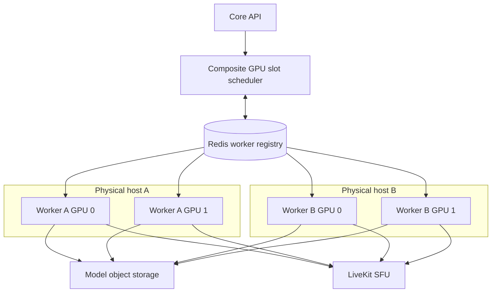

### 11.1. Định danh worker và GPU

`gpu_index=0` chỉ có ý nghĩa trong một host và không được dùng làm định danh toàn cục. Worker
ID nên chứa host, GPU UUID và instance ID:

```text
worker_id = {host_id}:{gpu_uuid}:{worker_instance_id}
```

Ví dụ worker registration:

```json
{
  "worker_id": "gpu-host-a:GPU-abc123:persona-1",
  "host_id": "gpu-host-a",
  "gpu_uuid": "GPU-abc123",
  "region": "hcm-1",
  "zone": "hcm-1a",
  "worker_type": "persona-render",
  "avatar_runtime": "tensorrt-10.0",
  "tts_runtime": "personaforge-tts-2.0",
  "cuda_version": "12.4",
  "compute_capability": "8.9",
  "total_vram_mb": 23034,
  "supported_avatar_models": ["personaforge-avatar-v2"],
  "supported_tts_models": ["personaforge-tts-v2"],
  "supported_voice_modes": ["full-model", "adapter", "embedding"],
  "supported_precisions": ["fp16"],
  "max_slots": 4
}
```

### 11.2. Worker tự đăng ký và tự sinh ID

Worker không đăng ký vào một Scheduler replica cụ thể. Trong MVP, Registration Service xác
thực bootstrap token, tạo Redis ACL credential động và ghi registration vào Worker Registry.
Sau đó worker dùng credential vừa nhận để giao tiếp trực tiếp với Redis.

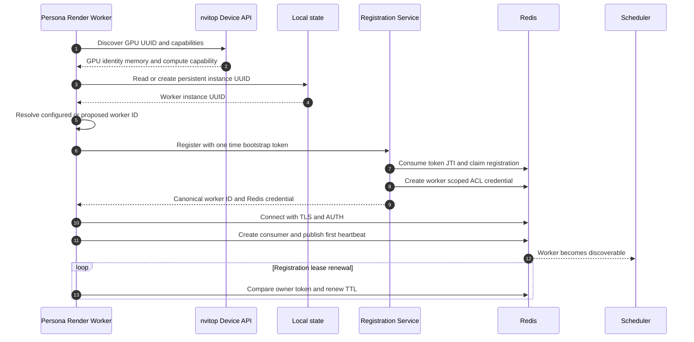

Thứ tự resolve ID:

1. Nếu có `AVATAR_WORKER_ID`, worker đề xuất chính ID đã cấu hình.
2. Nếu không có, đọc `AVATAR_HOST_ID`; nếu thiếu thì tạo host fingerprint ổn định.
3. Lấy GPU UUID từ `nvitop.Device.uuid()`, không dùng GPU index làm định danh toàn cục.
4. Đọc instance UUID theo GPU từ persistent state; nếu chưa có thì sinh và ghi lại.
5. Ghép thành `{host_id}:{gpu_uuid}:{worker_instance_id}`.
6. Registration Service chuẩn hóa, kiểm tra collision và trả canonical worker ID.

Ví dụ:

```text
gpu-host-a:GPU-abc123:96f642f8
```

Host fingerprint có thể là hash rút gọn của machine ID. Không nên chỉ dùng container hostname
vì hostname có thể thay đổi sau mỗi lần recreate. Instance UUID nằm trên volume bền vững và
được tách theo GPU UUID:

```env
AVATAR_WORKER_ID=
AVATAR_HOST_ID=
AVATAR_WORKER_STATE_DIR=/var/lib/personaforge/avatar-worker
AVATAR_WORKER_REGISTRATION_TTL_SECONDS=15
AVATAR_WORKER_HEARTBEAT_INTERVAL_SECONDS=5
```

Nếu không có persistent volume, worker sinh boot UUID và vẫn hoạt động, nhưng restart sẽ tạo ID
mới. Registration cũ tự hết TTL; lựa chọn này phù hợp container ngắn hạn nhưng mất cache
affinity và continuity của worker identity.

Mỗi lần process start tạo `boot_id` và `owner_token` ngẫu nhiên. Registration lưu:

```text
avatar:worker:{worker_id}:registration
    owner_token
    boot_id
    registered_at
    lease_expires_at
```

Policy collision:

- ID do người vận hành cấu hình: fail startup nếu owner hiện tại còn sống.
- ID tự sinh bị trùng: Registration Service cấp instance suffix mới.
- Registration hết TTL: process mới được claim bằng owner token mới.
- Renew và deregister phải compare owner token cùng boot ID.

Worker chỉ ready sau khi registration, Redis TLS/AUTH, command consumer và heartbeat đầu tiên
đều thành công. Mất registration lease khiến worker chuyển draining, từ chối session mới và
dừng session khi slot lease không thể renew; không fallback sang local registry.

Shutdown graceful:

```text
mark draining
stop accepting new assignments
finish or stop active sessions within grace timeout
release session slot leases
revoke dynamic Redis credential
compare and delete registration
close Redis and model runtime
```

Worker crash không có deregister; registration TTL loại worker khỏi Scheduler và credential
cleanup job thu hồi ACL user còn sót.

### 11.3. Bootstrap token và dynamic Redis ACL credential

Worker credential tách hoàn toàn khỏi user JWT và Agent delegation token:

| Credential | Mục đích | Thời hạn |
|---|---|---|
| Bootstrap JWT | Gọi Registration API lần đầu | Một lần, 5 đến 15 phút |
| Worker management token | Re-register và rotate credential qua các lần restart | Dài hơn, opaque và rotation-on-use |
| Redis ACL username/password | AUTH vào Redis và dùng worker namespace | Ngắn hạn, rotate được |
| Owner token | Fencing process đang sở hữu registration | Bằng registration lease |
| Slot lease token | Sở hữu một composite persona slot | Bằng session slot lease |

Redis OSS không xác thực JWT trực tiếp. “Token động” trong đường Redis là username/password
ngẫu nhiên do Registration Service tạo bằng Redis ACL. Bootstrap JWT chỉ dùng với Registration
API qua HTTPS.

#### Enrollment và cấp credential

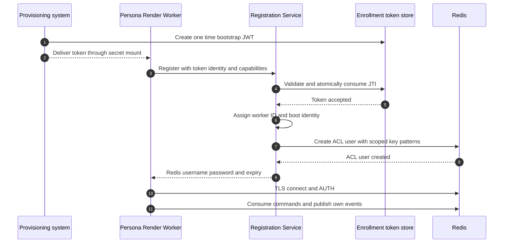

Bootstrap JWT nên ký bất đối xứng bằng EdDSA hoặc RS256:

```json
{
  "iss": "personaforge-control",
  "aud": "personaforge-render-worker-enrollment",
  "sub": "gpu-host-a",
  "jti": "enrollment-uuid",
  "scope": ["worker:register"],
  "cluster_id": "development",
  "host_id": "gpu-host-a",
  "allowed_worker_type": "persona-render",
  "max_gpu_count": 4,
  "iat": 1785891000,
  "exp": 1785891300
}
```

Registration Service kiểm tra `iss`, `aud`, `exp`, `nbf` nếu có, `jti`, scope, cluster,
worker type và host binding. `jti` được consume atomically nên token replay bị từ chối. Raw
token không được log hoặc truyền qua query string. Production cấp token qua Docker Secret,
Kubernetes Secret hoặc secret manager; `.env` chỉ dành local.

Redis username riêng cho từng process incarnation:

```text
pf-avatar:{worker_id}:{boot_id}
```

Password sinh ngẫu nhiên tối thiểu 256 bit, chỉ trả một lần qua HTTPS và không ghi log. Worker
giữ credential trong memory hoặc secret file permission `0600`, rồi kết nối bằng `rediss://`.

#### Token được phát ở đâu và vào thời điểm nào

Bootstrap token do PersonaForge Control Plane phát, không phải user JWT và không do Worker tự
ký. API nội bộ đề xuất:

```http
POST /internal/worker-enrollment-tokens
Authorization: Bearer <operator-access-token>
```

Operator token cần scope riêng như `workers:enroll`; user sở hữu chat session không có scope
này. Request:

```json
{
  "worker_type": "persona-render",
  "cluster_id": "development",
  "host_id": "gpu-host-a",
  "max_gpu_count": 2,
  "ttl_seconds": 600
}
```

Response chỉ hiển thị bootstrap token một lần. Token issuer dùng signing key và audience riêng,
không tái sử dụng secret của browser JWT hoặc Agent delegation token. Token Store chỉ lưu
metadata/hash cần thiết cùng audit actor, không lưu raw bearer token.

Bootstrap token được tạo ngay trước:

- enrollment GPU host/worker mới lần đầu;
- khôi phục khi persistent worker identity bị mất;
- enrollment lại sau revoke;
- chuyển worker sang cluster hoặc trust domain khác.

Không tạo bootstrap token theo chat session, model load hoặc restart thông thường. Nếu token
hết hạn trước khi đăng ký, Worker fail readiness và operator/deployment controller cấp token
mới; không fallback sang anonymous registration hay shared Redis password.

#### First boot, restart và management token

Enrollment thành công trả thêm một opaque management token ngẫu nhiên. Token này được bind với
stable `worker_id` và một token family, không bind cứng với `boot_id`, nên dùng được để tạo
process incarnation mới sau restart. Server chỉ lưu hash của token.

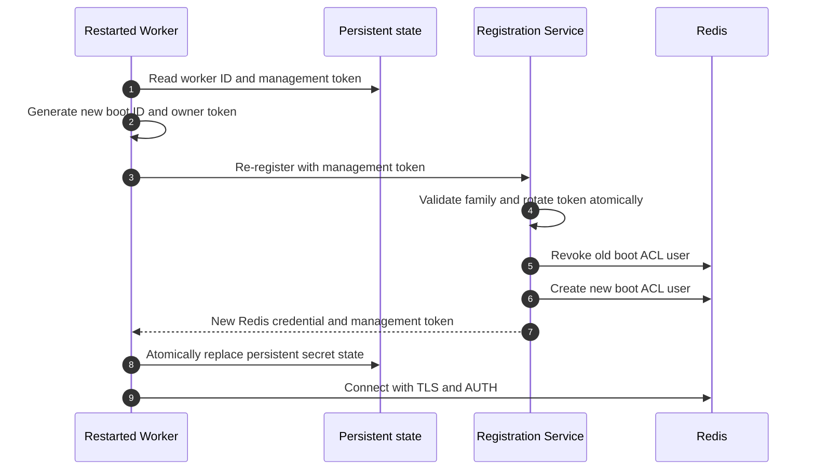

Worker state tối thiểu:

```text
worker_id
worker_instance_id
management_token
management_token_family_id
identity_generation
```

File được ghi atomic bằng temporary file và rename, permission `0600`. Redis password theo
boot có thể chỉ giữ trong runtime secret file; không dùng lại sau restart. Nếu persistent state
mất hoặc management token bị revoke/reuse, cần bootstrap token mới.

Management token là rotation-on-use tương tự refresh-token family: request hợp lệ phát token
mới và vô hiệu token cũ. Reuse token cũ với request khác revoke family để hạn chế credential
theft. Runtime phải serialize re-register/rotate request để không tự tạo false-positive reuse.

#### Registration idempotency và mất response

Consume token, tạo Redis ACL user và trả secret không nằm trong một transaction Redis thông
thường. Registration dùng `registration_request_id` do Worker sinh và một state machine:

```text
ISSUED -> CLAIMING -> ACTIVE
                   -> FAILED_CLEANED
ISSUED -> EXPIRED
ACTIVE -> REVOKED
```

Worker gửi cùng `registration_request_id` khi retry. Registration Service lưu một result
envelope được mã hóa bằng ephemeral public key Worker gửi trong request:

```text
registration:result:{token_jti}:{registration_request_id}
    canonical worker ID
    encrypted Redis credential
    encrypted management token
    expiry
```

Nếu response HTTPS bị mất sau khi token đã consume, retry cùng token và request ID trả lại đúng
encrypted result cũ. Cùng token nhưng request ID khác bị coi là replay và từ chối. Envelope hết
TTL sau khi Worker xác nhận hoặc quá recovery window.

Thứ tự saga:

```text
claim token JTI for request ID
create scoped ACL user
persist encrypted result and mark ACTIVE
return result
```

Nếu ACL creation hoặc result persistence thất bại, compensating action xóa ACL user vừa tạo và
đưa request về trạng thái có thể retry an toàn. Registration Service không bao giờ phát hai ACL
identity khác nhau cho cùng request ID.

#### Runbook Docker Compose và Kubernetes

Docker Compose local có thể dùng CLI quản trị dự kiến sau đây; command chỉ là contract mục tiêu,
chưa tồn tại trong source hiện tại:

```bash
personaforge-admin workers issue-token \
  --worker-type persona-render \
  --host-id gpu-host-a \
  --ttl 10m
```

CLI gọi internal enrollment endpoint, ghi token vào Docker Secret hoặc file secret mount, rồi
worker đọc `AVATAR_WORKER_BOOTSTRAP_TOKEN_FILE`. Local development có thể dùng `.env`, nhưng
không áp dụng cách này ở production.

Kubernetes flow mục tiêu:

```text
deployment controller requests bootstrap token
controller creates a short lived Kubernetes Secret
Secret is mounted read only into the Worker Pod
Worker enrolls and persists management identity on encrypted storage
controller deletes the consumed bootstrap Secret
```

Autoscaler tương lai là provisioning actor và tự thực hiện flow này. Bootstrap Secret đã
consume có thể xóa ngay; raw token không được đưa vào Pod annotation, log hoặc command line.

#### Worker-scoped key namespace và ACL

Mọi key worker truy cập phải chứa `worker_id` để ACL không cần hiểu assignment động:

```text
avatar:commands:{worker_id}
avatar:events:{worker_id}:{session_id}
avatar:worker:{worker_id}:heartbeat
avatar:worker:{worker_id}:telemetry
avatar:worker:{worker_id}:registration
avatar:worker:{worker_id}:leases:{session_id}
```

Worker chỉ có quyền trên namespace `avatar:*` của chính `worker_id` và không có quyền trên
scheduler/enrollment namespace. Speech segment là control command nhỏ trong
`avatar:commands:{worker_id}`; PCM sinh ra sau đó chỉ tồn tại trong process/session runtime.

ACL policy khái niệm:

```text
read  avatar:commands:{worker_id}
write avatar:events:{worker_id}:*
write avatar:worker:{worker_id}:heartbeat
write avatar:worker:{worker_id}:telemetry
renew avatar:worker:{worker_id}:leases:*
deny  all other worker and scheduler namespaces
```

Command allowlist chỉ gồm operation worker thực sự cần, ví dụ `PING`, `XREADGROUP`, `XACK`,
`XADD`, `HSET`, `HGET`, `PEXPIRE` và `PTTL`. Không cấp `+@all`, `ACL`, `CONFIG`, `FLUSHALL`,
`FLUSHDB`, `KEYS`, `MIGRATE`, `MODULE` hoặc `SHUTDOWN`. Nếu lease dùng Lua, chỉ cho phép
operation/script đã kiểm soát và vẫn giới hạn key pattern; không cấp arbitrary scripting rộng.

Redis ACL hỗ trợ command rules, key pattern và read/write key pattern. Tham khảo tài liệu chính
thức: [Redis ACL](https://redis.io/docs/latest/operate/oss_and_stack/management/security/acl/)
và [ACL SETUSER](https://redis.io/docs/latest/commands/acl-setuser/).

#### Expiry, rotation và revoke

Redis OSS ACL user/password không có TTL giống Redis key, vì vậy Registration Service lưu
`expires_at` và cleanup credential ở bên ngoài Redis ACL:

```text
redis_username
worker_id
boot_id
issued_at
expires_at
status
```

Khi revoke, chỉ đặt ACL user `off` là chưa đủ vì connection đã authenticate vẫn tiếp tục hoạt
động. Control plane dùng `ACL DELUSER` để xóa user và ngắt connection, hoặc kết hợp `CLIENT
KILL USER`. Đây là hành vi được mô tả trong tài liệu
[ACL SETUSER](https://redis.io/docs/latest/commands/acl-setuser/).

Rotation không gián đoạn:

```text
add a new password to the same ACL user
deliver it through authenticated Registration API
worker opens and verifies a new Redis connection
remove the old password
close the old connection
```

Redis ACL cho phép một user có nhiều active password nên hỗ trợ overlap trong lúc rotation.
Registration API dùng management token ràng buộc với stable `worker_id` và token family để
worker xin rotate sau bootstrap. Request runtime vẫn mang `boot_id` và owner token hiện tại để
fencing đúng process. Management token không dùng để AUTH Redis và được rotate khi sử dụng.

Khi credential nghi bị lộ:

1. Loại registration khỏi Scheduler candidate set.
2. Đánh dấu worker draining và dừng cấp session mới.
3. Xóa Redis ACL user để ngắt connection.
4. Revoke/kick LiveKit publisher nếu worker không hợp tác.
5. Reschedule bằng fencing generation mới nếu policy cho phép.
6. Ghi audit event cho enroll, rotate và revoke.

Redis phải bật TLS/auth và không expose trực tiếp ra Internet. Registration Service giữ một
Redis admin credential riêng trong secret manager; worker không bao giờ nhận credential này.

Cấu hình thiết kế MVP:

```env
AVATAR_REGISTRATION_URL=https://control.internal/workers/register
AVATAR_WORKER_BOOTSTRAP_TOKEN_FILE=/run/secrets/avatar_worker_bootstrap
AVATAR_REDIS_CA_FILE=/run/secrets/redis_ca.crt
AVATAR_REDIS_CREDENTIAL_FILE=/run/personaforge/redis-credential.json
AVATAR_REDIS_CREDENTIAL_RENEW_BEFORE_SECONDS=600
```

Worker Control Service với gRPC/mTLS, workload identity/SPIRE và CA multi-region là hướng nâng
cấp tương lai. MVP không phụ thuộc các thành phần đó; boundary registration và worker-scoped
namespace được giữ để có thể thay transport sau này.

### 11.4. Heartbeat và tải động

Target Worker Master đọc telemetry bằng public API của `nvitop`, không spawn command
`nvidia-smi`. Adapter lấy host CPU/RAM qua `nvitop.host`, GPU inventory/VRAM/utilization/nhiệt
độ/power qua `Device`, và tài nguyên từng Composite Child qua `Device.processes()`, `GpuProcess`
cùng `HostProcess(pid)`. Domain/Scheduler chỉ nhận DTO trung lập. Worker heartbeat mỗi vài giây:

```json
{
  "worker_id": "gpu-host-a:GPU-abc123:persona-1",
  "status": "ready",
  "draining": false,
  "active_slots": 2,
  "reserved_slots": 1,
  "active_speaking_slots": 1,
  "reserved_gpu_duty_cycle": 0.72,
  "host_cpu_utilization_percent": 37.2,
  "host_ram_used_mb": 65536,
  "host_ram_available_mb": 61440,
  "gpu_utilization_percent": 67,
  "gpu_memory_used_mb": 14120,
  "gpu_memory_free_mb": 8914,
  "gpu_temperature_celsius": 65,
  "gpu_power_watts": 61,
  "encoder_utilization_percent": 31,
  "render_queue_depth": 0,
  "tts_queue_depth": 0,
  "audio_underruns_total": 0,
  "observed_fps": 25,
  "heartbeat_at": "2026-08-04T10:00:00Z"
}
```

Registry đặt TTL cho heartbeat. Worker quá TTL, đang draining hoặc báo lỗi không được nhận
session mới. Metrics tức thời phục vụ health và scoring; chúng không thay thế reservation
accounting vì nhiều scheduler có thể nhìn thấy cùng một lượng VRAM trống.

### 11.5. Composite resource manifest

Mỗi cặp TTS/Avatar runtime cần manifest tạo từ composite benchmark, không suy đoán VRAM bằng
cách cộng kích thước weights hoặc cộng hai benchmark độc lập:

```json
{
  "avatar_model_id": "luna-avatar-v3",
  "avatar_checksum": "sha256:avatar123",
  "tts_model_id": "luna-tts-v2",
  "tts_checksum": "sha256:tts456",
  "voice_mode": "full-model",
  "runtime": "tensorrt-10.0",
  "precision": "fp16",
  "minimum_compute_capability": "8.0",
  "profiles": {
    "640x360@25": {
      "steady_vram_mb": 11800,
      "peak_vram_mb": 13200,
      "speaking_gpu_duty_cycle_p95": 0.58,
      "tts_realtime_factor_p95": 0.31
    },
    "1280x720@25": {
      "steady_vram_mb": 14200,
      "peak_vram_mb": 15780,
      "speaking_gpu_duty_cycle_p95": 0.72,
      "tts_realtime_factor_p95": 0.36
    }
  }
}
```

Manifest ban đầu là estimate. Resource profiler cập nhật observed statistics theo đúng tuple:

```text
Avatar model checksum
TTS model or base-model checksum
voice adapter or embedding version
GPU model and compute capability
TTS and Avatar runtime versions
precision
resolution and FPS
```

Phải benchmark lúc TTS inference xen kẽ lip-sync render vì workspace peak và compute contention
không tuyến tính. Không gộp benchmark L4 với A10/A100.

Resource manifest phải tách phần shared-resident và per-session incremental:

```text
worker overhead
shared TTS base weights if voice_mode is adapter or embedding
per-session TTS voice context
per-session Avatar runtime
overlapping TTS and lip-sync workspace peak
LiveKit and encoder headroom
```

Với `voice_mode=full-model`, toàn bộ TTS VRAM thuộc slot. Với adapter/embedding, session đầu
tiên có thể kích hoạt shared base model; session sau chỉ reserve incremental voice context.
Worker quản lý model-residency reference count và chỉ unload shared base khi không còn slot dùng.

Admission accounting:

```text
worker_overhead
+ resident_shared_models
+ pending_shared_model_activation
+ sum(active_and_reserved_slot_incremental_peak)
<= schedulable_vram
```

Shared-model activation cũng phải atomic để hai provision đồng thời không cùng tính thiếu hoặc
load lặp base model.

### 11.6. Filter, score và atomic reservation

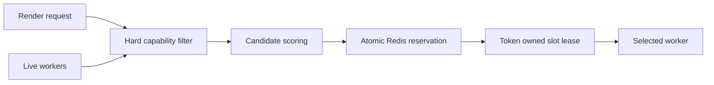

Hard filter loại worker khi:

- heartbeat quá hạn, không ready hoặc đang draining;
- TTS/Avatar runtime, model type, precision hay compute capability không tương thích;
- không đủ slot, schedulable VRAM hoặc compute budget đã reserve;
- không đáp ứng resolution/FPS;
- region, tenant isolation hoặc data residency không phù hợp.

Candidate còn lại được score theo affinity của cả TTS/Avatar artifact cache, available capacity,
queue depth, GPU load, LiveKit region, estimated startup time và recent failure rate.

Reservation phải atomic bằng Redis Lua script hoặc transaction:

```text
resident_shared_vram + pending_shared_activation_vram
  + active_slot_incremental_vram + reserved_slot_incremental_vram
  + requested_incremental_peak_vram <= schedulable_vram
active_slots + reserved_slots < max_slots
active_compute + reserved_compute + requested_compute <= compute_budget
```

`schedulable_vram` nhỏ hơn VRAM vật lý để chừa CUDA context, encoder, allocator fragmentation
và safety margin. Không được cấp phát chỉ bằng điều kiện `free_vram > estimated_vram`.

Kết quả reservation:

```json
{
  "session_id": "session-123",
  "worker_id": "gpu-host-a:GPU-abc123:persona-1",
  "slot_id": "slot-3",
  "lease_token": "random-uuid",
  "generation": 12,
  "reserved_vram_mb": 17360,
  "reserved_gpu_duty_cycle": 0.72,
  "expires_at": "2026-08-04T10:00:30Z"
}
```

Worker renew lease trong cả download, TTS/Avatar load, room connect và render. `generation` là
fencing token; Core và event consumer bỏ qua event có generation cũ sau reschedule.

Thuật toán target chi tiết cho candidate per-GPU, hard filter, scoring, atomic retry và local
admission được chuẩn hóa tại
[`worker-master-child-grpc.md`, mục 8](worker-master-child-grpc.md#8-multi-gpu-inventory-và-assignment).

## 12. Tracking VRAM và GPU utilization theo composite session

Mục tiêu tracking là trả lời được bốn câu hỏi:

1. Cặp TTS/Avatar runtime này cần bao nhiêu VRAM ở trạng thái steady và peak?
2. TTS và lip-sync chiếm bao nhiêu GPU time khi idle, thinking và speaking?
3. Cấu hình resolution/FPS nào làm TTS chậm hơn realtime hoặc giảm render FPS?
4. Reservation lần sau phải là bao nhiêu để tránh OOM và noisy-neighbor throttling?

### 12.1. Ba lớp số liệu

| Lớp | Nguồn | Độ chính xác và mục đích |
|---|---|---|
| Host | `nvitop.host` | CPU, load average, RAM/swap tổng/used/available |
| GPU/worker | `nvitop.Device` | VRAM, utilization, power, temperature, clocks, encoder/decoder và PCIe |
| Process | `GpuProcess` + `HostProcess(pid)` | GPU memory/SM và host RSS/CPU theo managed Child PID |
| Composite session | TTS/Avatar instrumentation và CUDA events | Load delta, peak, GPU time, TTS RTF, FPS, buffer và queue delay |

`nvitop` dùng thông tin NVML để quy thuộc GPU memory/utilization tới process, nhưng vẫn không biết
tensor nào thuộc session nào.
Nếu nhiều composite session nằm trong cùng một Python process, `process_used_vram` không thể
chia chính xác cho từng session chỉ bằng process accounting. Worker phải instrument tại boundary
load/render hoặc chạy subprocess-per-slot khi yêu cầu billing/isolation chính xác.

### 12.2. Instrument một composite session

Worker tạo `PersonaResourceTracker` cùng lifecycle của composite slot:

```text
before load
  capture worker and process VRAM baseline

during TTS and Avatar load
  sample process VRAM and record composite load peak

after load
  record steady VRAM and model startup duration

for every TTS or render batch
  CUDA event start and end
  inference latency
  GPU execution time
  input audio duration
  generated audio duration and buffer level
  generated frame count
  dropped frame count

on release
  record VRAM before and after unload
  detect unreleased or fragmented memory
```

Các metric cốt lõi:

```text
avatar_model_load_seconds
tts_model_load_seconds
avatar_model_vram_steady_bytes
avatar_model_vram_peak_bytes
persona_session_vram_peak_bytes
persona_session_gpu_time_seconds_total
tts_inference_seconds
tts_realtime_factor
tts_audio_buffer_seconds
tts_audio_underruns_total
avatar_render_inference_seconds
avatar_render_realtime_factor
avatar_render_fps
avatar_render_frames_dropped_total
avatar_render_queue_delay_seconds
avatar_audio_video_drift_seconds
persona_model_unreleased_vram_bytes
persona_session_oom_total
```

GPU utilization phần trăm không cộng được một cách đáng tin cậy giữa các session. Để quy
thuộc compute, worker đo CUDA execution time quanh từng model call:

```text
session_gpu_duty_cycle = session_gpu_time_in_window / window_duration
```

Ví dụ session dùng 420 ms GPU execution trong cửa sổ 1 giây có duty cycle xấp xỉ 42%.
Khi model chạy batch nhiều session, GPU time được gắn cho batch rồi phân bổ theo frame hoặc
sample count và phải đánh dấu là estimate.

### 12.3. Theo dõi theo phase

Một composite session có profile rất khác giữa idle và speaking. Tracker phải gắn phase vào
sample:

```text
loading
idle
thinking
speaking
stopping
```

Scheduler quan tâm nhất tới `speaking` peak vì TTS và lip-sync chạy xen kẽ. Không được dùng idle
utilization thấp để kết luận GPU còn đủ compute cho một session mới.

Resource profile được tổng hợp theo time window:

```json
{
  "avatar_model_id": "luna-avatar-v3",
  "avatar_checksum": "sha256:avatar123",
  "tts_model_id": "luna-tts-v2",
  "tts_checksum": "sha256:tts456",
  "voice_mode": "full-model",
  "gpu_name": "NVIDIA L4",
  "runtime": "tensorrt-10.0",
  "precision": "fp16",
  "resolution": "1280x720",
  "fps": 25,
  "sample_count": 640,
  "vram_peak_mb": {
    "p50": 9012,
    "p95": 9280,
    "p99": 9410
  },
  "speaking_gpu_duty_cycle": {
    "p50": 0.31,
    "p95": 0.47,
    "p99": 0.55
  },
  "render_fps_p95": 24.9,
  "inference_ms_p95": 31.2,
  "tts_realtime_factor_p95": 0.36,
  "audio_underrun_count": 0,
  "oom_count": 0
}
```

### 12.4. Reservation dựa trên observed profile

VRAM reservation nên lấy giá trị lớn nhất giữa manifest và observed peak:

```text
base = max(composite_manifest_peak_vram, observed_composite_p99_peak_vram)
reservation = base + allocator_margin + safety_margin
```

Compute admission dùng observed speaking duty cycle:

```text
sum(reserved_speaking_gpu_duty_cycle) <= configured_compute_budget
```

Ví dụ GPU chỉ cho reserve 85% compute để giữ headroom cho spike, encoder và jitter. Một session
cần P95 duty cycle 45% thì GPU không nên nhận thêm hai session tương tự dù vẫn còn VRAM.

Sau OOM, worker phải:

1. Cleanup composite TTS/Avatar runtime và release lease an toàn.
2. Báo event có model/config/GPU profile và memory snapshot.
3. Tăng failure penalty cho candidate tương ứng.
4. Không retry ngay trên cùng worker với cùng reservation.
5. Đánh dấu resource profile cần re-benchmark hoặc tăng estimate.
6. Có thể fallback xuống resolution/FPS thấp hơn nếu policy cho phép.

### 12.5. Lưu từng heartbeat

> Trạng thái triển khai: Worker hiện ghi đồng thời latest snapshot có TTL và worker-scoped Redis
> Stream. Control Telemetry Ingestor consumer-group ghi idempotent vào PostgreSQL, chỉ ACK sau
> transaction thành công, reclaim pending entry, đưa poison event vào DLQ, chạy retention và
> aggregate profile định kỳ. Media/Child không có PostgreSQL credential và không chờ analytics.

Mỗi heartbeat hợp lệ phải được lưu trước khi dùng cho phân tích lịch sử, nhưng storage được tách
theo mục đích:

| Dữ liệu | Storage | Retention | Mục đích |
|---|---|---|---|
| Snapshot mới nhất của worker/GPU | Redis key có TTL | 2–3 lần heartbeat TTL | Filter và score realtime |
| Telemetry ingest buffer | Redis Stream | 1–24 giờ, consumer ACK sau DB insert | Chống mất mẫu khi PostgreSQL chậm |
| Raw GPU heartbeat samples | PostgreSQL indexed table; partition là bước production | 7–30 ngày | Điều tra spike, OOM và capacity trend |
| Raw composite/process samples | PostgreSQL indexed table; partition là bước production | 7–30 ngày | Attribution theo avatar/voice/session |
| Resource profile P50/P95/P99 | PostgreSQL | Dài hạn, versioned | Input ổn định cho Scheduler |
| Active reservation counters | Redis atomic keys | Theo lease lifecycle | Chống over-allocation |

Không lưu lịch sử heartbeat vào process memory và không cấp PostgreSQL credential cho Master.
Master publish sample vào worker-scoped Redis Stream; Telemetry Ingestor của Control batch insert
PostgreSQL và chỉ `XACK` sau khi insert idempotent thành công. In-process batch chỉ là buffer có
giới hạn, không phải source of truth. Snapshot Redis và media loop không chờ analytics writer.
Nếu PostgreSQL tạm lỗi, pending entry được reclaim; nếu backlog vượt retention/capacity, hệ thống
ưu tiên render, phát alert và metric dropped sample thay vì làm nghẽn media.

Schema raw GPU heartbeat tối thiểu:

```text
gpu_heartbeat_samples
  worker_id
  boot_id
  identity_generation
  gpu_uuid
  sampled_at
  received_at
  total_vram_mb
  used_vram_mb
  free_vram_mb
  gpu_utilization
  memory_utilization
  encoder_utilization
  temperature_c
  power_watts
  active_children
  reserved_vram_mb
  reserved_compute
```

Unique key `(worker_id, boot_id, gpu_uuid, sampled_at)` giúp ingest idempotent. Dùng
`sampled_at` để phân tích hardware và `received_at` để phát hiện clock skew/network delay.
Heartbeat interval production nên ở mức 2–5 giây; lưu mỗi heartbeat không đồng nghĩa sample ở
tần suất frame hoặc inference batch.

### 12.6. Attribution theo nhân vật và giọng đọc

GPU heartbeat là tổng của cả card nên không thể tự kết luận avatar/voice nào tạo ra peak khi
nhiều Child cùng chạy. Mỗi Composite Child gửi thêm sample theo PID/session/generation:

```text
composite_resource_samples
  session_id
  generation
  child_id
  worker_id
  gpu_uuid
  process_id
  process_identity_matches
  process_status
  sampled_at
  phase
  character_id
  avatar_model_id
  avatar_revision
  voice_id
  tts_model_id
  tts_revision
  runtime_version
  precision
  resolution
  fps
  process_cpu_utilization
  process_host_rss_bytes
  process_host_memory_percent
  process_vram_mb
  process_gpu_memory_percent
  process_gpu_sm_utilization
  process_gpu_memory_utilization
  process_gpu_encoder_utilization
  process_gpu_decoder_utilization
  reserved_vram_mb
  reserved_gpu_duty_cycle
  composite_baseline_vram_mb
  attributed_vram_mb
  gpu_execution_ms
  tts_realtime_factor
  render_fps
  av_drift_ms
  oom
```

Với subprocess-per-composite, `nvitop.Device.processes()` map PID sang `GpuProcess` nên
attribution tương đối rõ:

```text
attributed_vram = process_vram - process_baseline_before_model_load
session_peak = max(process_vram during loading and speaking)
```

Mỗi hàng là đúng một hardware snapshot của một Composite tại `sampled_at`. Ba nhóm số liệu không
được trộn lẫn:

- `reserved_vram_mb` và `reserved_gpu_duty_cycle`: capacity Scheduler đã giữ, không phải usage;
- các cột `process_*`: nvitop/NVML đo thực tế theo `pid`, chỉ hợp lệ khi
  `process_identity_matches=true`;
- `render_fps`, `av_drift_ms`, `gpu_execution_ms`, `tts_realtime_factor`: chất lượng runtime.

Nếu fake runtime không tạo CUDA context, `process_vram_mb` phải là `NULL` hoặc `0` tùy NVML trả
về, trong khi reservation vẫn có thể là 4096 MB. Không dùng reservation để điền thay usage thực.
`attributed_vram_mb` bằng `max(0, process_vram_mb - composite_baseline_vram_mb)`; với subprocess
dành riêng và chưa có baseline thì toàn bộ `process_vram_mb` được quy thuộc cho Composite.

Scheduler vẫn reserve cả CUDA context/encoder/session overhead; không chỉ reserve delta của
weights. GPU heartbeat được join theo `gpu_uuid` và time window để đối chiếu:

```text
gpu_used_vram ~= system_baseline
              + sum(child_process_vram)
              + unattributed_driver_or_external_vram
```

Nếu sai số `unattributed` vượt threshold, GPU bị giảm điểm hoặc tạm ngừng nhận session mới. Với
shared process/executor, process VRAM không còn phân tách theo session; runtime phải instrument
allocation/model refcount và đánh dấu sample là `estimated` thay vì giả vờ chính xác.

### 12.7. Tổng hợp peak và fallback ban đầu

Resolver hiện chạy theo từng candidate GPU và dùng thứ tự:

```text
exact observed profile của GPU
-> compatible/learning profile với margin
-> persona/avatar/TTS/voice config trong PostgreSQL
-> platform conservative default
```

Request từ Core chỉ được dùng như một floor bổ sung. Nó không thể hạ thấp
`manifest_peak_vram_mb`, duty cycle hoặc minimum compute capability lưu trong DB. Lease lưu
`resource_source` và `resource_profile_id` để audit quyết định cấp phát.

Config DB khớp theo `character_id`, avatar model/revision, `voice_id`, TTS model/revision,
runtime/version, precision, resolution, FPS và isolation mode. `gpu_name='*'` là manifest dùng
chung; bản ghi đúng tên GPU được ưu tiên. Vì vậy khi thông tin nhân vật và audio đã có trong DB,
Scheduler không phụ thuộc vào số VRAM do Core tự khai báo mà dùng manifest đó làm dữ liệu so
sánh cho từng candidate:

```text
config_floor_vram = max(request_vram, db_manifest_peak_vram)
config_floor_compute = max(request_compute, db_manifest_gpu_duty_cycle)

exact profile:
  required_vram = max(config_floor_vram, exact_p99, exact_high_watermark) + state_margin
compatible avatar hoặc voice/TTS profile:
  required_vram = max(config_floor_vram, compatible_max_peak) + compatibility_margin
không có profile:
  required_vram = config_floor_vram + bootstrap_margin
```

Profile tương thích chỉ được lấy khi GPU name, compute capability, runtime version, precision,
resolution/FPS và isolation mode giống nhau. Nó phải cùng avatar revision **hoặc** cùng
voice/TTS revision, bị hạ confidence về `LEARNING` và không bao giờ bỏ qua DB safety floor.

Aggregation job nhóm sample theo tuple không được trộn lẫn:

```text
avatar model + revision
TTS model + revision
voice or adapter revision
GPU model + compute capability
runtime version + precision
resolution + FPS
process isolation mode
```

Profile chính để reserve là peak của **cặp avatar + voice/TTS chạy đồng thời**, không lấy peak
avatar cộng peak TTS độc lập. Hai model có thể xen kẽ hoặc trùng workspace nên phép cộng đó có
thể vừa over-reserve vừa bỏ sót concurrent peak. Profile riêng theo avatar và theo voice vẫn
được giữ làm dữ liệu chẩn đoán và fallback khi chưa từng thấy đúng cặp, nhưng phải cộng
compatibility/bootstrap margin lớn hơn.

Profile có state:

```text
BOOTSTRAP -> LEARNING -> TRUSTED -> DEGRADED
```

- `BOOTSTRAP`: chưa có sample, dùng manifest/config.
- `LEARNING`: có sample nhưng chưa đạt minimum sample count; vẫn lấy max với config và dùng margin
  lớn hơn.
- `TRUSTED`: đủ session hoàn tất sạch, profile còn mới và không có regression/OOM gần đây.
- `DEGRADED`: profile cũ, OOM, model revision đổi hoặc telemetry sai lệch; quay về conservative
  estimate.

Thứ tự resolve requirement:

```text
1. Exact TRUSTED profile của đúng tuple
2. Exact LEARNING profile với learning safety margin
3. Compatible profile của cùng model revision và GPU class với compatibility margin
4. Operator/model manifest config với bootstrap safety margin
5. Platform conservative default hoặc từ chối provision nếu không có safe default
```

Config do người dùng cuối gửi chỉ là hint. Control phải validate/clamp bằng giới hạn tối thiểu
của model manifest; không cho tenant khai báo VRAM thấp tùy ý vì có thể gây OOM cho session khác.

VRAM dùng P99 hoặc observed maximum có giới hạn outlier, compute dùng speaking P95:

```text
observed_vram = max(clean_session_p99, recent_high_watermark, oom_lower_bound)
required_vram = max(configured_manifest_vram, observed_vram) + safety_margin

required_compute = max(configured_compute, speaking_gpu_duty_cycle_p95)
```

OOM sample không bị loại như outlier: lượng VRAM ngay trước OOM là lower bound và lập tức nâng
estimate/cooldown profile. Estimate được phép tăng nhanh nhưng chỉ giảm chậm sau nhiều sample sạch
để tránh Scheduler dao động và tái tạo OOM.

Profile row cần lưu `sample_count`, `clean_session_count`, `first_seen_at`, `last_seen_at`,
`last_oom_at`, percentile, high-watermark, safety-margin version và policy version. Mỗi thay đổi
model/runtime revision tạo profile key mới, không ghi đè profile của revision cũ.

### 12.8. Storage và observability

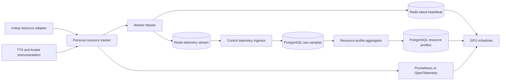

Prometheus labels không nên chứa `session_id`, `turn_id` hoặc unrestricted `character_id` vì
cardinality sẽ tăng không giới hạn. Metrics dùng label bounded như model family, GPU type,
runtime, resolution và phase. Chi tiết từng session đi vào structured log, trace hoặc bảng
usage chuyên dụng với retention policy; từ đó job tổng hợp tạo resource profile P50/P95/P99.

Một schema usage event tối thiểu:

```json
{
  "timestamp": "2026-08-04T10:00:00Z",
  "session_id": "session-123",
  "character_id": "luna",
  "avatar_model_id": "luna-avatar-v3",
  "avatar_checksum": "sha256:avatar123",
  "tts_model_id": "luna-tts-v2",
  "tts_checksum": "sha256:tts456",
  "voice_mode": "full-model",
  "worker_id": "gpu-host-a:GPU-abc123:persona-1",
  "gpu_uuid": "GPU-abc123",
  "phase": "speaking",
  "process_vram_mb": 9180,
  "estimated_session_vram_mb": 9040,
  "gpu_execution_ms": 31.2,
  "wall_time_ms": 40.0,
  "tts_realtime_factor": 0.34,
  "audio_buffer_ms": 480,
  "frames_generated": 1,
  "frames_dropped": 0
}
```

Đây là telemetry nội bộ, không phải business state. Mất một sample không được làm hỏng render
session; exporter cần bounded queue và drop/aggregate policy để observability không tạo
backpressure lên media loop.

### 12.9. Khi nào cần subprocess hoặc MIG

- Một process/GPU, nhiều session context: ít overhead nhất nhưng VRAM theo session là estimate.
- Một subprocess/slot: `nvitop` map PID sang GPU/host resource rõ hơn và giải phóng CUDA context
  chắc chắn hơn,
  đổi lại tốn thêm CUDA context memory và IPC.
- Một MIG instance/worker: isolation VRAM/compute mạnh nhất nhưng capacity cố định và chỉ dùng
  được trên GPU hỗ trợ MIG.

Lựa chọn được quyết định sau benchmark model thật. Interface tracker và usage schema nên tồn
tại từ đầu để không phụ thuộc phương án process isolation.

## 13. Liên hệ với source code hiện tại

Hiện trạng:

- `ControlPlaneAvatarStreamAdapter` gọi scheduler; assignment bền vững nằm ở Redis.
- Worker ID được auto-generate hoặc cấu hình; command đi vào `avatar:commands:{worker_id}`.
- `RedisRenderWorker` crawl hardware, heartbeat và sở hữu lifecycle render session.
- `LiveKitRenderSession` giữ stable audio/video track và audio master timeline.
- Start command hiện chờ `avatar.session.ready` tối đa 15 giây.
- Idle/thinking dùng video thu sẵn; speaking dùng tone TTS và frame từ `speaking.mp4` qua
  `CompositeSpeechPipeline`. Silence/beep chỉ dùng khi không có speech hoặc AV debug.

Khi tích hợp model, giữ nguyên Core port và command boundary, sau đó triển khai lần lượt:

1. Mở rộng `PersonaRuntimeSpec` với artifact URI/checksum và voice/TTS version thật.
2. Implement `TtsRuntimeFactory` và `AvatarModelFactory` bằng model thật.
3. Thêm resampler native và GPU execution coordinator; multi-reader timeline đã có.
4. Nối local `CompositeSlotManager` vào Redis Worker runtime thay `RenderSessionManager` cũ.
5. Bổ sung provision bất đồng bộ và progress event khi download/load/connect.
6. Thêm `nvitop` host/GPU/PID tracker, CUDA per-session instrumentation và observed resource
   profile cho scheduler.

## 14. Review kiến trúc và ranh giới triển khai

Chi tiết DTO, application ports, dependency direction, source structure và test strategy của
Worker Application Core nằm tại
[`persona-worker-core-architecture.md`](persona-worker-core-architecture.md).

### 14.1. Dependency và trust boundary

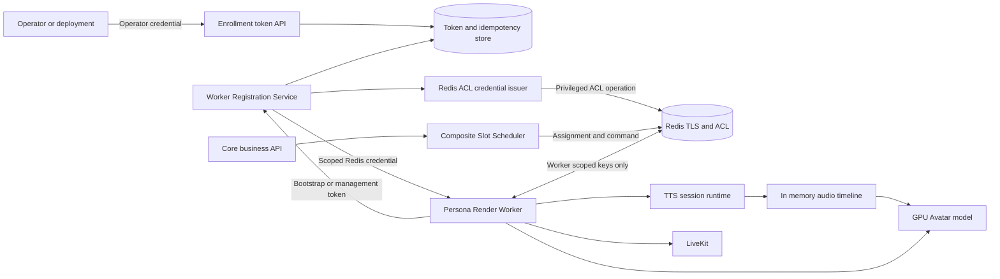

Core domain/application không import Redis ACL, `nvitop`, NVML, CUDA hoặc LiveKit SDK. Enrollment,
credential issuance, GPU probing và Redis communication là outbound/inbound adapter quanh các
application port. Thay Redis OSS bằng managed Redis API hoặc thay recorded renderer bằng model
GPU không làm đổi chat/session business rules.

### 14.2. Feature ownership

| Tính năng | Owner quyết định | Thành phần thực thi/ghi state |
|---|---|---|
| Cấp bootstrap token | Enrollment Token API | Token Store và signing adapter |
| Xác thực Persona Render Worker lần đầu | Registration Service | Token Store consume `jti` |
| Tự sinh/canonical worker ID | Worker đề xuất, Registration Service quyết định | Worker identity repository |
| Cấp Redis credential | Registration Service | Redis ACL Credential Issuer |
| Enforce quyền Redis | Không có business decision tại Redis | Redis ACL engine |
| Heartbeat/capability | Persona Render Worker | Worker-scoped Registry keys |
| Chọn GPU/composite slot | Composite Slot Scheduler | Atomic VRAM/compute reservation adapter |
| Load/unload TTS và Avatar | Persona Render Worker | Runtime factories và composite slot manager |
| Stream TTS vào lip-sync | Composite session orchestrator | In-memory multi-reader audio timeline |
| Bắt đầu/kết thúc chat media | Core business lifecycle | Scheduler command và Worker cleanup |
| Publish audio/video | Persona Render Worker | LiveKit adapter |
| VRAM/GPU telemetry | Worker resource tracker | Metrics/profile adapters |
| Revoke worker | Operator/Registration Service | ACL issuer, Registry và Scheduler |

Không thành phần nào tự mở rộng quyền của chính nó: Worker không tạo ACL user; Scheduler không
phát enrollment token; Core không tự sửa GPU counter; Redis không quyết định một session được
gán cho worker nào.

### 14.3. Invariant bắt buộc

Implementation và test phải bảo vệ các invariant sau:

1. Worker chưa enrollment không đọc/ghi được worker namespace nào.
2. Mỗi `worker_id + boot_id` có đúng một ACL identity đang active.
3. ACL identity chỉ truy cập namespace của chính `worker_id`.
4. Bootstrap `jti` chỉ tạo được một idempotent registration result.
5. Restart hợp lệ rotate management token và revoke ACL identity của boot cũ.
6. Process cũ không renew/deregister được registration có owner token mới.
7. Worker chỉ ready sau Redis TLS/AUTH, command consumer và heartbeat đầu tiên.
8. Scheduler chỉ chọn worker có heartbeat/registration lease còn hiệu lực.
9. TTS và Avatar runtime chỉ load sau composite reservation và generation còn hợp lệ.
10. Mỗi session có một audio timeline owner; lip-sync và LiveKit dùng cursor độc lập.
11. Speaking chỉ bắt đầu sau minimum prebuffer; playback complete chỉ sau timeline drain.
12. Close/cancel thắng late `ready`; event generation cũ không đổi Core state.
13. Release chỉ giảm capacity nếu lease token thuộc đúng owner.
14. Revoked worker bị ngắt Redis connection và không nhận assignment mới.
15. Telemetry lỗi hoặc nghẽn không block media loop.
16. PCM, raw video và tensor không đi qua Core, PostgreSQL hoặc Redis control keys.

### 14.4. Application ports đề xuất

```python
class WorkerEnrollmentTokenIssuerPort(Protocol):
    async def issue(self, request: EnrollmentRequest) -> IssuedEnrollment: ...

class WorkerRegistrationPort(Protocol):
    async def enroll(self, request: WorkerEnrollmentRequest) -> WorkerCredentials: ...
    async def reregister(self, request: WorkerReregistrationRequest) -> WorkerCredentials: ...
    async def revoke(self, worker_id: str) -> None: ...

class WorkerCredentialIssuerPort(Protocol):
    async def create(self, scope: WorkerRedisScope) -> DynamicRedisCredential: ...
    async def rotate(self, credential_id: str) -> DynamicRedisCredential: ...
    async def revoke(self, credential_id: str) -> None: ...

class WorkerRegistryPort(Protocol):
    async def list_candidates(self, requirement: CompositeRequirement) -> list[WorkerSnapshot]: ...

class CompositeSlotAllocatorPort(Protocol):
    async def acquire(self, request: CompositeSlotRequest) -> CompositeSlotLease | None: ...

class TtsRuntimeFactoryPort(Protocol):
    async def load(self, spec: VoiceRuntimeSpec, device: str) -> TtsSessionRuntime: ...

class TtsSessionRuntime(Protocol):
    def synthesize(self, segment: SpeechSegment) -> AsyncIterator[NativeAudioChunk]: ...
    async def close(self) -> None: ...

class AvatarRuntimeFactoryPort(Protocol):
    async def load(self, spec: AvatarRuntimeSpec, device: str) -> AvatarSessionRuntime: ...

class AvatarSessionRuntime(Protocol):
    async def render(self, window: TimedAudioWindow) -> TimedVideoFrame: ...
    async def close(self) -> None: ...

class AudioTimelinePort(Protocol):
    async def append(self, chunk: TimedAudioChunk) -> None: ...
    def reader(self, consumer: str) -> AudioTimelineReader: ...
```

Adapter mục tiêu:

```text
JwtEnrollmentTokenAdapter
RedisEnrollmentTokenRepository
RedisOssAclCredentialIssuer
ManagedRedisCredentialIssuer
RedisWorkerRegistry
RedisCompositeSlotAllocator
NvitopResourceProbeAdapter
LocalGpuTtsRuntimeFactory
RecordedAvatarModelFactory
GpuAvatarModelFactory
BoundedAudioTimeline
```

`RedisOssAclCredentialIssuer` và adapter managed Redis implement cùng port vì một số managed
provider không cho ứng dụng gọi `ACL SETUSER` trực tiếp mà yêu cầu provider control API.

### 14.5. Trạng thái implementation

Đã chạy trong production composition root/Docker flow:

- Enrollment Token API, one-time JTI, idempotent registration và operator/core scope.
- Persistent worker identity, management-token rotation và boot owner fencing.
- Dynamic Redis ACL credential create/revoke và worker-scoped command/event namespace.
- Auto-generated `host:gpu:instance` worker ID khi `AVATAR_WORKER_ID` rỗng.
- Registration/heartbeat TTL, GPU hardware snapshot và Control inventory API.
- `nvitop` public-API adapter cho host CPU/RAM, GPU inventory/metrics và resource theo managed
  Child PID; `auto` fallback về config trong demo/CI không có NVML.
- Redis scheduler, dynamic worker selection, atomic slot/VRAM/compute reservation, renewable
  lease, assignment persistence và generation fencing.
- Core `ControlPlaneAvatarStreamAdapter` cho provision/state/speech/release.
- Stable LiveKit publisher với recorded idle/thinking fallback.
- `CompositeSpeechPipeline`: scripted streaming TTS, PCM canonicalizer, bounded multi-reader
  timeline, recorded-clip fake lip-sync và queued LiveKit publisher acknowledgement.
- `PlaybackCompleted` chỉ phát sau audio và video cuối đã được LiveKit publishing loop nhận.
- `assistant_complete` phản ánh Agent đã sinh xong text và được gửi trước khi chờ playback;
  avatar chỉ về `idle` sau `PlaybackCompleted`. Cursor text và trạng thái phát media vì vậy có
  lifecycle độc lập, tránh giữ cursor giả trong lúc avatar vẫn đang đọc.

Đã có application core và test:

- Local composite capacity guard và session runtime factory ports.
- Neutral TTS/lip-sync/media DTO và interface để thay fake adapter bằng model thật.
- Worker Master là process duy nhất đọc Redis và quản lý nhiều Composite Child subprocess.
- Mỗi Child có gRPC channel/bidirectional stream riêng qua UDS listener chung, queue riêng,
  one-time handshake token, sequence và generation fencing.
- Child sở hữu `CompositeSpeechPipeline` và stable LiveKit publisher; Master không chuyển raw
  PCM/video frame.

Vẫn chưa triển khai:

- TTS/Avatar GPU runtime factories thật và GPU execution coordinator.
- Artifact registry, signed download, checksum và local NVMe cache.
- CUDA-event instrumentation trong model runtime thật; fake runtime hiện dùng nvitop PID VRAM,
  measured LiveKit FPS/A-V drift và reservation duty cycle làm số liệu bootstrap.
- Progress state đầy đủ `downloading/model-loading/connecting` và asynchronous `202` UI flow.
- Redis/Scheduler HA, MIG và shared per-GPU model executor.

### 14.6. Phạm vi HA tương lai

MVP không cần Scheduler replica, Redis Sentinel/Cluster, multi-AZ CA hoặc automatic host
failover. Tuy vậy, request ID, token-owned lease, generation fencing và application ports vẫn
được thiết kế ngay từ đầu vì đây là correctness boundary, không chỉ là HA optimization.

Khi có tải thực tế, có thể scale Registration/Scheduler stateless và thay Redis deployment mà
không đổi các use case Core hoặc Worker model lifecycle.

### 14.7. Các quyết định còn mở trước khi code

Review overview, role table, sequence và trust boundary không còn thiếu component lớn. Các mục
sau được giữ explicit vì cần quyết định bằng spike/benchmark, không nên âm thầm giả định:

1. Redis OSS version hay managed provider nào được dùng; `RedisOssAclCredentialIssuer` phải có
   contract test cho ACL key pattern, `XREADGROUP`, `XACK`, rotation và `ACL DELUSER`.
2. Audio timeline capacity, prebuffer/underrun policy, text segmentation và GPU execution
   scheduling giữa TTS burst với lip-sync frame deadline.
3. Operator identity lấy từ internal admin JWT, CI workload identity hay secret manager nào.
4. Persistent management token được bảo vệ bằng OS keyring, encrypted volume hay node secret
   store nào trên GPU host.
5. Scheduler MVP chạy cùng Core process hay deployment riêng; port và Redis state không đổi ở
   cả hai lựa chọn.
6. Model chạy in-process hay subprocess-per-slot; quyết định sau benchmark VRAM cleanup,
   startup latency và crash isolation.
7. Cách cưỡng bức loại LiveKit publisher cũ khi generation thay đổi hoặc worker bị revoke.
8. Nguồn phát hiện no-participant để áp dụng grace timeout và release composite slot.

Các quyết định này không cản trở tài liệu hóa boundary, nhưng mục 1, 2, 3 và 4 phải được khóa
trước khi triển khai security/model runtime thật.

## 15. Runbook đăng ký Persona Render Worker hiện tại

### 15.1. Chọn Resource Probe

Worker Master hiện dùng `nvitop` public API cho host/GPU/managed Child PID. Chế độ `auto` dùng
configured fallback khi NVML không khả dụng; adapter legacy chỉ được giữ để tương thích tạm thời.

```env
# auto: dùng nvitop khi NVML khả dụng; nếu không thì configured fallback có đánh dấu degraded.
# nvitop: production GPU mode, fail readiness nếu không đọc được inventory.
# configured: demo CPU/CI, không tạo observed metric giả.
PERSONA_RESOURCE_PROBE_PROVIDER=auto
PERSONA_RESOURCE_PROBE_TIMEOUT_SECONDS=3
PERSONA_RESOURCE_SAMPLE_INTERVAL_SECONDS=5
PERSONA_CHILD_RESOURCE_SAMPLE_INTERVAL_SECONDS=2
AVATAR_GPU_RESERVE_VRAM_MB=512

# Để rỗng thì worker ID được sinh ổn định từ host_id + GPU UUID + instance ID.
AVATAR_WORKER_ID=
AVATAR_HOST_ID=gpu-host-a
```

Repo cung cấp hai image Worker độc lập:

- `Dockerfile.worker`: `python:3.10-slim`, dùng cho fake pipeline CPU, local và CI. Python image
  có thể cài `nvitop`, nhưng chỉ đọc được GPU khi NVIDIA Container Toolkit inject driver/NVML;
  image không có CUDA/cuDNN để chạy model.
- `Dockerfile.worker.gpu`: CUDA + cuDNN runtime cho NVIDIA GPU. `compose.gpu.yaml` tự override
  image Worker CPU, cấp GPU device và cung cấp NVML cho `nvitop`.

Host GPU cần cài NVIDIA driver và NVIDIA Container Toolkit. Kiểm tra trước khi start:

```bash
docker run --rm --gpus all nvidia/cuda:12.4.1-base-ubuntu22.04 nvidia-smi
```

CUDA base image có thể đổi để khớp framework/model:

```env
WORKER_CUDA_IMAGE=nvidia/cuda:12.4.1-cudnn-runtime-ubuntu22.04
NVIDIA_VISIBLE_DEVICES=all
NVIDIA_DRIVER_CAPABILITIES=compute,utility,video
PERSONA_RESOURCE_PROBE_PROVIDER=nvitop
```

File `compose.gpu.yaml` đã có trong repo và có cấu hình tương đương:

```yaml
services:
  avatar-worker:
    deploy:
      resources:
        reservations:
          devices:
            - driver: nvidia
              count: all
              capabilities: [gpu]
```

Sau đó chạy các lệnh Compose với cả hai file:

```bash
docker compose -f compose.yaml -f compose.gpu.yaml \
  --profile livekit --profile agent up -d --build avatar-worker
```

Image GPU hiện cung cấp CUDA/cuDNN và dependency của fake composite pipeline. PyTorch,
ONNX Runtime GPU, TensorRT và dependency riêng của model chưa được cài vì model thật chưa được
chọn; bổ sung chúng vào requirements/image GPU khi implement adapter model tương ứng.

### 15.2. Khởi động storage, LiveKit và Control Plane

```bash
docker compose --profile livekit up -d postgres redis livekit personaforge-control
curl -fsS http://127.0.0.1:8090/health/live
```

Các secret bắt buộc nên đặt khác nhau trong `.env`:

```env
CONTROL_OPERATOR_TOKEN=<operator-secret>
CONTROL_CORE_TOKEN=<core-secret>
CONTROL_ENROLLMENT_JWT_SECRET=<at-least-32-random-bytes>
CONTROL_PLANE_URL=http://personaforge-control:8090
AVATAR_REGISTRATION_URL=http://personaforge-control:8090
```

### 15.3. Phát one-time bootstrap token

`host_id` trong token phải giống `AVATAR_HOST_ID` của Worker:

```bash
curl -fsS http://127.0.0.1:8090/internal/worker-enrollment-tokens \
  -H "Authorization: Bearer ${CONTROL_OPERATOR_TOKEN}" \
  -H "Content-Type: application/json" \
  -d '{
    "worker_type":"persona-render",
    "cluster_id":"development",
    "host_id":"gpu-host-a",
    "max_gpu_count":1,
    "ttl_seconds":600
  }'
```

Copy `bootstrap_token` từ response vào `.env`:

```env
AVATAR_WORKER_BOOTSTRAP_TOKEN=<one-time-bootstrap-token>
```

### 15.4. Start Worker và kiểm tra hardware heartbeat

```bash
docker compose --profile livekit up -d avatar-worker
docker compose --profile livekit logs -f avatar-worker
```

Control Plane cung cấp inventory cho operator; endpoint không trả management token hoặc Redis
password:

```bash
curl -fsS http://127.0.0.1:8090/internal/workers \
  -H "Authorization: Bearer ${CONTROL_OPERATOR_TOKEN}"
```

Các trường cần kiểm tra:

- registration `status=ready` và có `heartbeat`;
- `capabilities.gpu_uuid`, compute capability và schedulable VRAM đúng GPU;
- `heartbeat.hardware_source=nvitop` trên GPU host;
- host CPU/RAM và GPU VRAM/utilization/temperature/power thay đổi theo tải;
- mỗi Child PID có host RSS/CPU và GPU memory/SM utilization khi driver hỗ trợ;
- nếu `hardware_source=configured`, đọc `probe_errors`, kiểm tra GPU device, PID namespace và
  NVIDIA Container Toolkit/NVML availability.

Latest heartbeat được lưu Redis với TTL và sample được append vào worker-scoped Redis Stream.
Control chỉ ACK sau khi insert idempotent vào `gpu_heartbeat_samples` và
`composite_resource_samples`. Scheduler loại worker khi heartbeat hết hạn; sau đó resolve
requirement theo profile/DB config cho từng GPU, kiểm tra per-GPU ledger và observed free VRAM.

### 15.5. Restart và re-register

Sau first enrollment, Worker lưu management token trong volume `avatar_worker_identity` với
permission `0600`. Khi restart:

1. Worker đọc stable identity từ volume.
2. Gọi `/internal/workers/reregister` bằng management token.
3. Gửi hardware capabilities mới crawl được.
4. Control rotate management token/Redis ACL credential và revoke boot credential cũ.

Không cấp bootstrap token mới khi chỉ restart container. Chỉ cấp token mới khi identity đã bị
revoke, GPU/host identity thay đổi, hoặc volume identity bị xóa có chủ đích.

### 15.6. Luồng fake CompositeSpeechPipeline để demo

```text
Agent text
  -> avatar.speech.synthesize
  -> ScriptedToneTtsRuntime
  -> PcmS16MonoCanonicalizer
  -> BoundedAudioTimeline
       -> audio cursor -> QueuedMediaPublisher -> LiveKit audio track
       -> lip-sync cursor -> RecordedClipLipSyncRuntime -> LiveKit video track
  -> acknowledge final audio and video
  -> avatar.speech.completed
  -> Core chuyển avatar về idle
```

`TTS_AUDIO_BUFFER_MAX_MS` giới hạn PCM buffer và tạo backpressure.
`SCRIPTED_TTS_MS_PER_CHARACTER` điều chỉnh thời gian tone giả. Khi tích hợp model thật chỉ thay
`TtsSessionRuntimePort` và `LipSyncSessionRuntimePort`; Control/Core protocol không đổi.
