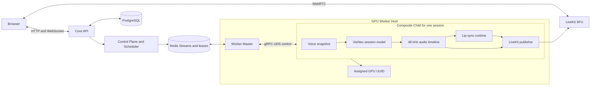
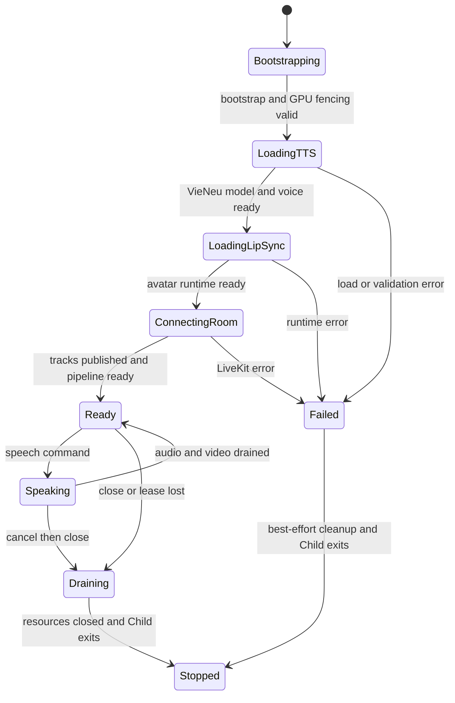
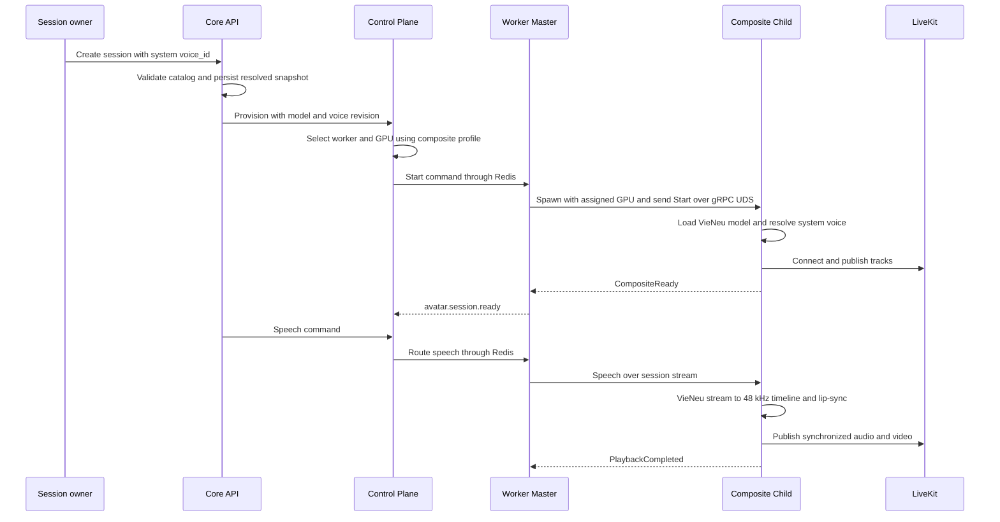
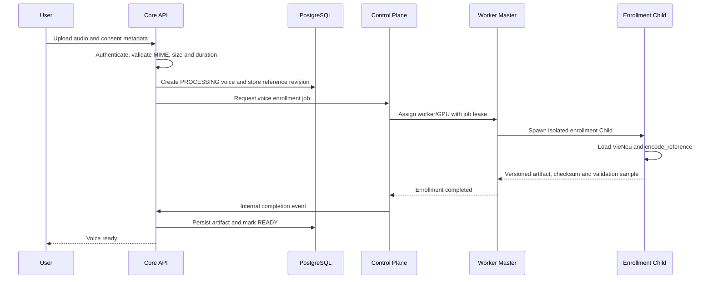
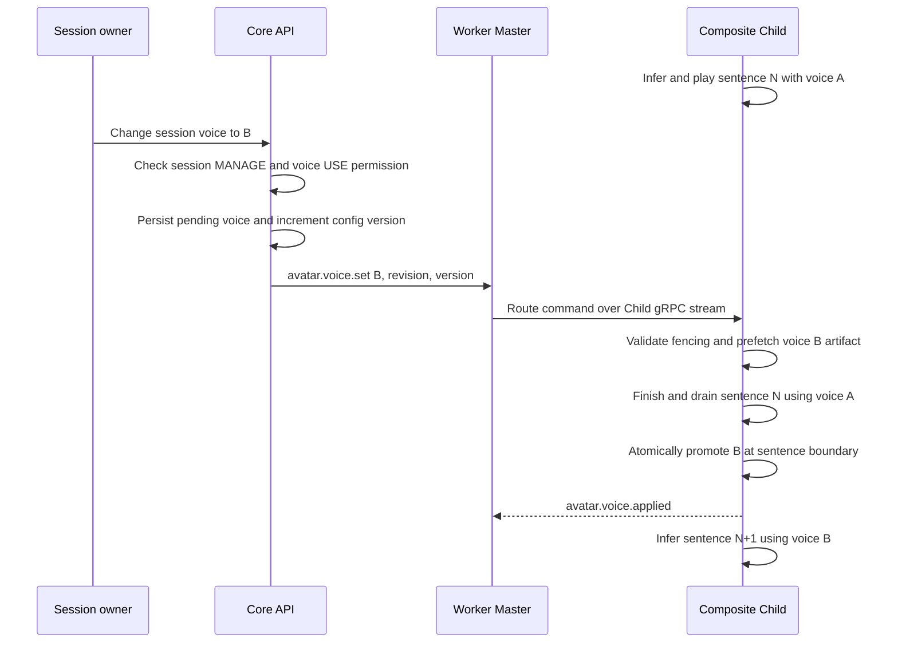

# Kế hoạch tích hợp VieNeu-TTS vào PersonaForge

> Trạng thái: kế hoạch triển khai. Phần 1 đã đủ quyết định để bắt đầu implementation sau khi
> được duyệt. Phần 2 mới là design draft; phải thảo luận và chốt design gate trước khi viết code.
>
> Phiên bản upstream được review: VieNeu-TTS `v3.2.4`, commit
> `a8c9fbf99749d5ce45c89111f71558d6ceef3424`.

## 1. Mục tiêu và các quyết định cố định

Tích hợp được chia thành hai phần độc lập theo thứ tự:

1. **Inference bằng system default voices**: thay scripted tone bằng VieNeu-TTS thật, dùng các
   giọng được hệ thống cấu hình sẵn. Chưa cho user upload, tạo hay chia sẻ voice.
2. **Custom voice và phân quyền**: user tạo voice từ reference audio, sở hữu và chia sẻ quyền sử
   dụng; owner của session chọn hoặc đổi voice tại ranh giới câu. Phần này chỉ triển khai sau khi
   luồng nghiệp vụ, authorization, artifact lifecycle và consent được thống nhất.

Các quyết định kiến trúc không thay đổi giữa hai phần:

- Mỗi persona session có đúng một `Composite Child` dài hạn.
- **VieNeu model được tạo bên trong Child, thuộc riêng session và không share với Child khác.**
- TTS model, voice context, lip-sync runtime, media timeline và LiveKit publisher có cùng session
  lifecycle.
- Scheduler chọn `worker_id + gpu_uuid`; Master pin Child vào GPU được cấp trước khi Child import
  Torch hoặc khởi tạo CUDA.
- Master không infer, không giữ model và không truyền PCM.
- Child không đọc Redis. Master đọc Redis rồi route command qua gRPC bidirectional stream riêng
  của Child trên Unix Domain Socket.
- PostgreSQL là durable source of truth. Redis chỉ là transport, cache, lease và coordination.
- Audio TTS được canonicalize thành PCM S16LE mono 48 kHz, chunk 20 ms; cùng timeline cấp audio
  cho LiveKit và lip-sync.
- Child process exit là ranh giới giải phóng CUDA context/VRAM đáng tin cậy nhất. Không xem
  `torch.cuda.empty_cache()` là bằng chứng session đã release.

Thiết kế này ưu tiên isolation và deterministic cleanup. Đổi lại, mỗi session chịu model load
latency và VRAM riêng; Scheduler phải admission theo peak của toàn bộ composite TTS + lip-sync.

## 2. Đánh giá VieNeu-TTS

VieNeu-TTS v3 Turbo phù hợp với media contract hiện tại vì:

- `infer_stream()` sinh tuần tự các NumPy audio chunk;
- output v3 là 48 kHz, trùng canonical sample rate của PersonaForge;
- preset voice có thể resolve thành `speaker_emb + ref_codes`;
- `encode_reference()` có thể tạo artifact cho phần custom voice sau này;
- code và model được công bố theo Apache 2.0.

Nguồn tham khảo:

- [VieNeu-TTS repository](https://github.com/pnnbao97/VieNeu-TTS)
- [VieNeu v3 Turbo model](https://huggingface.co/pnnbao-ump/VieNeu-TTS-v3-Turbo)
- [Voice cloning documentation](https://docs.vieneu.io/docs/sdk/voice-cloning/)
- [Streaming quick start](https://docs.vieneu.io/docs/getting-started/quick-start/)

Các giới hạn cần bao bọc bằng adapter:

- SDK inference là synchronous generator, không được block `grpc.aio`/asyncio event loop.
- `add_voice()`/`save_voices()` ghi JSON cục bộ, không hỗ trợ tenant, ACL, revision hay nhiều
  worker; PersonaForge không dùng chúng làm voice repository.
- Voice được resolve một lần khi bắt đầu một lần gọi `infer_stream()`. Vì vậy đổi voice phải chia
  text thành câu và tạo inference call mới tại sentence boundary.
- Remote server trong repository không phải tenant-aware Voice/TTS Service của PersonaForge.
- V3 vẫn là early-access/beta dependency; phải pin code, model revision và checksum, không tải
  `latest` khi Child khởi động.
- GPU reference stack của upstream và CUDA/Torch image hiện tại phải được kiểm chứng bằng build
  và benchmark, không cài dependency vào production image theo suy đoán.

## 3. Baseline hiện tại và khoảng trống

Những thành phần có thể tái sử dụng:

- `TtsSessionRuntimePort` đã định nghĩa streaming native audio.
- `CompositeSpeechPipeline` đã có bounded queue, canonicalizer và multi-reader audio timeline.
- Audio timeline đã fan-out cùng PCM/timestamp sang LiveKit và lip-sync.
- Master–Child đã dùng subprocess-per-session và gRPC UDS.
- Control/Scheduler đã mang `voice_id`, `tts_model_id` và lưu telemetry profile theo composite.

Khoảng trống phải xử lý trong phần 1:

- `LiveKitRenderSession` đang trực tiếp khởi tạo `ScriptedToneTtsRuntime`.
- Core adapter đang hard-code `tts_model_id=scripted-tone` và chưa resolve system voice.
- `SpeechSegment` chưa mang immutable voice snapshot/revision.
- Speech command Master–Child chưa có voice metadata cần thiết.
- Child chưa có VieNeu model factory, readiness probe, inference executor và deterministic cleanup.
- Chưa có manifest/version/checksum thống nhất cho model và system default voices.
- Scheduler chưa có benchmark profile thật cho tổ hợp VieNeu + lip-sync trên từng GPU type.

## 4. Kiến trúc mục tiêu



Model/audio ownership:

```text
Core        owns authorization, session config and durable voice metadata
Control     owns assignment, generation, lease and resource admission
Master      owns host registration, Redis consumption and Child supervision
Child       owns one session's VieNeu model, voice context, lip-sync and publisher
PostgreSQL  owns durable business state and versioned configuration
Redis       carries commands/events/leases; never stores PCM or model tensors
```

# Phần 1 — Inference bằng system default voices

## 5. Phạm vi phần 1

### 5.1. Có trong phạm vi

- Tích hợp `v3turbo` qua một outbound adapter implement `TtsSessionRuntimePort`.
- Hệ thống công bố một allowlist system voices cố định và một default voice.
- Session owner chọn một system voice khi tạo/config session.
- Core kiểm tra voice thuộc allowlist trước khi provision.
- Child load một VieNeu model riêng khi session start và release bằng process exit khi session
  stop/fail/lease lost.
- Stream audio thật qua pipeline hiện tại tới cả lip-sync và LiveKit.
- Giữ `scripted-tone` làm provider fallback phục vụ test và rollback.
- Thu thập metrics/log theo `session_id`, `generation`, `child_id`, `utterance_id`, `voice_id` và
  model revision.

### 5.2. Chưa có trong phạm vi

- Upload reference audio.
- Voice cloning/enrollment.
- Voice ownership, sharing hoặc public voice marketplace.
- Đổi voice trong khi session đang chạy.
- Shared model executor giữa nhiều Child.
- Auto-upgrade model hoặc voice artifact.

## 6. System voice catalog

Không truyền tên preset tùy ý từ browser xuống SDK. PersonaForge cần catalog ổn định:

```text
SystemVoiceDefinition
  voice_id              stable PersonaForge ID, ví dụ system-vi-minh-duc
  display_name
  language
  provider              vieneu
  provider_voice_key    exact upstream preset key
  tts_model_id          vieneu-v3-turbo
  tts_revision          pinned code/model revision
  artifact_revision
  artifact_checksum
  enabled
  is_default
```

Giai đoạn đầu, catalog là immutable manifest được version và bake vào Core/Worker image. Core và
Worker phải dùng cùng manifest checksum. Không mutate package JSON khi runtime đang chạy. Khi
cần quản trị catalog động, manifest sẽ được migrate vào PostgreSQL mà không thay domain port.

Quy tắc resolve:

1. Session có `voice_id` hợp lệ và enabled: dùng voice đó.
2. Session không cấu hình: dùng đúng một `is_default=true`.
3. Voice bị disable trước provision: fallback default và lưu resolved snapshot.
4. Voice/model revision không tồn tại trên Worker: Child fail typed `VOICE_ARTIFACT_UNAVAILABLE`;
   không âm thầm chọn một giọng khác sau khi session đã được provision.

Snapshot đã resolve phải gồm `voice_id`, provider key, artifact/model revision và checksum. Child
không tự quyết định quyền hay fallback.

## 7. Contract và adapter

Nên mở rộng request thay vì để VieNeu-specific field rò vào application core:

```python
@dataclass(frozen=True, slots=True)
class VoiceSnapshot:
    voice_id: str
    provider: str
    model_id: str
    model_revision: str
    artifact_revision: str
    artifact_checksum: str
    provider_config: Mapping[str, object]


@dataclass(frozen=True, slots=True)
class TtsSynthesisRequest:
    segment: SpeechSegment
    voice: VoiceSnapshot


class TtsSessionRuntimePort(Protocol):
    def synthesize(
        self,
        request: TtsSynthesisRequest,
    ) -> AsyncIterator[NativeAudioChunk]: ...

    async def close(self) -> None: ...
```

`provider_config` là opaque data ở core boundary. Chỉ `VieNeuTtsSessionRuntime` hiểu preset key,
`speaker_emb` hoặc `ref_codes`.

Adapter phần 1 thực hiện:

1. Khởi tạo VieNeu v3 Turbo trên GPU visible của Child.
2. Resolve preset từ system voice manifest đã kiểm tra checksum.
3. Chạy synchronous `infer_stream()` trong bounded executor/thread thuộc Child.
4. Bridge kết quả sang bounded `asyncio.Queue`; cancel/close phải dừng producer.
5. Clamp float32 về `[-1, 1]`, convert thành PCM S16LE mono.
6. Rechunk chính xác 960 samples, tương đương 20 ms tại 48 kHz.
7. Đánh `end_of_segment=true` sau khi generator của segment kết thúc hợp lệ; chỉ segment cuối
   cùng của reply mới được đánh `end_of_utterance=true` sau khi tail đã flush.
8. Biến exception/empty output thành typed failure; không phát silence rồi báo completed.

Mọi global PTS vẫn do `AudioTimelinePort` cấp. VieNeu adapter không publish LiveKit, không gọi
lip-sync và không tự reset media clock.

### 7.1. Đơn vị text đầu vào

Cần phân biệt ba loại dữ liệu:

```text
Agent TEXT_DELTA or token
    -> StreamingTextSegmenter
immutable synthesis segment
    -> VieNeu infer_stream
streamed PCM chunks
```

Không gọi VieNeu theo từng từ. Một từ không có đủ ngữ cảnh ngữ điệu, làm tăng số lần setup
inference, tạo khoảng ngắt khó nối và có thể phát âm sai khi dấu câu/từ tiếp theo chưa xuất hiện.
Ngược lại, không chờ cả đoạn văn hoặc toàn bộ Agent reply vì time-to-first-audio sẽ phụ thuộc độ
dài toàn bộ câu trả lời.

Đơn vị inference là một **cụm từ hoặc câu đã ổn định và immutable**:

- ưu tiên hard boundary: `.`, `?`, `!`, xuống dòng;
- cho phép soft boundary: `,`, `;`, `:` khi buffer đủ dài;
- nếu Agent chưa sinh dấu câu, flush ở word boundary sau một khoảng chờ ngắn;
- force flush khi đạt giới hạn ký tự;
- text đã gửi TTS không được sửa hoặc phát lại do delta/revision đến muộn.

Ví dụ Agent phát các delta:

```text
"Xin" | " chào" | " bạn," | " hôm nay" | " tôi có thể" | " giúp gì" | " cho bạn?"
```

Segmenter có thể tạo:

```text
segment 0: "Xin chào bạn,"
segment 1: "hôm nay tôi có thể giúp gì cho bạn?"
```

Giá trị khởi đầu để benchmark tiếng Việt:

```text
minimum characters: 20
target characters:  60
maximum characters: 160
maximum wait:        200 ms từ khi có unspoken stable text đầu tiên
```

Đây là tuning knob, không phải business invariant. Segmenter phải normalize whitespace nhưng
không tự thay đổi nội dung, dấu hoặc số có ý nghĩa phát âm.

### 7.2. Khoảng trống latency trong luồng hiện tại

Agent Runtime hiện đã stream `TEXT_DELTA`, nhưng Chat use case mới append delta vào message và
chỉ gọi `avatar.speak(full_reply)` sau `TURN_COMPLETED`. Vì vậy Worker đang nhận cả reply sau khi
Agent sinh xong, dù UI đã thấy text sớm hơn.

Luồng phần 1 cần đổi thành:

```text
Agent TEXT_DELTA
    -> persist/yield chat delta như hiện tại
    -> append vào per-turn StreamingTextSegmenter
    -> emit SpeechSegmentReady ngay khi có immutable segment
    -> Core/Control/Redis/Master/gRPC UDS
    -> Composite Child VieNeu infer_stream
```

`TURN_COMPLETED` chỉ flush phần text còn lại với `is_final_segment=true`; nó không phải thời điểm
bắt đầu TTS. Nếu Agent fail, chỉ các segment chưa phát bị cancel; audio đã phát không thể rollback.
Vì vậy chỉ segment text ổn định, không phải token tùy ý.

### 7.3. Speech và audio contract cho nhiều segment

Một Agent reply có một `utterance_id` nhưng có nhiều `segment_id`:

```python
@dataclass(frozen=True, slots=True)
class SpeechSegment:
    session_id: str
    turn_id: str
    utterance_id: str
    segment_id: str
    segment_sequence: int
    text: str
    boundary: SynthesisBoundary
    sentence_id: str
    sentence_sequence: int
    voice_config_version: int
    is_final_segment: bool
```

Audio chunk cần phân biệt:

```python
end_of_segment: bool
end_of_utterance: bool
```

- `end_of_segment` kết thúc một lần gọi `infer_stream()` nhưng không hoàn tất reply.
- `end_of_utterance` chỉ xuất hiện ở chunk cuối của final segment.
- Playback completion chỉ được emit sau final audio và final video của cả utterance đã drain.
- Audio sample clock, video PTS và frame index tiếp tục tăng giữa các segment, không reset về 0.
- Ordering dùng `generation + utterance_id + segment_sequence + chunk_sequence`.

Pipeline hiện tại đánh completion theo `utterance_id`; implementation phải tránh đánh audio/video
done khi mới gặp `end_of_segment` đầu tiên.

### 7.4. Audio TTS sang lip-sync là stream

Không tạo full WAV và không đợi VieNeu sinh hết audio. Luồng media là:

```text
VieNeu float32 chunks
    -> clamp and convert
PCM S16LE mono 48 kHz, 20 ms chunks
    -> bounded multi-reader timeline
       |-> synchronized audio publisher
       `-> lip-sync window assembler -> lip-sync inference -> video frames
```

PCM không đi qua Redis/PostgreSQL/Master và không cần materialize thành file. Timeline giữ
backpressure; khi downstream chậm, TTS producer phải chờ thay vì tăng RAM vô hạn.

Transport chunk 20 ms không có nghĩa model lip-sync bắt buộc infer bằng 20 ms. Mỗi lip-sync
adapter công bố capability:

```python
@dataclass(frozen=True, slots=True)
class LipSyncRuntimeCapabilities:
    minimum_context_ms: int
    lookahead_ms: int
    video_fps: float
```

`LipSyncWindowAssembler` gom đúng lượng context/lookahead model cần, ví dụ 80–300 ms, rồi render
frame sớm nhất. Kích thước thực tế phải benchmark theo model, không hard-code chung cho mọi
adapter.

### 7.5. Mục tiêu latency frame đầu tiên

Chỉ số chính là thời gian từ **stable text đầu tiên** đến **speaking frame đầu tiên được publish**:

```text
t0 Agent emits first stable text
t1 segmenter emits first synthesis segment
t2 VieNeu emits first PCM chunk
t3 lip-sync has minimum audio context
t4 lip-sync renders first speaking frame
t5 synchronized audio/video playback gate opens
t6 first speaking frame is published to LiveKit
```

Latency cần tách riêng để biết bottleneck:

```text
agent_first_delta_ms
text_to_first_segment_ms              t1 - t0
tts_time_to_first_audio_ms            t2 - t1
lipsync_context_wait_ms               t3 - t2
lipsync_time_to_first_frame_ms        t4 - t3
media_prebuffer_ms                    t5 - t4
first_frame_publish_ms                t6 - t5
end_to_end_first_speaking_frame_ms    t6 - t0
```

Các quyết định ưu tiên latency:

1. Child load VieNeu, resolve default voice, load lip-sync và chạy warm-up trước `READY`.
2. Model/reference artifact đã có trong local image/cache; không download hoặc
   `encode_reference()` khi speech đầu tiên đến.
3. Core gửi synthesis segment đầu tiên trước khi Agent hoàn tất toàn bộ reply.
4. VieNeu adapter yield PCM ngay khi SDK có chunk đầu tiên; không tạo full audio artifact.
5. Lip-sync chỉ prebuffer minimum context, không dùng buffer 1–2 giây theo mặc định.
6. Publisher mở playback gate khi đã có audio window và speaking frame đầu để không làm audio đi
   trước video; cả hai dùng cùng audio master clock.
7. Warm-up output không append timeline hoặc publish LiveKit.

Model load/warm-up làm tăng session connect time nhưng giảm latency mọi speech turn. Đây là chủ
đích của session-scoped Child: không load lại model theo utterance.

### 7.6. Synthesis boundary khác voice-switch boundary

Để giảm latency, một câu dài có thể chia thành nhiều synthesis segment ở dấu phẩy hoặc soft flush.
Điều đó không cho phép đổi voice giữa mọi segment:

```text
SYNTHESIS_BOUNDARY     có thể là clause/soft flush để bắt đầu TTS sớm
VOICE_SWITCH_BOUNDARY  chỉ là kết thúc một câu hoàn chỉnh
```

Tất cả synthesis segment thuộc cùng `sentence_id` dùng cùng immutable voice snapshot. Pending
voice chỉ được promote sau khi segment cuối của sentence đã infer và playback drain. Nhờ vậy có
thể giảm time-to-first-frame mà vẫn bảo đảm một câu không đổi timbre giữa chừng.

## 8. Session lifecycle trong Composite Child



Child chỉ phát `avatar.session.ready` sau khi:

- đúng assigned GPU visible;
- VieNeu model và system voice đã resolve/load thành công;
- lip-sync runtime sẵn sàng;
- LiveKit room/track đã publish;
- speech pipeline consumer đã start.

Cleanup theo thứ tự:

1. Chặn speech command mới và fence generation.
2. Cancel inference iterator/producer đang chạy.
3. Drain hoặc abort bounded audio/video queue theo stop reason.
4. Đóng LiveKit publisher.
5. Gọi `close()` idempotent cho lip-sync và TTS adapter.
6. Xóa strong reference tới model/runtime.
7. Child process thoát; Master `waitpid` và xác nhận PID biến mất.
8. Master gửi terminal event/resource sample; Control mới release assignment.

Nếu Child không thoát trong grace timeout, Master dùng terminate rồi kill theo supervisor policy.
VRAM được coi là released theo process lifecycle/resource observation, không dựa riêng vào
`empty_cache()`.

## 9. Provisioning và command flow

Provision request phải thay giá trị hard-code bằng snapshot đã resolve:

```json
{
  "tts_model_id": "vieneu-v3-turbo",
  "tts_revision": "pinned-revision",
  "voice_id": "system-vi-minh-duc",
  "voice_revision": "1",
  "voice_checksum": "sha256:...",
  "runtime": "vieneu-v3-turbo",
  "resolution": "1280x720",
  "fps": 25
}
```

Speech command phần 1 mang lại cùng immutable snapshot hoặc `voice_config_version` đã bind trong
generation hiện tại. Child từ chối command nếu voice/model khác session snapshot; phần 1 chưa hỗ
trợ hot change.

Luồng end-to-end:



## 10. Scheduler và resource profile

Vì mỗi Child load model riêng, reservation không được trừ theo shared model cache:

```text
predicted_session_peak =
    VieNeu model resident VRAM
  + voice/codec/denoise context
  + lip-sync model resident VRAM
  + overlapping inference workspace
  + LiveKit/video buffers
  + safety margin
```

Profile key tối thiểu:

```text
tts_model_id + tts_revision
voice_id + voice_revision
avatar_model_id + avatar_revision
resolution + fps
precision + runtime version
GPU name + compute capability
```

Phải đo cả load peak, steady idle và speaking peak. Scheduler ban đầu dùng configured safety
floor; sau đủ mẫu mới dùng learned P95/P99 nhưng không được thấp hơn floor. Child heartbeat tiếp
tục export RSS/CPU/GPU/VRAM theo PID để attribution đúng session.

## 11. Dependency và image strategy

- Pin VieNeu source/package version, Hugging Face revision và checksum.
- Model phải có sẵn trong image hoặc read-only model cache trước khi Child nhận assignment; không
  phụ thuộc Internet trong session startup.
- Xác minh Torch/CUDA/NVML compatibility trong GPU image hiện tại bằng smoke test.
- Import CUDA-dependent module chỉ sau khi Master đã đặt GPU visibility cho Child.
- Tách optional dependency group `tts-vieneu`; CPU test không buộc cài GPU stack.
- Giữ scripted adapter trong test/dev và làm rollback provider bằng config.
- Không log JWT, reference artifact, speaker embedding, raw PCM hoặc signed artifact locator.

Environment contract dự kiến:

```dotenv
TTS_RUNTIME_PROVIDER=vieneu-v3-turbo
TTS_MODEL_ID=vieneu-v3-turbo
TTS_MODEL_REVISION=<pinned-revision>
TTS_MODEL_PATH=/models/vieneu-v3-turbo
TTS_SYSTEM_VOICE_MANIFEST=/app/config/system-voices.v1.json
TTS_SYSTEM_DEFAULT_VOICE_ID=system-vi-minh-duc
TTS_INFERENCE_QUEUE_MAX_CHUNKS=64
TTS_SEGMENT_MIN_CHARACTERS=20
TTS_SEGMENT_TARGET_CHARACTERS=60
TTS_SEGMENT_MAX_CHARACTERS=160
TTS_SEGMENT_MAX_WAIT_MS=200
TTS_LIPSYNC_PREBUFFER_MS=160
TTS_MODEL_LOAD_TIMEOUT_SECONDS=120
TTS_INFERENCE_TIMEOUT_SECONDS=120
TTS_CHILD_SHUTDOWN_GRACE_SECONDS=20
```

Tên cuối cùng phải tuân theo `WorkerSettings`; không đưa secret vào các biến trên.

## 12. Observability và error contract

Structured log context:

```text
trace_id, request_id, session_id, generation, worker_id, child_id, child_pid,
gpu_uuid, turn_id, utterance_id, segment_id, segment_sequence, sentence_id,
voice_id, voice_revision, voice_config_version,
tts_model_id, tts_revision, command_id
```

Metrics tối thiểu:

- `tts_model_load_seconds` và load failure count;
- text-to-first-segment, time-to-first-audio, lipsync context wait, time-to-first-frame,
  first-frame publish, inference duration, output audio duration và realtime factor;
- generated chunks, queue wait, backpressure, underrun và cancellation;
- Child RSS/CPU, GPU utilization, VRAM steady/peak theo PID;
- audio buffer depth, A/V drift, published FPS và playback completion latency;
- cleanup duration và VRAM/process release result.

Typed error tối thiểu:

```text
TTS_MODEL_UNAVAILABLE
TTS_MODEL_LOAD_TIMEOUT
VOICE_NOT_CONFIGURED
VOICE_ARTIFACT_UNAVAILABLE
VOICE_ARTIFACT_MISMATCH
TTS_INFERENCE_TIMEOUT
TTS_EMPTY_OUTPUT
TTS_CANCELLED
TTS_RUNTIME_FAILED
TTS_CLEANUP_TIMEOUT
```

Core map capacity/runtime failure thành response rõ ràng; không trả generic `Internal Error` cho
lỗi admission hoặc model unavailable đã biết.

## 13. Thứ tự implementation phần 1

1. Thêm system voice manifest, checksum validation và catalog port.
2. Implement per-turn `StreamingTextSegmenter`, phát segment sớm từ Agent `TEXT_DELTA` và flush
   final tail tại `TURN_COMPLETED`.
3. Mở rộng runtime spec/DTO/protobuf/Redis envelope với segment identity và pinned TTS/voice
   snapshot.
4. Thêm `TtsRuntimeFactory`; bỏ việc `LiveKitRenderSession` tự hard-code scripted runtime.
5. Implement `VieNeuTtsSessionRuntime` và float32-to-S16LE 20 ms rechunker.
6. Mở rộng timeline/completion contract với `end_of_segment` và `end_of_utterance`.
7. Bổ sung lip-sync window assembler, playback gate, inference cancellation và idempotent close
   trong Child.
8. Resolve system voice ở Core, persist session snapshot và bỏ `scripted-tone` hard-code trong
   Control Plane media adapter.
9. Bổ sung settings, dependency/image/model cache, startup warm-up và validation.
10. Thu benchmark profile VieNeu + current lip-sync trên từng GPU type và seed safety floor.
11. Thêm integration/E2E tests với LiveKit; giữ scripted provider regression suite.
12. Cập nhật runbook Docker/Makefile sau khi image và model distribution được chốt.

## 14. Test và Definition of Done phần 1

Unit/contract tests:

- System voice unknown/disabled bị từ chối trước provision.
- Cùng manifest/revision cho kết quả resolve deterministic giữa Core và Child.
- Adapter emit đúng PCM S16LE mono 48 kHz và chunk 20 ms.
- Segmenter không emit từng từ, không cắt giữa codepoint/word và flush tail đúng một lần.
- Tail audio không mất; segment/chunk sequence tăng đơn điệu; marker segment/utterance đúng.
- Nhiều synthesis segment của một utterance không phát playback completed sớm.
- Error/empty output không sinh playback completed giả.
- Cancel đóng producer và không append chunk muộn.
- `close()` gọi nhiều lần không lỗi.

Integration tests:

- Child chỉ `READY` sau TTS + lip-sync + LiveKit ready.
- Một session tạo đúng một VieNeu model instance trong PID Child.
- Hai session tạo hai Child/model instance độc lập, kể cả cùng GPU/voice.
- Restart/kill Child không ảnh hưởng model state của session khác.
- Đóng session làm PID biến mất và VRAM attribution của PID được release.
- Audio thật đi cùng lipsync video, không reset media/sample/frame counters khi bắt đầu nói.
- TTS bắt đầu từ stable segment đầu tiên, không đợi Agent `TURN_COMPLETED` nếu đã có boundary.
- Audio được stream sang lip-sync; test fail nếu implementation đợi materialize full WAV.
- First speaking frame chỉ publish sau minimum lip-sync context và nằm trong A/V drift budget.
- Các segment cùng sentence giữ cùng voice snapshot dù có pending voice update.
- Scheduler từ chối session mới bằng capacity error rõ ràng khi không đủ VRAM.

Phần 1 hoàn thành khi E2E browser có thể chọn một system voice, nghe audio VieNeu thật, thấy video
lip-sync, đóng session giải phóng Child/GPU, và scripted provider vẫn chạy được để rollback.

# Phần 2 — Custom voice, ownership và sharing

## 15. Trạng thái phần 2

Phần này **chưa phải implementation plan cuối cùng**. Các cấu trúc dưới đây là proposal để thảo
luận. Không tạo migration, API, worker job hay frontend trước khi chốt các quyết định ở mục 22.

Yêu cầu nghiệp vụ ban đầu:

- User có thể tạo voice mới từ reference audio.
- Voice có owner rõ ràng và mặc định private.
- Owner có thể chia sẻ quyền sử dụng cho user khác.
- Khi tạo/config session, owner chỉ chọn được system voice hoặc custom voice mà họ có quyền dùng.
- Trong khi stream, session owner có thể yêu cầu đổi voice.
- Voice chỉ đổi sau khi câu đang phát hoàn thành; không đổi giữa câu.
- Revoke/disable/delete không làm rò artifact hoặc cho phép inference trái quyền.

## 16. Domain proposal để thảo luận

### 16.1. Voice

```text
Voice
  id
  owner_user_id              nullable cho system voice
  name
  kind                       SYSTEM | CLONED
  provider                   VIENEU
  model_id
  model_revision
  active_artifact_revision
  language
  status                     DRAFT | PROCESSING | READY | FAILED | DISABLED
  visibility                 PRIVATE | PUBLIC (cần quyết định)
  created_at, updated_at
```

### 16.2. Voice artifact

```text
VoiceArtifact
  voice_id
  revision
  schema_version             ví dụ vieneu-v3-voice-v1
  reference_audio
  normalized_audio_checksum
  reference_text             nếu workflow yêu cầu
  encrypted_provider_payload speaker_emb + ref_codes
  payload_checksum
  model_revision
  status
  created_at
```

Với reference audio ngắn, giai đoạn đầu có thể lưu binary trong PostgreSQL để đúng durable data
policy hiện tại. Nếu chuyển sang S3/MinIO, phải đi qua `VoiceArtifactStorePort`; PostgreSQL vẫn
giữ metadata, checksum và revision. Redis không lưu artifact lâu dài.

### 16.3. Voice grant

```text
VoiceGrant
  voice_id
  grantee_user_id
  permission                 USE | MANAGE (cần chốt có cần MANAGE không)
  granted_by
  expires_at
  revoked_at
  created_at
```

Baseline đề xuất:

- Owner luôn có `USE + MANAGE`.
- Shared user chỉ có `USE`; không được đổi tên, re-enroll, share tiếp hoặc xóa.
- System voice được cấp qua policy, không tạo grant cho từng user.
- Chưa triển khai public marketplace trong lần đầu; voice mặc định private và share đích danh.

## 17. Enrollment flow proposal



Điểm cần thảo luận: enrollment có dùng cùng Composite Child của session hay một short-lived
`Enrollment Child`. Baseline đề xuất là Enrollment Child riêng vì lúc tạo voice chưa có persona
session/LiveKit room; job cần retry, timeout và resource profile khác inference session.

Không dùng `VieNeu.add_voice(save=True)`. Enrollment adapter gọi `encode_reference()`, validate
artifact rồi trả opaque versioned payload về durable store.

## 18. Authorization và session selection proposal

Core là policy enforcement point duy nhất:

```text
usable voices = enabled system voices
              + READY voices owned by requester
              + READY voices with active USE grant to requester
```

API candidate:

```http
POST   /api/voices
GET    /api/voices?scope=usable
GET    /api/voices/{voice_id}
POST   /api/voices/{voice_id}/grants
DELETE /api/voices/{voice_id}/grants/{user_id}
PATCH  /api/sessions/{session_id}/voice
```

Worker không nhận user JWT và không tự query permission. Core kiểm tra quyền trong transaction,
persist immutable voice snapshot rồi gửi ID/revision/checksum đã resolve. Artifact locator nếu có
phải internal, TTL ngắn và bind đúng worker/session/revision.

Session config proposal:

```text
active_voice_id
active_voice_revision
pending_voice_id
pending_voice_revision
voice_config_version
```

## 19. Đổi voice ở sentence boundary

VieNeu resolve voice một lần cho mỗi `infer_stream()`, do đó PersonaForge phải segment text trước
SDK call. Child giữ:

```text
active_voice_snapshot
pending_voice_snapshot
active_voice_config_version
pending_voice_config_version
```

Luồng proposal:



Rules đề xuất:

- Chỉ session owner hoặc user có session `MANAGE` mới đổi voice.
- Requester đồng thời phải có `USE` trên voice đích.
- Câu đã snapshot voice A luôn hoàn tất bằng A.
- Nhiều update liên tiếp dùng monotonic `voice_config_version`; Child áp dụng version cao nhất và
  bỏ stale command.
- Nếu reply chỉ có một câu, voice mới áp dụng ở agent reply tiếp theo.
- Nếu voice B chưa prefetch xong tại boundary, tiếp tục A và emit delayed event thay vì tạo
  silence không giới hạn.
- Không reload VieNeu model khi A và B dùng cùng model/revision; chỉ đổi voice artifact/context.
- Nếu voice mới yêu cầu model/revision khác, baseline là từ chối hot switch và yêu cầu reprovision
  session. Không giữ đồng thời hai model trong một Child vì dễ tạo VRAM peak/OOM.

Command candidate:

```json
{
  "type": "avatar.voice.set",
  "session_id": "...",
  "generation": 12,
  "voice_id": "...",
  "voice_revision": "3",
  "voice_checksum": "sha256:...",
  "voice_config_version": 8,
  "effective_from": "next_sentence"
}
```

`SpeechSegment`/gRPC payload cần thêm `sentence_id`, `sentence_index` và voice config version để
trace và replay không đổi giọng sai vị trí.

## 20. Revocation, disable và deletion proposal

Các policy cần chốt trước implementation:

- Revoke grant trong lúc câu đang phát: baseline cho câu hiện tại hoàn tất, sau đó fallback system
  default hoặc pause session.
- Owner disable voice: không cho session mới sử dụng; session đang chạy áp dụng cùng policy revoke.
- Delete: nên là soft-delete trước, artifact có retention window để audit/recovery.
- Grant expiry: Core kiểm tra khi chọn/đổi voice; cần quyết định có revalidate định kỳ cho session
  dài hạn hay không.
- Worker cache: artifact bị revoke không được dùng để bypass Core; cache chỉ là data optimization,
  không phải authorization evidence.

Baseline an toàn đề xuất là revalidate ở mỗi request đổi voice và mỗi lần provision. Revoke/disable
phát domain event tới các active session đang dùng voice đó; áp dụng system default tại sentence
boundary kế tiếp.

## 21. Consent, privacy và abuse controls

Open-source license của model không thay thế quyền sử dụng giọng nói. Design phần 2 cần định nghĩa:

- user assertion/consent nào bắt buộc khi upload;
- có cho clone giọng của người khác hay chỉ self-voice;
- lưu consent evidence và audit event trong bao lâu;
- giới hạn audio MIME, duration, size, sample rate và malware/content validation;
- encryption at rest cho reference audio và embedding;
- ai được nghe validation sample;
- rate limit/quota enrollment và storage;
- cơ chế report, disable và xóa voice/artifact;
- có watermark/disclosure rằng audio được tổng hợp hay không.

Không log reference audio, transcript nhạy cảm, embedding/ref codes hoặc signed locator.

## 22. Design gate phải thảo luận trước phần 2

Các câu hỏi sau phải có quyết định ghi thành ADR hoặc cập nhật tài liệu này:

1. **Consent:** chỉ cho self-voice hay cho third-party voice nếu có consent evidence?
2. **Visibility:** lần đầu chỉ private + share đích danh, hay cần public voice ngay?
3. **Permission:** chỉ cần `USE`, hay cần thêm `MANAGE`; shared user có được share tiếp không?
4. **Artifact storage:** PostgreSQL `BYTEA` đủ cho giai đoạn đầu hay dùng MinIO ngay?
5. **Enrollment runtime:** xác nhận dùng Enrollment Child riêng và Scheduler queue/profile riêng?
6. **Reference input:** thời lượng, định dạng, transcript, denoise và quality gate cụ thể là gì?
7. **Versioning:** re-enroll tạo revision mới hay tạo voice mới; session đang chạy pin revision nào?
8. **Revocation:** fallback system default, pause session, hay close session tại sentence boundary?
9. **Grant expiry:** active session có revalidate định kỳ hay chỉ nhận revoke event?
10. **Sentence signal:** baseline là Core giữ `StreamingTextSegmenter`; Agent có cần bổ sung event
    `sentence_final` đáng tin cậy để Core ưu tiên hơn heuristic dấu câu hay không?
11. **Hot switch failure:** tiếp tục voice cũ bao lâu nếu voice mới chưa load được?
12. **Cross-model switch:** cấm khi session active hay cho drain/reprovision tự động?
13. **Deletion/retention:** soft-delete và audit/artifact retention trong bao lâu?
14. **Quota:** mỗi user được bao nhiêu voice, bao nhiêu enrollment/ngày và dung lượng tối đa?
15. **Frontend semantics:** UI hiển thị `pending`, `applied`, `delayed`, `revoked` như thế nào?

Chỉ sau design gate mới chốt schema migration, endpoint contract, domain events, worker enrollment
job và E2E acceptance suite.

## 23. Acceptance scenarios dự kiến cho phần 2

Các scenario này dùng để kiểm tra design trước khi implementation:

- User A tạo voice; mặc định chỉ A nhìn thấy và sử dụng được.
- A share `USE` cho B; B chọn được voice cho session do B quản lý nhưng không sửa/xóa/share tiếp.
- User C không có grant không thể enumerate, chọn hoặc lấy artifact.
- Grant bị revoke không thể dùng cho session mới; active session làm đúng revoke policy đã chốt.
- Voice enrollment/revision tồn tại qua restart Worker vì state nằm trong PostgreSQL/artifact store.
- Hai worker resolve cùng voice revision/checksum giống nhau.
- A đổi voice khi một câu đang phát: câu hiện tại không đổi timbre, câu sau dùng voice mới.
- A đổi A → B → C nhanh: Child chỉ áp dụng config version mới nhất tại boundary.
- Artifact lỗi/checksum sai tạo typed failure và không fallback âm thầm sang voice khác.
- Đóng session giải phóng VieNeu model của Child bất kể đang dùng system hay custom voice.

## 24. Thứ tự delivery tổng thể

```text
Part 1A  System voice manifest and provider-neutral contracts
Part 1B  VieNeu per-session Child runtime and deterministic cleanup
Part 1C  Core selection, Control propagation and Scheduler profile
Part 1D  Browser E2E, telemetry, benchmark and rollback runbook
          ↓
Part 2 Design workshop and ADR decisions from section 22
          ↓
Part 2A  Voice domain, storage, consent and authorization
Part 2B  Enrollment Child and versioned artifact pipeline
Part 2C  Sharing APIs/UI and session selection
Part 2D  Sentence segmentation and boundary-safe hot switching
Part 2E  Revocation, deletion, audit and production hardening
```

## 25. Quan hệ với các tài liệu hiện có

- Master–Child process, Redis ownership và gRPC UDS:
  [`worker-master-child-grpc.md`](worker-master-child-grpc.md).
- TTS/lip-sync port và media timeline:
  [`persona-worker-core-architecture.md`](persona-worker-core-architecture.md).
- Composite scheduling, GPU telemetry và artifact định hướng:
  [`tts-avatar-render-flow.md`](tts-avatar-render-flow.md).
- Pipeline end-to-end hiện tại:
  [`current-pipeline.md`](current-pipeline.md).

Nếu tài liệu cũ nói shared TTS base model giữa nhiều session, đối với VieNeu integration này quyết
định trong mục 1 được ưu tiên: **mỗi Composite Child tự tạo và release model theo session**.
