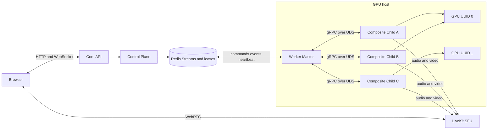
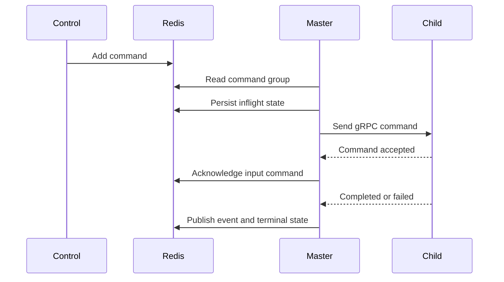
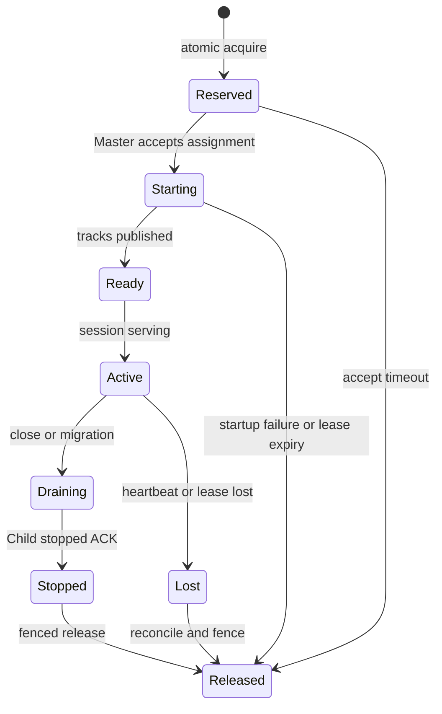
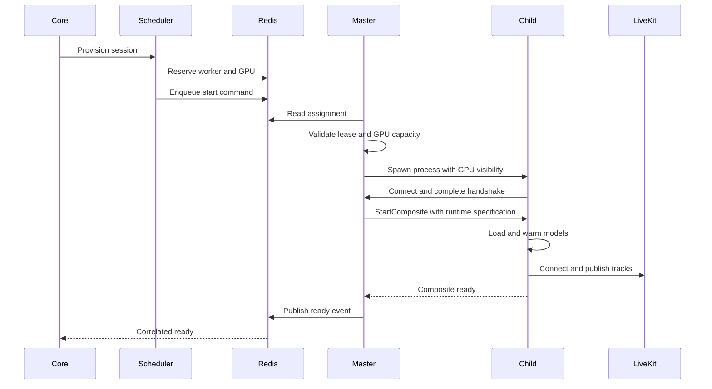
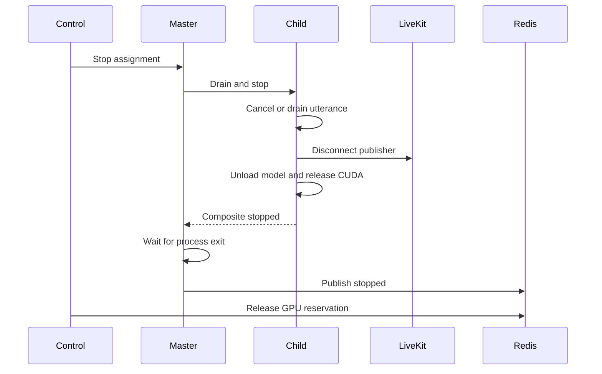

# Thiết kế Worker Master–Child qua gRPC Unix Domain Socket

> Trạng thái: kiến trúc target đã chốt cho giai đoạn refactor tiếp theo. Runtime hiện tại vẫn
> đọc Redis và chạy composite trong cùng một process. Tài liệu này mô tả đích triển khai, không
> tuyên bố các thành phần Master–Child đã có trong source.

## 1. Quyết định kiến trúc

- Một `Worker Master` đại diện cho một host vật lý và quản lý nhiều GPU.
- Chỉ Master register với Control Plane, giữ Redis ACL credential và đọc Redis Streams.
- Core chỉ yêu cầu provision; Scheduler là nguồn duy nhất chọn `worker_id + gpu_uuid`.
- Mỗi `Composite Child` ban đầu sở hữu đúng một persona session.
- Master và Child giữ một gRPC bidirectional stream lâu dài qua Unix Domain Socket.
- Child xử lý TTS, lip-sync, A/V synchronization và publish trực tiếp lên LiveKit.
- PCM, tensor và raw video frame không đi qua Master hoặc Redis.
- Child được pin vào GPU UUID đã cấp trước khi import model hoặc khởi tạo CUDA.
- Giai đoạn đầu dùng subprocess-per-composite. Shared per-GPU model executor chỉ được cân nhắc
  sau benchmark.

 Implementation dùng
`grpc.aio`; gRPC runtime và event loop xử lý non-blocking I/O. Domain/application code không gọi
raw `select.epoll()`.

## 2. Sơ đồ tổng thể



```text
Control command: Redis -> Master -> gRPC UDS -> Child
Media:           Child TTS/lip-sync -> LiveKit
Status:          Child -> gRPC UDS -> Master -> Redis/Control
Transcript:      Agent/Core -> PostgreSQL and browser
```

## 3. Ownership

### 3.1. Worker Master

Master là host agent, không chạy model inference và không tạo CUDA context. Trách nhiệm:

- enrollment, re-registration và credential rotation;
- giữ Redis ACL username/password của worker;
- đọc `avatar:commands:{worker_id}` bằng một consumer group;
- reclaim pending message, retry và quản lý DLQ;
- crawl GPU inventory bằng NVML hoặc `nvidia-smi`;
- gửi heartbeat tổng hợp theo GPU và child;
- validate worker, GPU, lease token và generation;
- local admission trước khi spawn child;
- spawn, monitor, drain và terminate child;
- route command theo `session_id`;
- nhận event/telemetry qua gRPC và publish về Redis;
- reconcile Control assignment với child/process thực tế;
- quản lý artifact cache chung của host.

Master có runtime index, nhưng đây chỉ là cache có thể reconstruct:

```text
session_id -> child_id
child_id   -> pid, gpu_uuid, stream, state, last heartbeat
gpu_uuid   -> local reservation and observed hardware
command_id -> inflight state
```

Assignment, lease và inflight command state phải nằm trong Redis. Dictionary của Master không
phải durable source of truth.

### 3.2. Composite Child

Một Child sở hữu toàn bộ runtime của một session:

- per-session command actor/queue;
- TTS runtime và voice configuration;
- audio canonicalizer và bounded audio timeline;
- avatar/lip-sync runtime;
- A/V synchronizer;
- LiveKit room connection và stable publisher;
- cancellation/barge-in theo `utterance_id`;
- resource tracker;
- lifecycle state machine;
- heartbeat và progress event.

Child không nhận Redis credential, Control token, worker management token hoặc assignment của
session khác. LiveKit token phải publish-only, bind đúng room và có TTL ngắn.

## 4. Redis chỉ nằm ở Master

Nếu mỗi Child cùng đọc worker stream, consumer group có thể giao command session A cho Child B.
Tạo stream và ACL riêng cho mỗi session làm tăng dynamic key, credential và recovery complexity.

Một Master consumer cho phép:

- quản lý pending entries tại một nơi;
- route đúng session;
- tuần tự trong một session nhưng song song giữa các session;
- không cấp Redis credential cho model process;
- child crash không làm mất consumer ownership;
- Master restart dùng `XAUTOCLAIM` và replay idempotently.

Redis vẫn là durable transport giữa Control và host. gRPC UDS chỉ là local transport giữa
Master và Child.

## 5. gRPC bidirectional streaming qua UDS

### 5.1. Endpoint và RPC

Master mở gRPC server:

```text
unix:///run/personaforge/worker-master/control.sock
```

Thư mục dùng mode `0700`; socket chỉ service UID truy cập. Child connect ngay sau `spawn/exec`
và giữ stream tới terminal state.

```protobuf
service CompositeChildControl {
  rpc Connect(stream ChildToMaster) returns (stream MasterToChild);
}
```

- Child request stream: hello, heartbeat, accepted, ready, progress, completed, failed, stopped.
- Master response stream: start, speech chunk, state, cancel, drain, stop.

Proto target:

```text
proto/personaforge/worker/v1/child_control.proto
```

Generated namespace:

```text
personaforge.worker.v1
```

### 5.2. Envelope và payload

Mọi message mang routing và fencing metadata:

```protobuf
message MessageMeta {
  uint32 schema_version = 1;
  string message_id = 2;
  string worker_id = 3;
  string child_id = 4;
  string session_id = 5;
  string gpu_uuid = 6;
  string lease_token = 7;
  int64 generation = 8;
  int64 sequence = 9;
  int64 sent_at_unix_ms = 10;
}

message MasterToChild {
  MessageMeta meta = 1;
  oneof payload {
    StartComposite start = 20;
    SpeechChunk speech = 21;
    ChangeAvatarState change_state = 22;
    CancelUtterance cancel = 23;
    DrainComposite drain = 24;
    StopComposite stop = 25;
  }
}

message ChildToMaster {
  MessageMeta meta = 1;
  oneof payload {
    ChildHello hello = 20;
    CommandAccepted accepted = 21;
    ChildHeartbeat heartbeat = 22;
    CompositeReady ready = 23;
    PlaybackCompleted playback_completed = 24;
    CompositeFailed failed = 25;
    CompositeStopped stopped = 26;
  }
}
```

### 5.3. Handshake

Master sinh `child_bootstrap_token` một lần trước khi spawn. Child gửi `ChildHello` gồm PID,
session, assigned GPU, protocol version và token. Master kiểm tra token, expected PID/session/GPU
rồi consume token atomically.

Token nên truyền bằng inherited file descriptor hoặc file secret tạm, không đặt trong command
line. UDS permission là lớp đầu; one-time token ngăn process cùng UID chiếm child slot.

### 5.4. Async tasks của Master

```text
RedisCommandConsumer
GrpcChildControlServer
ChildProcessSupervisor
GpuInventoryCollector
HeartbeatAggregator
AssignmentReconciler
RedisEventPublisher
```

Không task nào được chạy inference, blocking `waitpid` hoặc blocking NVML call trên event loop.
Dùng async subprocess và adapter/executor riêng cho blocking hardware probe.

## 6. Ordering và backpressure

Master giữ bounded outbound queue cho mỗi Child:

```text
priority queue: stop, lease_lost, cancel, drain
normal queue:   start, state, speech
```

Policy:

- stop/cancel không đứng sau speech backlog;
- state update được coalesce theo `state_version`;
- speech chunk giữ đúng thứ tự và không drop;
- heartbeat cũ được thay bằng heartbeat mới;
- queue đầy trả `child_backpressure`, không tăng RAM vô hạn.

Ordering keys:

```text
generation + command_sequence
utterance_id + utterance_sequence
```

Child từ chối generation cũ, bỏ duplicate sequence và báo missing sequence. Command giữa hai
session chạy đồng thời; command cùng session được actor xử lý tuần tự.

## 7. Redis ACK, inflight và recovery

Master không ACK Redis ngay sau khi đặt command vào queue memory.



Correctness rules:

1. `command_id` unique và idempotent.
2. Inflight state được persist trước input ACK.
3. Master restart reclaim pending bằng `XAUTOCLAIM`.
4. Command đã ACK nhưng chưa terminal được replay từ inflight state.
5. Retry vượt ngưỡng chuyển worker DLQ.
6. Terminal state có retention TTL.
7. `CommandAccepted` chỉ xác nhận actor nhận command, không phải playback hoàn tất.

```text
avatar:commands:{worker_id}
avatar:commands:{worker_id}:dlq
avatar:command-state:{worker_id}:{command_id}
avatar:events:{worker_id}:{session_id}
```

## 8. Multi-GPU inventory và assignment

Worker heartbeat chuyển từ một GPU sang danh sách GPU UUID ổn định:

```json
{
  "worker_id": "gpu-host-a-worker",
  "host_id": "gpu-host-a",
  "gpus": [
    {
      "gpu_uuid": "GPU-abc123",
      "compute_capability": "8.9",
      "total_vram_mb": 24576,
      "free_vram_mb": 16000,
      "reserved_vram_mb": 6200,
      "gpu_utilization_ewma": 42.5,
      "active_composites": 2,
      "healthy": true
    }
  ]
}
```

Assignment bắt buộc chứa `gpu_uuid`:

```json
{
  "session_id": "session-123",
  "worker_id": "gpu-host-a-worker",
  "gpu_uuid": "GPU-abc123",
  "slot_id": "GPU-abc123-slot-2",
  "lease_token": "opaque-token",
  "generation": 4,
  "reserved_vram_mb": 6200,
  "reserved_gpu_duty_cycle": 0.25
}
```

Redis reservation chuyển thành per-GPU:

```text
personaforge:control:gpu:{worker_id}:{gpu_uuid}:usage
personaforge:control:lease:{session_id}
personaforge:control:assignment:{session_id}
```

Scheduler hard-filter heartbeat, runtime support, compute capability, slot, VRAM và compute
budget; sau đó score theo model-cache affinity, utilization EWMA, reserved compute, free VRAM và
active composites.

```text
reserved_vram + pending_shared_activation + requested_incremental_peak
<= schedulable_vram
```

VRAM reservation là hard boundary. GPU utilization là tín hiệu mềm và dùng EWMA/p95, không dùng
một sample tức thời làm hard capacity.

### 8.1. Input của Scheduler

Scheduler nhận một `CompositeRequirement` đã được Resource Profiler chuẩn hóa. Không để Core tự
chọn GPU hoặc gửi trực tiếp một con số VRAM tùy ý:

```json
{
  "session_id": "session-123",
  "tenant_id": "tenant-a",
  "avatar_model_id": "avatar-v4",
  "tts_model_id": "tts-vi-v2",
  "runtime": "tensorrt",
  "minimum_compute_capability": "8.0",
  "resolution": "1280x720",
  "fps": 25,
  "cold_predicted_peak_vram_mb": 6200,
  "warm_incremental_peak_vram_mb": 1800,
  "predicted_gpu_duty_cycle": 0.25,
  "required_encoder_sessions": 1,
  "livekit_region": "ap-southeast",
  "artifact_revision": "sha256:..."
}
```

Resource Profiler tách shared model và phần tăng thêm của session. Scheduler tính
`requested_incremental_peak_vram` riêng cho từng candidate: dùng warm incremental khi đúng model
revision đã resident, ngược lại gồm cả model activation. Profile được tính từ:

```text
model_base_incremental
+ voice_or_avatar_adapter
+ inference_workspace_peak
+ encoder_incremental
+ allocator_fragmentation_margin
+ safety_margin
```

Nếu chưa có observed profile thì dùng manifest conservative. Khi đã có dữ liệu production:

```text
cold_peak = max(manifest_cold_peak, observed_p99_cold_peak) + cold_start_margin
warm_incremental = max(manifest_warm_incremental, observed_p99_warm_incremental)
```

Không lấy trực tiếp `nvidia-smi free memory` làm requirement vì giá trị đó không mô tả peak của
composite sắp được load. Chi tiết lưu heartbeat, attribution và fallback profile nằm tại
[`tts-avatar-render-flow.md`, mục 12](tts-avatar-render-flow.md#12-tracking-vram-và-gpu-utilization-theo-composite-session).

Với mode subprocess-per-composite ban đầu, Scheduler luôn dùng cold VRAM profile vì CUDA model
không được share giữa hai Child. Artifact cache trên disk chỉ giảm startup time. Chỉ dùng
`warm_incremental_peak_vram_mb` khi một shared per-GPU executor thực sự được triển khai và báo
model residency/refcount đáng tin cậy.

### 8.2. Tạo candidate theo từng GPU

Một Worker Master heartbeat nhiều GPU. Scheduler flatten registry thành danh sách candidate:

```text
Candidate = WorkerRegistration + WorkerHeartbeat + GpuSnapshot + GpuReservationUsage
key       = worker_id + gpu_uuid
```

`max_gpu_count` của enrollment giới hạn số GPU UUID mà Master được phép advertise. Control chỉ
nhận tối đa số GPU đã cấp quyền, nhưng không biến `max_gpu_count=1` thành `max_composites=1`.
Một GPU vẫn có thể chạy nhiều Child nếu slot, VRAM và compute budget còn đủ.

Snapshot Scheduler sử dụng cho một vòng chọn phải chứa:

- `worker_id`, `boot_id`, `identity_generation` và registration expiry;
- `gpu_uuid`, compute capability, runtime/codec hỗ trợ;
- `schedulable_vram_mb`, `max_slots`, `compute_budget`;
- reserved slots/VRAM/compute lấy từ Redis;
- observed free/used VRAM, utilization EWMA/p95, temperature và health;
- queue depth, active Child, model-cache affinity và recent failure rate;
- thời điểm hardware sample và heartbeat expiry.

### 8.3. Hard filter

Candidate bị loại trước scoring nếu một điều kiện sau đúng:

1. Registration, management lease hoặc heartbeat hết hạn.
2. `boot_id`/`identity_generation` heartbeat không khớp registration hiện hành.
3. Master không `ready`, đang `draining`, GPU unhealthy/quarantined hoặc hardware sample quá cũ.
4. GPU UUID nằm ngoài enrollment grant hoặc không còn visible trên host.
5. Runtime, model format, precision, compute capability, encoder, resolution/FPS không tương thích.
6. Tenant/region/data-residency constraint không phù hợp.
7. Không còn slot theo reservation ledger.
8. Không đủ VRAM reservation hoặc compute budget.
9. Observed free VRAM thấp hơn emergency guard, thể hiện có allocation ngoài ledger hoặc leak.

Capacity hard check:

```text
reserved_slots + 1 <= max_slots

reserved_vram
+ pending_shared_model_activation_vram
+ requested_incremental_peak_vram(candidate)
<= schedulable_vram

reserved_compute + predicted_gpu_duty_cycle <= compute_budget
```

`schedulable_vram` đã trừ system/CUDA/encoder headroom. Ngoài reservation ledger, dùng thêm một
guard để phát hiện state thực tế sai lệch:

```text
observed_free_vram >= predicted_immediate_allocation + emergency_headroom
```

Observed guard không thay thế ledger. Hai scheduler có thể cùng nhìn thấy một lượng VRAM free;
chỉ atomic reservation mới ngăn over-allocation.

### 8.4. Scoring

Sau hard filter, mỗi metric được normalize về `[0, 1]`. Điểm cao hơn được ưu tiên:

```text
score = 0.25 * model_cache_affinity
      + 0.20 * vram_headroom_after_reservation
      + 0.15 * compute_headroom
      + 0.10 * queue_headroom
      + 0.10 * reliability
      + 0.10 * runtime_load_headroom
      + 0.05 * livekit_region_locality
      + 0.05 * thermal_headroom
      - 0.15 * recent_oom_or_start_failure_penalty
```

Quy tắc scoring:

- cache affinity chỉ có điểm khi đúng model revision, precision và runtime;
- VRAM/compute headroom tính từ reservation ledger, không từ một NVML sample;
- runtime load headroom dùng utilization EWMA/p95 để tránh dao động do sample tức thời;
- GPU vượt soft utilization threshold vẫn có thể là candidate nhưng bị giảm điểm;
- recent OOM đưa GPU/resource profile vào cooldown, không retry ngay cùng cấu hình;
- locality giảm thời gian connect tới LiveKit nhưng không vượt hard capacity;
- tie-break dùng `(score desc, worker_id asc, gpu_uuid asc)` để kết quả deterministic.

Weight phải nằm trong config/versioned policy để thay đổi không sửa domain model. Giai đoạn đầu
dùng bộ weight trên; chỉ hiệu chỉnh sau benchmark và telemetry thực tế.

### 8.5. Atomic reservation và retry

Scheduler lấy một shortlist đã sort, ví dụ top 8 candidate, rồi thử reserve tuần tự. Với mỗi
candidate, Redis Lua script thực hiện atomically:

1. kiểm tra assignment hiện tại của session để bảo đảm idempotency;
2. đọc usage của đúng `{worker_id, gpu_uuid}`;
3. kiểm tra slot, VRAM và compute một lần nữa;
4. tăng generation của session;
5. cộng các counter reservation;
6. tạo lease có TTL và ghi assignment;
7. trả về `lease_token + generation`.

```text
usage key      personaforge:control:gpu:{worker_id}:{gpu_uuid}:usage
lease key      personaforge:control:lease:{session_id}
assignment key personaforge:control:assignment:{session_id}
generation key personaforge:control:generation:{session_id}
```

Scoring chỉ là optimistic decision. Nếu Lua trả `capacity_changed`, candidate đã bị request khác
chiếm giữa lúc score và reserve; Scheduler thử candidate kế tiếp, không lock toàn bộ registry.
Sau khi hết shortlist, Scheduler refresh snapshot và chạy tối đa một vòng nữa với jitter nhỏ.
Nếu vẫn thất bại, trả `NoWorkerCapacity` kèm reason aggregate như `vram`, `compute`, `slot`,
`runtime` hoặc `no_healthy_gpu` để autoscaler/observability sử dụng.

Trong Redis Cluster tương lai, các key mà một Lua script chạm tới phải nằm cùng hash slot hoặc
reservation cần chuyển sang một service/transaction model khác. MVP Redis AOF đơn node hiện tại
không có giới hạn cross-slot này.

### 8.6. Thuật toán provision

```text
function provision(requirement):
    current = assignment(session_id)
    if current is valid:
        return current

    profile = resource_profiler.resolve(requirement)

    for scheduling_round in [1, 2]:
        candidates = flatten_live_workers_to_gpus()
        candidates = evaluate_candidate_incremental_resources(candidates, profile)
        candidates = hard_filter(candidates)
        candidates = sort_by_score_desc(candidates)

        for candidate in candidates[0:8]:
            lease = atomic_try_reserve(candidate, profile)
            if lease was not acquired:
                continue

            try:
                enqueue_start_command(lease, requirement)
                return lease
            catch delivery_error:
                fenced_rollback(lease)
                raise

        refresh_registry_and_usage()
        bounded_jitter()

    raise NoWorkerCapacity(reason_summary)
```

Không retry vô hạn trong request HTTP. Core có thể retry theo policy với idempotency key; một
background provision workflow là lựa chọn tốt hơn khi model cold-start lâu.

### 8.7. Reservation lifecycle



- `Reserved` có accept deadline ngắn để không giữ GPU khi Master không nhận command.
- Master renew lease trong model download/load, LiveKit connect và active session.
- `generation + lease_token` đi trong mọi command/event để chặn process cũ.
- Scheduler chỉ chuyển sang `Ready` sau event tương ứng của đúng generation.
- Close bình thường chỉ release sau `CompositeStopped` và process exit.
- Heartbeat mất thì reconciler fence generation, revoke/disconnect publisher cũ, đánh dấu worker
  unavailable, cleanup ledger và mới reschedule trên worker khác. Không tái cấp GPU của host
  unreachable cho tới khi Master đăng ký lại và reconcile process thực tế.
- Redis key hết TTL không được âm thầm làm mất counter; reconciler dùng lease index để trừ đúng
  reservation bằng Lua idempotent.

### 8.8. Local admission tại Master

Scheduler quyết định toàn cục nhưng snapshot có thể cũ. Master phải kiểm tra lại ngay trước
spawn bằng GPU UUID và reservation được cấp:

```text
assignment generation còn mới
lease chưa hết hạn
GPU còn visible và healthy
observed free VRAM vượt emergency guard
local child/process limit chưa vượt
artifact/runtime còn hỗ trợ
```

Master không tự chuyển sang GPU khác. Nếu local admission thất bại, Master phát correlated
`assignment_rejected` với reason; Control release reservation và Scheduler chọn lại. Quy tắc này
giữ Scheduler là authority duy nhất và tránh assignment trong Redis khác GPU Child thực sự dùng.

### 8.9. Khoảng cách so với code hiện tại

Runtime hiện tại đã có atomic slot/VRAM/compute reservation nhưng allocation key vẫn theo
`worker_id`, registration/heartbeat chỉ chứa một `gpu_uuid`, và lease chưa chứa `gpu_uuid`.
Để áp dụng thuật toán trên cần:

1. đổi capability/heartbeat thành một danh sách `GpuSnapshot`;
2. thêm `gpu_uuid` vào `CompositeSlotLease`, assignment, command và event;
3. chuyển Redis usage counter từ per-worker sang per-worker-per-GPU;
4. hợp nhất acquire lease và ghi assignment trong một atomic operation;
5. cập nhật candidate port trả từng GPU thay vì từng worker;
6. thay tuple sort hiện tại bằng policy filter/score versioned;
7. thêm accept deadline, stopped ACK, reason aggregate, cooldown và reconciliation test;
8. để Master local admission và Child GPU pinning xác nhận assignment trước model load.

## 9. Local admission và provision hai pha



Master reject assignment nếu snapshot Scheduler đã cũ:

```text
gpu_not_visible
gpu_unhealthy
insufficient_observed_vram
local_slot_limit
lease_expired
generation_stale
model_artifact_unavailable
```

Control release reservation và chọn GPU khác; không retry mù cùng resource profile.

## 10. GPU visibility và process isolation

Master không import CUDA model. Child dùng `spawn/exec`, không `fork` từ process đã có CUDA
context.

MVP trusted-process isolation:

```env
CUDA_VISIBLE_DEVICES=GPU-abc123
PERSONAFORGE_ASSIGNED_GPU_UUID=GPU-abc123
```

Child fail-fast nếu visible device count khác 1 hoặc UUID không khớp assignment.

`CUDA_VISIBLE_DEVICES` là isolation mức ứng dụng. Isolation cứng cần child container với đúng
NVIDIA device UUID, Kubernetes device allocation hoặc MIG UUID. Master chỉ truyền allowlisted
environment, không truyền Redis/Control credentials xuống Child.

## 11. Child lifecycle

```text
ALLOCATED
-> SPAWNING
-> CONNECTING_IPC
-> DOWNLOADING
-> LOADING_TTS
-> LOADING_AVATAR
-> WARMING_UP
-> CONNECTING_LIVEKIT
-> READY
-> IDLE or SPEAKING
-> DRAINING
-> STOPPED
```

Terminal failure:

```text
FAILED
CRASHED
OOM
KILLED
LEASE_LOST
```

Session chỉ media-ready sau khi Child load/warm-up model, connect LiveKit và publish thành công
cả audio/video track.

## 12. Stop và release

GPU reservation không release ngay khi gửi stop:



Nếu vượt grace timeout:

```text
SIGTERM -> wait -> SIGKILL -> observe process exit -> forced cleanup event
```

Release luôn kiểm tra lease token và generation. Không tái sử dụng slot trước stopped ACK hoặc
forced cleanup đã xác nhận process cũ không còn.

## 13. Heartbeat hai tầng

Child gửi heartbeat qua gRPC mỗi 1–2 giây:

```json
{
  "child_id": "child-01",
  "session_id": "session-123",
  "gpu_uuid": "GPU-abc123",
  "state": "speaking",
  "pid": 31240,
  "last_command_sequence": 18,
  "livekit_connected": true,
  "vram_used_mb": 6180,
  "fps": 24.9,
  "av_drift_ms": 8.2
}
```

Master gửi heartbeat tổng hợp 3–5 giây một lần. Master kết hợp gRPC stream health, application
heartbeat, PID/process health, NVML per-process memory, GPU health và LiveKit frame progress.
Socket còn mở không có nghĩa model vẫn xử lý được.

## 14. Failure policy

| Failure | Master action | Control action |
|---|---|---|
| Child không handshake | Terminate process, cleanup socket | Release hoặc reschedule |
| Child heartbeat timeout | Probe PID và terminate process treo | Mark failed, release fenced lease |
| Child crash | Thu exit code, stderr tail và NVML usage | Release/reschedule theo policy |
| Child OOM | Không retry mù cùng profile | Cập nhật observed peak, chọn GPU khác |
| gRPC stream mất | Drain hoặc terminate Child | Giữ generation fencing |
| Master mất Redis | Chuyển draining, từ chối session mới | Lease hết hạn, loại worker |
| Master crash | Parent-death cleanup hoặc reconcile orphan | Registration heartbeat hết TTL |
| GPU unhealthy | Drain Child trên GPU đó | Không schedule GPU đó |
| LiveKit disconnect | Child reconnect trong grace timeout | Fail nếu vượt deadline |

Restart Child phải bounded theo generation, ví dụ tối đa một lần. Không restart khi session đã
close, lease mất hoặc OOM chưa thay resource profile. Linux nên dùng parent-death signal/process
group để Child không sống vô chủ sau khi Master chết.

## 15. Security

- UDS directory `0700` và socket chỉ service UID truy cập.
- One-time child bootstrap token bind PID/session/GPU.
- Giới hạn gRPC message size, metadata và heartbeat rate.
- Child không tự yêu cầu GPU/session khác.
- Không log raw token, prompt nhạy cảm hoặc model credential.
- LiveKit publisher token publish-only, đúng room và TTL ngắn.
- Model artifact phải qua checksum/signature.
- Child chạy non-root, read-only filesystem khi có thể.
- Production có thể thêm seccomp, cgroup, child container hoặc MIG.

## 16. Cấu hình target

Master:

```env
PERSONA_WORKER_ROLE=master
PERSONA_MASTER_SOCKET=/run/personaforge/worker-master/control.sock
PERSONA_MASTER_MAX_CHILDREN=32
PERSONA_CHILD_HANDSHAKE_TIMEOUT_SECONDS=10
PERSONA_CHILD_HEARTBEAT_INTERVAL_SECONDS=1
PERSONA_CHILD_HEARTBEAT_TIMEOUT_SECONDS=5
PERSONA_CHILD_STOP_GRACE_SECONDS=10
PERSONA_CHILD_COMMAND_QUEUE_SIZE=100
PERSONA_COMMAND_INFLIGHT_TTL_SECONDS=3600
PERSONA_COMMAND_RECLAIM_IDLE_SECONDS=30
PERSONA_COMMAND_MAX_RETRIES=5
```

Child nhận cấu hình tối thiểu lúc spawn:

```env
PERSONA_WORKER_ROLE=child
PERSONA_MASTER_SOCKET=/run/personaforge/worker-master/control.sock
PERSONA_CHILD_ID=child-01
PERSONA_SESSION_ID=session-123
PERSONA_ASSIGNED_GPU_UUID=GPU-abc123
CUDA_VISIBLE_DEVICES=GPU-abc123
```

Các biến trên là target và chưa có trong `WorkerSettings` hiện tại.

## 17. Target source architecture

```text
src/personaforge_worker/
├── master/
│   ├── main.py
│   ├── redis_command_consumer.py
│   ├── grpc_child_server.py
│   ├── assignment_router.py
│   ├── child_supervisor.py
│   ├── gpu_inventory.py
│   ├── local_admission.py
│   ├── heartbeat_aggregator.py
│   └── reconciler.py
├── child/
│   ├── main.py
│   ├── grpc_master_client.py
│   ├── composite_actor.py
│   ├── runtime_factory.py
│   └── livekit_publisher.py
├── application/
│   ├── master_ports.py
│   ├── child_ports.py
│   ├── supervise_composite.py
│   └── route_command.py
├── domain/
│   ├── assignments.py
│   ├── child_state.py
│   ├── gpu_resources.py
│   └── ipc_messages.py
└── adapters/
    ├── inbound/
    │   ├── redis_commands.py
    │   └── grpc_child_control.py
    └── outbound/
        ├── subprocess_child.py
        ├── redis_events.py
        ├── nvml_inventory.py
        └── livekit.py
```

## 18. Lộ trình triển khai

### Giai đoạn 1 — IPC skeleton

- Tạo proto và gRPC UDS service.
- Tách current `LiveKitRenderSession` thành Child entrypoint.
- Master spawn một fake Child cho một session.
- Redis chỉ do Master đọc.
- Test handshake, ready, heartbeat, stop và child crash.

### Giai đoạn 2 — Async dispatcher và recovery

- Per-session bounded queue; Master không await playback.
- Redis inflight, `XAUTOCLAIM`, idempotency và DLQ.
- Priority cancel/stop và Master restart reconciliation.

### Giai đoạn 3 — Multi-GPU scheduling

- Heartbeat chứa nhiều GPU snapshot.
- Enrollment enforce `max_gpu_count` hoặc allowed UUID list.
- Lease/assignment bổ sung `gpu_uuid`.
- Redis reservation theo `worker_id + gpu_uuid`.
- Master local admission và GPU pinning.

### Giai đoạn 4 — Model thật

- TTS/lip-sync runtime factories.
- Load/warm-up/unload lifecycle.
- Per-child VRAM, RTF, FPS và A/V drift tracker.
- OOM feedback cập nhật observed resource profile.

### Giai đoạn 5 — Tối ưu theo benchmark

- Đo CUDA context/model duplication của process-per-composite.
- Chỉ khi có số liệu mới cân nhắc shared per-GPU executor, cache hoặc batching.
- Chuyển child container/MIG nếu cần isolation cứng.

## 19. Test bắt buộc

Unit/contract:

- gRPC envelope validation và schema version;
- one-time handshake bind đúng PID/session/GPU;
- generation/lease fencing;
- command ordering, dedup và missing sequence;
- bounded queue, backpressure và priority stop/cancel;
- ACK sau durable inflight + Child accepted;
- `XAUTOCLAIM`, replay và DLQ;
- local admission theo VRAM/compute;
- Child chỉ thấy assigned GPU;
- stopped ACK trước release reservation.

Integration:

- một Master quản lý nhiều fake Child trên hai fake GPU;
- hai composite cùng GPU nói song song mà không block nhau;
- Child crash không ảnh hưởng Child khác;
- Master restart reclaim command và reconcile assignment;
- GPU unhealthy drain đúng Child;
- LiveKit playback completed chỉ sau A/V delivery ACK.

Performance/soak:

- số Child tối đa trước khi Master event-loop lag;
- gRPC UDS latency p50/p95/p99;
- Redis-to-Child command latency;
- heartbeat fan-in và aggregation cost;
- VRAM fragmentation/CUDA context overhead;
- FPS, RTF và A/V drift khi nhiều composite dùng chung GPU.

## 20. Invariant

1. Scheduler là nơi duy nhất chọn `worker_id + gpu_uuid`.
2. Master là process duy nhất đọc worker Redis command stream.
3. Child không có Redis credential và không tự chọn GPU.
4. Một session có tối đa một active generation/publisher hợp lệ.
5. Command cùng session giữ thứ tự; session khác không block nhau.
6. Media đi trực tiếp Child–LiveKit.
7. Redis command chỉ ACK sau durable acceptance.
8. GPU reservation chỉ release sau stopped ACK hoặc forced cleanup có fencing.
9. Master không khởi tạo CUDA; Child được spawn với GPU visibility đã khóa.
10. Runtime cache của Master phải reconstruct được.
